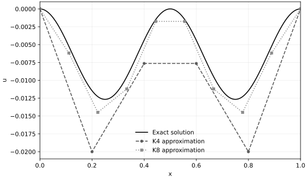

::: {.problem-day data-date="2026-11-08"}

## 2026-11-08 {.problem-date-heading}

::: {.problem-entry data-problem="{&quot;path&quot;: [&quot;MATH&quot;, &quot;LINEAR-ALGEBRA&quot;, &quot;矩阵的秩&quot;], &quot;tags&quot;: [&quot;矩阵等价&quot;, &quot;等价标准形&quot;], &quot;title&quot;: &quot;矩阵等价与秩&quot;}"}

```{=html}

<div class="problem-meta">MATH / LINEAR-ALGEBRA / 矩阵的秩</div>

<h3>01. 矩阵等价与秩</h3>

<div class="entry-tags">#矩阵等价 · #等价标准形</div>

```

设 $A,B$ 为 $m\times n$ 矩阵，证明：$A,B$ 等价的充要条件是 $r(A)=r(B)$。

```{=html}

<details class="problem-answer"><summary>answer/ 展开答案</summary><div class="problem-solution">

```

必要性：若 $A,B$ 等价，则存在可逆矩阵 $P,Q$，使 $PAQ=B$。所以
$$
r(A)=r(PAQ)=r(B).
$$
充分性：设 $r(A)=r(B)=r$。由矩阵的等价标准形，存在可逆矩阵 $P_1,Q_1,P_2,Q_2$，使
$$
P_1AQ_1=P_2BQ_2=
\begin{pmatrix}
E_r&0\\
0&0
\end{pmatrix}_{m\times n}.
$$
从而
$$
B=(P_2^{-1}P_1)A(Q_1Q_2^{-1}).
$$
左右两侧的乘子均可逆，故 $A,B$ 等价。

```{=html}

</div></details>

<p class="problem-source">来源：《线性代数习题精选精解》第 4.19 题</p>

```

:::

::: {.problem-entry data-problem="{&quot;path&quot;: [&quot;MATH&quot;, &quot;LINEAR-ALGEBRA&quot;, &quot;矩阵的秩&quot;], &quot;tags&quot;: [&quot;幂等矩阵&quot;, &quot;矩阵的秩&quot;, &quot;可逆矩阵&quot;], &quot;title&quot;: &quot;两个幂等矩阵的秩相等&quot;}"}

```{=html}

<div class="problem-meta">MATH / LINEAR-ALGEBRA / 矩阵的秩</div>

<h3>02. 两个幂等矩阵的秩相等</h3>

<div class="entry-tags">#幂等矩阵 · #矩阵的秩 · #可逆矩阵</div>

```

设 $n$ 阶方阵 $A,B$ 满足 $A^2=A$、$B^2=B$，且 $E-A-B$ 可逆，其中 $E$ 为 $n$ 阶单位矩阵。证明：
$$
r(A)=r(B).
$$

```{=html}

<details class="problem-answer"><summary>answer/ 展开答案</summary><div class="problem-solution">

```

证法一：由 $E-A-B$ 可逆，
$$
n=r(E-A-B)\le r(E-A)+r(B),
$$
所以 $r(B)\ge n-r(E-A)$。又由 $A^2=A$，得 $A(E-A)=0$，于是
$$
r(A)+r(E-A)\le n.
$$
从而
$$
r(B)\ge n-r(E-A)\ge r(A).
$$
交换 $A,B$，同理得 $r(A)\ge r(B)$，故 $r(A)=r(B)$。

证法二：由
$$
A(E-A-B)=A-A^2-AB=-AB,
$$
且 $E-A-B$ 可逆，得 $r(A)=r(AB)$。又
$$
(E-A-B)B=B-AB-B^2=-AB,
$$
故 $r(B)=r(AB)$。因此 $r(A)=r(B)$。

```{=html}

</div></details>

<p class="problem-source">来源：《线性代数习题精选精解》第 4.20 题</p>

```

:::

```{=html}

<details id="discussion-2026-11-08" class="log-comments problem-discussion" data-comment-term="/problems/2026-11-08/" data-comment-date="2026-11-08" data-comment-title="每日好题 · 2026-11-08">

<summary>discussion/ <span>2026-11-08 · 当日讨论</span></summary>

<div class="log-comments-body"><p class="log-comments-status" aria-live="polite">展开后加载讨论，使用 GitHub 账号分享思路、提问或勘误。</p><div class="log-comments-widget"></div></div>

</details>

```

:::

::: {.problem-day data-date="2026-11-07"}

## 2026-11-07 {.problem-date-heading}

::: {.problem-entry data-problem="{&quot;path&quot;: [&quot;MATH&quot;, &quot;CALCULUS&quot;, &quot;证明题&quot;], &quot;tags&quot;: [&quot;数列极限&quot;, &quot;介值定理&quot;, &quot;单调有界&quot;], &quot;title&quot;: &quot;加权幂和方程的根与极限&quot;}"}

```{=html}

<div class="problem-meta">MATH / CALCULUS / 证明题</div>

<h3>01. 加权幂和方程的根与极限</h3>

<div class="entry-tags">#数列极限 · #介值定理 · #单调有界</div>

```

设 $n$ 为正整数，
$$
r_n(x)=x+2x^2+\cdots+nx^n.
$$
（1）证明：存在唯一的 $x_n\in(0,1)$，使得 $r_n(x_n)=\frac12$。

（2）求 $\displaystyle\lim_{n\to\infty}x_n$。

```{=html}

<details class="problem-answer"><summary>answer/ 展开答案</summary><div class="problem-solution">

```

（1）$r_n$ 在 $[0,1]$ 上连续，且
$$
r_n(0)=0<\frac12<r_n(1)=\frac{n(n+1)}2.
$$
由介值定理，根 $x_n\in(0,1)$ 存在。又
$$
r_n'(x)=1+2^2x+\cdots+n^2x^{n-1}>0\qquad(0<x<1),
$$
故根唯一。

（2）由 $r_{n+1}(x_n)=\frac12+(n+1)x_n^{n+1}>\frac12$，得 $x_{n+1}<x_n$。又 $x_1=\frac12$，所以 $0<x_n\le\frac12$，数列收敛，记极限为 $L\in[0,\frac12]$。

将有限等比和求导，得
$$
r_n(x)=\frac{x-(n+1)x^{n+1}+nx^{n+2}}{(1-x)^2}.
$$
代入 $x=x_n$。因 $0<x_n\le\frac12$，含 $nx_n^{n+1}$ 的项趋于零，令 $n\to\infty$，得
$$
\frac{L}{(1-L)^2}=\frac12,\qquad L^2-4L+1=0.
$$
由 $L\in[0,\frac12]$，得 $\boxed{L=2-\sqrt3}$。

```{=html}

</div></details>

<p class="problem-source">来源：2026–2027 学年微积分（甲）Ⅰ期中考试（2026-11-07，用户提供题目手记）</p>

```

:::

::: {.problem-entry data-problem="{&quot;path&quot;: [&quot;MATH&quot;, &quot;CALCULUS&quot;, &quot;证明题&quot;], &quot;tags&quot;: [&quot;达布定理&quot;, &quot;导数介值性&quot;, &quot;辅助函数&quot;], &quot;title&quot;: &quot;达布定理：导数的介值性&quot;}"}

```{=html}

<div class="problem-meta">MATH / CALCULUS / 证明题</div>

<h3>02. 达布定理：导数的介值性</h3>

<div class="entry-tags">#达布定理 · #导数介值性 · #辅助函数</div>

```

证明达布定理：设 $f$ 在区间 $I$ 上可导，$a,b\in I$，$a<b$。若 $\lambda$ 严格介于 $f'(a)$ 与 $f'(b)$ 之间，则存在 $\xi\in(a,b)$，使得
$$
f'(\xi)=\lambda.
$$

```{=html}

<details class="problem-answer"><summary>answer/ 展开答案</summary><div class="problem-solution">

```

先设 $f'(a)<\lambda<f'(b)$，令 $g(x)=f(x)-\lambda x$。则 $g$ 在 $[a,b]$ 上连续，且
$$
g'(a)<0,\qquad g'(b)>0.
$$
由导数定义，对充分小的 $h>0$，有
$$
g(a+h)<g(a),\qquad g(b-h)<g(b).
$$
所以 $a,b$ 均不是 $g$ 在 $[a,b]$ 上的最小值点。由最值定理，$g$ 在某个 $\xi\in(a,b)$ 处取得最小值。由费马定理，
$$
g'(\xi)=0,\qquad f'(\xi)=\lambda.
$$
若 $f'(a)>\lambda>f'(b)$，对 $-f$ 与 $-\lambda$ 应用上述结论即可。

```{=html}

</div></details>

<p class="problem-source">来源：达布定理（用户指定）</p>

```

:::

```{=html}

<details id="discussion-2026-11-07" class="log-comments problem-discussion" data-comment-term="/problems/2026-11-07/" data-comment-date="2026-11-07" data-comment-title="每日好题 · 2026-11-07">

<summary>discussion/ <span>2026-11-07 · 当日讨论</span></summary>

<div class="log-comments-body"><p class="log-comments-status" aria-live="polite">展开后加载讨论，使用 GitHub 账号分享思路、提问或勘误。</p><div class="log-comments-widget"></div></div>

</details>

```

:::

::: {.problem-day data-date="2026-11-06"}

## 2026-11-06 {.problem-date-heading}

::: {.problem-entry data-problem="{&quot;path&quot;: [&quot;MATH&quot;, &quot;CALCULUS&quot;, &quot;极限&quot;], &quot;tags&quot;: [&quot;有理化&quot;, &quot;二阶无穷小&quot;], &quot;title&quot;: &quot;根式差的二阶极限&quot;}"}

```{=html}

<div class="problem-meta">MATH / CALCULUS / 极限</div>

<h3>01. 根式差的二阶极限</h3>

<div class="entry-tags">#有理化 · #二阶无穷小</div>

```

求极限
$$
\lim_{x\to0}\frac{\sqrt{1+2x+3x^2}-1-x}{x^2}.
$$

```{=html}

<details class="problem-answer"><summary>answer/ 展开答案</summary><div class="problem-solution">

```

分子有理化，得
$$
\frac{\sqrt{1+2x+3x^2}-1-x}{x^2}
=\frac{2}{\sqrt{1+2x+3x^2}+1+x}\longrightarrow\boxed{1}.
$$

```{=html}

</div></details>

<p class="problem-source">来源：错题自编</p>

```

:::

::: {.problem-entry data-problem="{&quot;path&quot;: [&quot;MATH&quot;, &quot;CALCULUS&quot;, &quot;不等式&quot;], &quot;tags&quot;: [&quot;二项式定理&quot;, &quot;严格不等式&quot;], &quot;title&quot;: &quot;二项式幂的严格估计&quot;}"}

```{=html}

<div class="problem-meta">MATH / CALCULUS / 不等式</div>

<h3>02. 二项式幂的严格估计</h3>

<div class="entry-tags">#二项式定理 · #严格不等式</div>

```

证明：
$$
2<\left(1+\frac1{100}\right)^{100}<3.
$$

```{=html}

<details class="problem-answer"><summary>answer/ 展开答案</summary><div class="problem-solution">

```

由二项式定理，
$$
\left(1+\frac1{100}\right)^{100}
=2+\sum_{k=2}^{100}\binom{100}{k}\frac1{100^k}>2.
$$
对 $2\le k\le100$，有
$$
\binom{100}{k}\frac1{100^k}
=\frac1{k!}\prod_{j=0}^{k-1}\left(1-\frac j{100}\right)<\frac1{k!}\le\frac1{2^{k-1}}.
$$
故
$$
\left(1+\frac1{100}\right)^{100}
<2+\sum_{k=2}^{100}\frac1{2^{k-1}}<3.
$$

```{=html}

</div></details>

<p class="problem-source">来源：错题自编</p>

```

:::

::: {.problem-entry data-problem="{&quot;path&quot;: [&quot;MATH&quot;, &quot;CALCULUS&quot;, &quot;导数&quot;], &quot;tags&quot;: [&quot;参数方程&quot;, &quot;二阶导数&quot;], &quot;title&quot;: &quot;参数方程中对 y 的二阶导数&quot;}"}

```{=html}

<div class="problem-meta">MATH / CALCULUS / 导数</div>

<h3>03. 参数方程中对 y 的二阶导数</h3>

<div class="entry-tags">#参数方程 · #二阶导数</div>

```

设 $x=t^2+t$，$y=t^3+t$，求
$$
\left.\frac{d^2x}{dy^2}\right|_{t=0}.
$$

```{=html}

<details class="problem-answer"><summary>answer/ 展开答案</summary><div class="problem-solution">

```

因 $dy/dt=3t^2+1>0$，
$$
\frac{dx}{dy}=\frac{2t+1}{3t^2+1},\qquad
\frac{d^2x}{dy^2}=\frac1{3t^2+1}\frac d{dt}\left(\frac{2t+1}{3t^2+1}\right)
=\frac{2(3t^2+1)-6t(2t+1)}{(3t^2+1)^3}.
$$
代入 $t=0$，得 $\boxed{2}$。

```{=html}

</div></details>

<p class="problem-source">来源：错题自编</p>

```

:::

::: {.problem-entry data-problem="{&quot;path&quot;: [&quot;MATH&quot;, &quot;CALCULUS&quot;, &quot;高阶导数&quot;], &quot;tags&quot;: [&quot;莱布尼兹公式&quot;, &quot;调和数&quot;], &quot;title&quot;: &quot;幂函数与对数乘积的 n 阶导数&quot;}"}

```{=html}

<div class="problem-meta">MATH / CALCULUS / 高阶导数</div>

<h3>04. 幂函数与对数乘积的 n 阶导数</h3>

<div class="entry-tags">#莱布尼兹公式 · #调和数</div>

```

设 $n$ 为正整数，$x>0$，求
$$
\frac{d^n}{dx^n}(x^n\ln x).
$$

```{=html}

<details class="problem-answer"><summary>answer/ 展开答案</summary><div class="problem-solution">

```

记 $H_n=\sum_{k=1}^n1/k$。由莱布尼兹公式及
$$
(\ln x)^{(k)}=(-1)^{k-1}(k-1)!x^{-k}\qquad(k\ge1),
$$
得
$$
\frac{d^n}{dx^n}(x^n\ln x)
=n!\left[\ln x+\sum_{k=1}^n(-1)^{k-1}\binom nk\frac1k\right].
$$
其中
$$
\sum_{k=1}^n(-1)^{k-1}\binom nk\frac1k
=\int_0^1\frac{1-(1-t)^n}{t}\,dt
=\int_0^1\sum_{j=0}^{n-1}(1-t)^j\,dt=H_n.
$$
因此结果为 $\boxed{n!(\ln x+H_n)}$。

```{=html}

</div></details>

<p class="problem-source">来源：错题自编</p>

```

:::

::: {.problem-entry data-problem="{&quot;path&quot;: [&quot;MATH&quot;, &quot;CALCULUS&quot;, &quot;数列&quot;], &quot;tags&quot;: [&quot;单调有界&quot;, &quot;递推数列&quot;], &quot;title&quot;: &quot;对数递推数列的收敛性&quot;}"}

```{=html}

<div class="problem-meta">MATH / CALCULUS / 数列</div>

<h3>05. 对数递推数列的收敛性</h3>

<div class="entry-tags">#单调有界 · #递推数列</div>

```

设 $a_1=1$，$a_{n+1}=\ln(1+a_n)$。证明数列 $\{a_n\}$ 收敛，并求其极限。

```{=html}

<details class="problem-answer"><summary>answer/ 展开答案</summary><div class="problem-solution">

```

对任意 $u>0$，有 $0<\ln(1+u)<u$。由归纳法，
$$
0<a_{n+1}<a_n\le1.
$$
故数列单调递减且有下界，存在极限 $L\ge0$。由连续性，$L=\ln(1+L)$。若 $L>0$，则 $\ln(1+L)<L$，矛盾。因此 $\boxed{L=0}$。

```{=html}

</div></details>

<p class="problem-source">来源：错题自编</p>

```

:::

::: {.problem-entry data-problem="{&quot;path&quot;: [&quot;MATH&quot;, &quot;CALCULUS&quot;, &quot;数列&quot;], &quot;tags&quot;: [&quot;Cesàro 平均&quot;, &quot;数列极限&quot;], &quot;title&quot;: &quot;收敛数列的算术平均&quot;}"}

```{=html}

<div class="problem-meta">MATH / CALCULUS / 数列</div>

<h3>06. 收敛数列的算术平均</h3>

<div class="entry-tags">#Cesàro 平均 · #数列极限</div>

```

设 $a_n\to A$，证明
$$
\frac1n\sum_{k=1}^n a_k\longrightarrow A.
$$

```{=html}

<details class="problem-answer"><summary>answer/ 展开答案</summary><div class="problem-solution">

```

任给 $\varepsilon>0$，取 $N$，使 $k>N$ 时 $|a_k-A|<\varepsilon/2$。令
$$
C=\sum_{k=1}^N|a_k-A|.
$$
当 $n>N$ 且 $n>2C/\varepsilon$ 时，
$$
\left|\frac1n\sum_{k=1}^n a_k-A\right|
\le\frac Cn+\frac1n\sum_{k=N+1}^n|a_k-A|
<\frac\varepsilon2+\frac\varepsilon2=\varepsilon.
$$
故结论成立。

```{=html}

</div></details>

<p class="problem-source">来源：错题自编</p>

```

:::

```{=html}

<details id="discussion-2026-11-06" class="log-comments problem-discussion" data-comment-term="/problems/2026-11-06/" data-comment-date="2026-11-06" data-comment-title="每日好题 · 2026-11-06">

<summary>discussion/ <span>2026-11-06 · 当日讨论</span></summary>

<div class="log-comments-body"><p class="log-comments-status" aria-live="polite">展开后加载讨论，使用 GitHub 账号分享思路、提问或勘误。</p><div class="log-comments-widget"></div></div>

</details>

```

:::

::: {.problem-day data-date="2026-11-05"}

## 2026-11-05 {.problem-date-heading}

::: {.problem-entry data-problem="{&quot;path&quot;: [&quot;AI&quot;, &quot;FIP&quot;, &quot;函数&quot;], &quot;tags&quot;: [&quot;Python&quot;, &quot;返回值&quot;], &quot;title&quot;: &quot;函数的返回值&quot;}"}

```{=html}

<div class="problem-meta">AI / FIP / 函数</div>

<h3>01. 函数的返回值</h3>

<div class="entry-tags">#Python · #返回值</div>

```

下面的 `print` 会看到什么？

```python
def f(n):
    n = n + 1
print(f(2))
```

- A. 3
- B. 2
- C. `None`
- D. 语法错误

```{=html}

<details class="problem-answer"><summary>answer/ 展开答案</summary><div class="problem-solution">

```

**答案：C。**

函数没有执行 `return` 语句时，返回值为 `None`。`n = n + 1` 只修改函数内的局部变量，因此 `print(f(2))` 输出：

```text
None
```

```{=html}

</div></details>

<p class="problem-source">来源：FIP 期中考试 · 第 7 题</p>

```

:::

```{=html}

<details id="discussion-2026-11-05" class="log-comments problem-discussion" data-comment-term="/problems/2026-11-05/" data-comment-date="2026-11-05" data-comment-title="每日好题 · 2026-11-05">

<summary>discussion/ <span>2026-11-05 · 当日讨论</span></summary>

<div class="log-comments-body"><p class="log-comments-status" aria-live="polite">展开后加载讨论，使用 GitHub 账号分享思路、提问或勘误。</p><div class="log-comments-widget"></div></div>

</details>

```

:::

::: {.problem-day data-date="2026-11-04"}

## 2026-11-04 {.problem-date-heading}

::: {.problem-entry data-problem="{&quot;path&quot;: [&quot;MATH&quot;, &quot;CALCULUS&quot;, &quot;导数&quot;], &quot;tags&quot;: [&quot;三角多项式&quot;, &quot;系数估计&quot;], &quot;title&quot;: &quot;三角多项式的系数和估计&quot;}"}

```{=html}

<div class="problem-meta">MATH / CALCULUS / 导数</div>

<h3>01. 三角多项式的系数和估计</h3>

<div class="entry-tags">#三角多项式 · #系数估计</div>

```

设 $a_1,a_2,\ldots,a_n$ 为常数，记

$$
f(x)=\sum_{k=1}^n a_k\sin kx,\qquad
g(x)=\sum_{j=1}^n a_{n-j+1}\sin jx.
$$

已知 $|f(x)|\le|\sin x|$，$|g(x)|\le|\sin x|$，求证

$$
\left|\sum_{k=1}^n a_k\right|\le\frac{2}{n+1}.
$$

提示：考虑 $f'(0),g'(0)$。

```{=html}

<details class="problem-answer"><summary>answer/ 展开答案</summary><div class="problem-solution">

```

由 $f(0)=g(0)=0$ 及题设不等式，得 $|f'(0)|\le1$，$|g'(0)|\le1$。又

$$
f'(0)=\sum_{k=1}^n ka_k,\qquad
g'(0)=\sum_{k=1}^n(n-k+1)a_k.
$$

故

$$
\left|\sum_{k=1}^n a_k\right|
=\frac{|f'(0)+g'(0)|}{n+1}
\le\frac{2}{n+1}.
$$

```{=html}

</div></details>

<p class="problem-source">来源：2026–2027 学年微积分（甲）Ⅰ期中模拟卷 · 第 10 题 B</p>

```

:::

```{=html}

<details id="discussion-2026-11-04" class="log-comments problem-discussion" data-comment-term="/problems/2026-11-04/" data-comment-date="2026-11-04" data-comment-title="每日好题 · 2026-11-04">

<summary>discussion/ <span>2026-11-04 · 当日讨论</span></summary>

<div class="log-comments-body"><p class="log-comments-status" aria-live="polite">展开后加载讨论，使用 GitHub 账号分享思路、提问或勘误。</p><div class="log-comments-widget"></div></div>

</details>

```

:::

::: {.problem-day data-date="2026-11-03"}

## 2026-11-03 {.problem-date-heading}

::: {.problem-entry data-problem="{&quot;path&quot;: [&quot;AI&quot;, &quot;FIP&quot;, &quot;期中复习&quot;], &quot;tags&quot;: [&quot;列表&quot;, &quot;别名&quot;], &quot;title&quot;: &quot;别名、浅拷贝与返回值&quot;}"}

```{=html}

<div class="problem-meta">AI / FIP / 期中复习</div>

<h3>01. 别名、浅拷贝与返回值</h3>

<div class="entry-tags">#列表 · #别名</div>

```

写出程序的完整输出：

```python
a = [[1], [2]]
b = a[:]
b[0].append(3)
b[1] = [9]
print(a)
print(b)
print(a.reverse())
print(a)
```

```{=html}

<details class="problem-answer"><summary>answer/ 展开答案</summary><div class="problem-solution">

```

```text
[[1, 3], [2]]
[[1, 3], [9]]
None
[[2], [1, 3]]
```

切片创建外层新列表，内层列表仍共享。`reverse()`原地修改并返回`None`。

```{=html}

</div></details>

<p class="problem-source">来源：FIP W1–W8 期中复习笔记 · 程序输出</p>

```

:::

::: {.problem-entry data-problem="{&quot;path&quot;: [&quot;AI&quot;, &quot;FIP&quot;, &quot;期中复习&quot;], &quot;tags&quot;: [&quot;字典&quot;, &quot;程序输出&quot;], &quot;title&quot;: &quot;字典方法与插入顺序&quot;}"}

```{=html}

<div class="problem-meta">AI / FIP / 期中复习</div>

<h3>02. 字典方法与插入顺序</h3>

<div class="entry-tags">#字典 · #程序输出</div>

```

写出程序的完整输出：

```python
d = {}
for x in ['b','a','b']:
    d[x] = d.get(x,0) + 1
print(d.get('c',0), 'c' in d)
print(d.setdefault('c',4))
print(list(d.items()))
```

```{=html}

<details class="problem-answer"><summary>answer/ 展开答案</summary><div class="problem-solution">

```

```text
0 False
4
[('b', 2), ('a', 1), ('c', 4)]
```

`get`不插入键；`setdefault`在缺键时插入。字典保留键首次插入的顺序。

```{=html}

</div></details>

<p class="problem-source">来源：FIP W1–W8 期中复习笔记 · 程序输出</p>

```

:::

::: {.problem-entry data-problem="{&quot;path&quot;: [&quot;AI&quot;, &quot;FIP&quot;, &quot;期中复习&quot;], &quot;tags&quot;: [&quot;递归&quot;, &quot;程序输出&quot;], &quot;title&quot;: &quot;递归的递进与回归&quot;}"}

```{=html}

<div class="problem-meta">AI / FIP / 期中复习</div>

<h3>03. 递归的递进与回归</h3>

<div class="entry-tags">#递归 · #程序输出</div>

```

写出程序的完整输出，注意空格：

```python
def walk(n):
    if n == 0:
        return
    print(n, end=' ')
    walk(n-1)
    print(n, end=' ')
walk(3)
print()
```

```{=html}

<details class="problem-answer"><summary>answer/ 展开答案</summary><div class="problem-solution">

```

```text
3 2 1 1 2 3 
```

递归前依次输出`3 2 1`，返回时依次输出`1 2 3`。最后一个`3`后仍有一个空格，然后换行。

```{=html}

</div></details>

<p class="problem-source">来源：FIP W1–W8 期中复习笔记 · 程序输出</p>

```

:::

```{=html}

<details id="discussion-2026-11-03" class="log-comments problem-discussion" data-comment-term="/problems/2026-11-03/" data-comment-date="2026-11-03" data-comment-title="每日好题 · 2026-11-03">

<summary>discussion/ <span>2026-11-03 · 当日讨论</span></summary>

<div class="log-comments-body"><p class="log-comments-status" aria-live="polite">展开后加载讨论，使用 GitHub 账号分享思路、提问或勘误。</p><div class="log-comments-widget"></div></div>

</details>

```

:::

::: {.problem-day data-date="2026-11-02"}

## 2026-11-02 {.problem-date-heading}

::: {.problem-entry data-problem="{&quot;path&quot;: [&quot;MATH&quot;, &quot;CALCULUS&quot;, &quot;高阶导数&quot;], &quot;tags&quot;: [&quot;莱布尼兹公式&quot;, &quot;递推关系&quot;], &quot;title&quot;: &quot;反正弦函数在原点的高阶导数&quot;}"}

```{=html}

<div class="problem-meta">MATH / CALCULUS / 高阶导数</div>

<h3>01. 反正弦函数在原点的高阶导数</h3>

<div class="entry-tags">#莱布尼兹公式 · #递推关系</div>

```

利用莱布尼兹公式，求函数 $y=\arcsin x$ 的 $y^{(n)}(0)$，其中 $n\ge1$。

```{=html}

<details class="problem-answer"><summary>answer/ 展开答案</summary><div class="problem-solution">

```

由 $(1-x^2)y''-xy'=0$，求 $r$ 阶导数并令 $x=0$，由莱布尼兹公式得
$$
y^{(r+2)}(0)=r^2y^{(r)}(0)\qquad(r\ge0).
$$
结合 $y(0)=0,y'(0)=1$，得
$$
\boxed{y^{(2m)}(0)=0\ (m\ge1),\qquad y^{(2m+1)}(0)=[(2m-1)!!]^2\ (m\ge0).}
$$
约定 $(-1)!!=1$。

```{=html}

</div></details>

<p class="problem-source">来源：微积分习题课</p>

```

:::

::: {.problem-entry data-problem="{&quot;path&quot;: [&quot;MATH&quot;, &quot;CALCULUS&quot;, &quot;高阶导数&quot;], &quot;tags&quot;: [&quot;莱布尼兹公式&quot;, &quot;递推关系&quot;], &quot;title&quot;: &quot;反正切函数在原点的高阶导数&quot;}"}

```{=html}

<div class="problem-meta">MATH / CALCULUS / 高阶导数</div>

<h3>02. 反正切函数在原点的高阶导数</h3>

<div class="entry-tags">#莱布尼兹公式 · #递推关系</div>

```

利用莱布尼兹公式，求函数 $y=\arctan x$ 的 $y^{(n)}(0)$，其中 $n\ge1$。

```{=html}

<details class="problem-answer"><summary>answer/ 展开答案</summary><div class="problem-solution">

```

由 $(1+x^2)y'=1$，求 $r$ 阶导数并令 $x=0$，得
$$
y^{(r+1)}(0)=-r(r-1)y^{(r-1)}(0)\qquad(r\ge2).
$$
又 $y'(0)=1,y''(0)=0$，故
$$
\boxed{y^{(2m)}(0)=0\ (m\ge1),\qquad y^{(2m+1)}(0)=(-1)^m(2m)!\ (m\ge0).}
$$

```{=html}

</div></details>

<p class="problem-source">来源：微积分习题课</p>

```

:::

::: {.problem-entry data-problem="{&quot;path&quot;: [&quot;MATH&quot;, &quot;CALCULUS&quot;, &quot;高阶导数&quot;], &quot;tags&quot;: [&quot;莱布尼兹公式&quot;, &quot;递推关系&quot;], &quot;title&quot;: &quot;根式函数在原点的高阶导数&quot;}"}

```{=html}

<div class="problem-meta">MATH / CALCULUS / 高阶导数</div>

<h3>03. 根式函数在原点的高阶导数</h3>

<div class="entry-tags">#莱布尼兹公式 · #递推关系</div>

```

利用莱布尼兹公式，求函数 $y=\sqrt{1-x^2}$ 的 $y^{(n)}(0)$，其中 $n\ge1$。

```{=html}

<details class="problem-answer"><summary>answer/ 展开答案</summary><div class="problem-solution">

```

由 $(1-x^2)y'+xy=0$，求 $r$ 阶导数并令 $x=0$，得
$$
y^{(r+1)}(0)=r(r-2)y^{(r-1)}(0)\qquad(r\ge1).
$$
又 $y(0)=1,y'(0)=0$，故
$$
\boxed{y^{(2m+1)}(0)=0\ (m\ge0),\qquad y^{(2m)}(0)=-(2m-1)!!(2m-3)!!\ (m\ge1).}
$$
约定 $(-1)!!=1$。

```{=html}

</div></details>

<p class="problem-source">来源：微积分习题课</p>

```

:::

::: {.problem-entry data-problem="{&quot;path&quot;: [&quot;MATH&quot;, &quot;CALCULUS&quot;, &quot;高阶导数&quot;], &quot;tags&quot;: [&quot;莱布尼兹公式&quot;, &quot;递推关系&quot;], &quot;title&quot;: &quot;对数函数在原点的高阶导数&quot;}"}

```{=html}

<div class="problem-meta">MATH / CALCULUS / 高阶导数</div>

<h3>04. 对数函数在原点的高阶导数</h3>

<div class="entry-tags">#莱布尼兹公式 · #递推关系</div>

```

利用莱布尼兹公式，求函数 $y=\ln(1+x^2)$ 的 $y^{(n)}(0)$，其中 $n\ge1$。

```{=html}

<details class="problem-answer"><summary>answer/ 展开答案</summary><div class="problem-solution">

```

由 $(1+x^2)y'=2x$，求 $r$ 阶导数并令 $x=0$，当 $r\ge2$ 时有
$$
y^{(r+1)}(0)=-r(r-1)y^{(r-1)}(0).
$$
又 $y'(0)=0,y''(0)=2$，故
$$
\boxed{y^{(2m+1)}(0)=0\ (m\ge0),\qquad y^{(2m)}(0)=2(-1)^{m-1}(2m-1)!\ (m\ge1).}
$$

```{=html}

</div></details>

<p class="problem-source">来源：微积分习题课</p>

```

:::

::: {.problem-entry data-problem="{&quot;path&quot;: [&quot;MATH&quot;, &quot;CALCULUS&quot;, &quot;高阶导数&quot;], &quot;tags&quot;: [&quot;分段函数&quot;, &quot;导数定义&quot;, &quot;振荡函数&quot;], &quot;title&quot;: &quot;振荡函数的高阶可导性&quot;}"}

```{=html}

<div class="problem-meta">MATH / CALCULUS / 高阶导数</div>

<h3>05. 振荡函数的高阶可导性</h3>

<div class="entry-tags">#分段函数 · #导数定义 · #振荡函数</div>

```

设 $n$ 为正整数，证明函数
$$
f(x)=\begin{cases}x^{2n}\sin\frac1x,&x\ne0,\\0,&x=0\end{cases}
$$
在 $x=0$ 处有一直到 $n$ 阶的导数，但不存在 $n+1$ 阶导数。

```{=html}

<details class="problem-answer"><summary>answer/ 展开答案</summary><div class="problem-solution">

```

对 $x\ne0$ 反复求导，$f^{(k)}(x)$ 是若干项 $x^p\sin(1/x)$ 或 $x^p\cos(1/x)$ 的线性组合，其中最低幂次为 $2n-2k$。因而对 $0\le k\le n-1$，
$$
f^{(k)}(x)=O(x^{2n-2k}).
$$
从 $f(0)=0$ 出发，逐次用导数定义，因 $2n-2k-1\ge1$，得 $f^{(k+1)}(0)=0$，所以 $f^{(n)}(0)=0$。

第 $n$ 次求导的最低次项来自每次都对三角因子求导，故
$$
f^{(n)}(x)=(-1)^n\sin\left(\frac1x+\frac{n\pi}{2}\right)+O(x).
$$
它在零点不连续，而 $f^{(n)}(0)=0$；因此 $f^{(n)}$ 在零点不可导，即 $f^{(n+1)}(0)$ 不存在。

```{=html}

</div></details>

<p class="problem-source">来源：吉米多维奇《数学分析习题集》第 1224 题（用户提供照片，第 87 页）</p>

```

:::

::: {.problem-entry data-problem="{&quot;path&quot;: [&quot;MATH&quot;, &quot;CALCULUS&quot;, &quot;高阶导数&quot;], &quot;tags&quot;: [&quot;莱布尼兹公式&quot;, &quot;勒让德多项式&quot;, &quot;微分方程&quot;], &quot;title&quot;: &quot;勒让德多项式的微分方程&quot;}"}

```{=html}

<div class="problem-meta">MATH / CALCULUS / 高阶导数</div>

<h3>06. 勒让德多项式的微分方程</h3>

<div class="entry-tags">#莱布尼兹公式 · #勒让德多项式 · #微分方程</div>

```

证明：勒让德多项式
$$
P_m(x)=\frac{1}{2^m m!}\frac{d^m}{dx^m}(x^2-1)^m\qquad(m=0,1,2,\ldots)
$$
满足方程
$$
(1-x^2)P_m''(x)-2xP_m'(x)+m(m+1)P_m(x)=0.
$$

```{=html}

<details class="problem-answer"><summary>answer/ 展开答案</summary><div class="problem-solution">

```

令 $u=(x^2-1)^m$，则
$$
(x^2-1)u'=2mxu.
$$
两边求 $m+1$ 阶导数，利用莱布尼兹公式得
$$
(x^2-1)u^{(m+2)}+2(m+1)xu^{(m+1)}+m(m+1)u^{(m)}
=2m\bigl[xu^{(m+1)}+(m+1)u^{(m)}\bigr].
$$
移项，得
$$
(x^2-1)u^{(m+2)}+2xu^{(m+1)}-m(m+1)u^{(m)}=0.
$$
代入 $u^{(m)}=2^m m!P_m$，即得所证。

```{=html}

</div></details>

<p class="problem-source">来源：吉米多维奇《数学分析习题集》第 1227 题（用户提供照片，第 87 页）</p>

```

:::

```{=html}

<details id="discussion-2026-11-02" class="log-comments problem-discussion" data-comment-term="/problems/2026-11-02/" data-comment-date="2026-11-02" data-comment-title="每日好题 · 2026-11-02">

<summary>discussion/ <span>2026-11-02 · 当日讨论</span></summary>

<div class="log-comments-body"><p class="log-comments-status" aria-live="polite">展开后加载讨论，使用 GitHub 账号分享思路、提问或勘误。</p><div class="log-comments-widget"></div></div>

</details>

```

:::

::: {.problem-day data-date="2026-11-01"}

## 2026-11-01 {.problem-date-heading}

::: {.problem-entry data-problem="{&quot;path&quot;: [&quot;MATH&quot;, &quot;CALCULUS&quot;, &quot;证明题&quot;], &quot;tags&quot;: [&quot;压缩映射&quot;, &quot;不动点&quot;, &quot;数列收敛&quot;], &quot;title&quot;: &quot;压缩映射与不动点&quot;}"}

```{=html}

<div class="problem-meta">MATH / CALCULUS / 证明题</div>

<h3>01. 压缩映射与不动点</h3>

<div class="entry-tags">#压缩映射 · #不动点 · #数列收敛</div>

```

设函数 $f(x)$ 满足对于任意 $x\in[a,b]$，都有 $f(x)\in[a,b]$。且存在常数 $k\in(0,1)$，对于任意 $x_1,x_2\in[a,b]$，都有 $|f(x_2)-f(x_1)|\le k|x_2-x_1|$。证明：

（1）存在唯一 $\xi\in[a,b]$ 使得 $f(\xi)=\xi$。

（2）对于任意 $x_0\in[a,b]$，定义 $x_{n+1}=f(x_n)\ (n\in\mathbb N)$。证明 $\{x_n\}$ 收敛且 $\displaystyle\lim_{n\to\infty}x_n=\xi$。

```{=html}

<details class="problem-answer"><summary>answer/ 展开答案</summary><div class="problem-solution">

```

（1）由 Lipschitz 条件可知 $f$ 连续。令 $F(x)=f(x)-x$，则 $F(a)\ge0,F(b)\le0$。由介值定理（含端点为零的情形），存在 $\xi\in[a,b]$ 使得 $f(\xi)=\xi$。

若另有 $f(\eta)=\eta$，则
$$
|\xi-\eta|=|f(\xi)-f(\eta)|\le k|\xi-\eta|.
$$
由 $k<1$，得 $\xi=\eta$，故不动点唯一。

（2）由 $f([a,b])\subset[a,b]$，迭代始终有定义，且
$$
|x_n-\xi|\le k|x_{n-1}-\xi|\le\cdots\le k^n|x_0-\xi|\longrightarrow0.
$$
故 $x_n\to\xi$。

```{=html}

</div></details>

<p class="problem-source">来源：2026–2027 学年微积分（甲）Ⅰ期中模拟卷 · 杨立命题 · 第 12 题</p>

```

:::

::: {.problem-entry data-problem="{&quot;path&quot;: [&quot;MATH&quot;, &quot;CALCULUS&quot;, &quot;证明题&quot;], &quot;tags&quot;: [&quot;奇函数&quot;, &quot;罗尔定理&quot;, &quot;辅助函数&quot;], &quot;title&quot;: &quot;奇函数与中值定理&quot;}"}

```{=html}

<div class="problem-meta">MATH / CALCULUS / 证明题</div>

<h3>02. 奇函数与中值定理</h3>

<div class="entry-tags">#奇函数 · #罗尔定理 · #辅助函数</div>

```

设奇函数 $f(x)$ 在 $[-1,1]$ 上二阶可导，证明：存在 $\xi\in(-1,1)$ 使得 $f''(\xi)-f'(\xi)+f(1)=0$。

```{=html}

<details class="problem-answer"><summary>answer/ 展开答案</summary><div class="problem-solution">

```

由奇性，$f(0)=0,f(-1)=-f(1)$。分别在 $[0,1]$ 与 $[-1,0]$ 上用拉格朗日中值定理，得 $\theta_1\in(0,1)$、$\theta_2\in(-1,0)$，满足
$$
f'(\theta_1)=f'(\theta_2)=f(1).
$$
令 $F(x)=e^{-x}[f'(x)-f(1)]$，则 $F(\theta_1)=F(\theta_2)=0$。由罗尔定理，存在 $\xi\in(\theta_2,\theta_1)$，使得
$$
0=F'(\xi)=e^{-\xi}[f''(\xi)-f'(\xi)+f(1)].
$$
因此结论成立。

```{=html}

</div></details>

<p class="problem-source">来源：2026–2027 学年微积分（甲）Ⅰ期中模拟卷 · 杨立命题 · 附加题</p>

```

:::

```{=html}

<details id="discussion-2026-11-01" class="log-comments problem-discussion" data-comment-term="/problems/2026-11-01/" data-comment-date="2026-11-01" data-comment-title="每日好题 · 2026-11-01">

<summary>discussion/ <span>2026-11-01 · 当日讨论</span></summary>

<div class="log-comments-body"><p class="log-comments-status" aria-live="polite">展开后加载讨论，使用 GitHub 账号分享思路、提问或勘误。</p><div class="log-comments-widget"></div></div>

</details>

```

:::

::: {.problem-day data-date="2026-10-31"}

## 2026-10-31 {.problem-date-heading}

::: {.problem-entry data-problem="{&quot;path&quot;: [&quot;MATH&quot;, &quot;LINEAR-ALGEBRA&quot;, &quot;行列式&quot;], &quot;tags&quot;: [&quot;范德蒙德行列式&quot;, &quot;三角函数&quot;], &quot;title&quot;: &quot;余弦行列式&quot;}"}

```{=html}

<div class="problem-meta">MATH / LINEAR-ALGEBRA / 行列式</div>

<h3>01. 余弦行列式</h3>

<div class="entry-tags">#范德蒙德行列式 · #三角函数</div>

```

计算 $n$ 阶行列式
$$
D_n=\begin{vmatrix}
1&1&\cdots&1\\
\cos\theta_1&\cos\theta_2&\cdots&\cos\theta_n\\
\cos2\theta_1&\cos2\theta_2&\cdots&\cos2\theta_n\\
\vdots&\vdots&&\vdots\\
\cos((n-1)\theta_1)&\cos((n-1)\theta_2)&\cdots&\cos((n-1)\theta_n)
\end{vmatrix},\qquad \theta_1,\ldots,\theta_n\in\mathbb R.
$$

```{=html}

<details class="problem-answer"><summary>answer/ 展开答案</summary><div class="problem-solution">

```

令 $x_j=\cos\theta_j$。由
$$
\cos((k+1)\theta)=2\cos\theta\cos(k\theta)-\cos((k-1)\theta)
$$
可知 $\cos(k\theta)=T_k(\cos\theta)$，其中 $T_0(x)=1$，$T_1(x)=x$；对 $k\ge1$，$T_k$ 是首项系数为 $2^{k-1}$ 的 $k$ 次多项式。

从最后一行起，依次用前面各行消去各行多项式的低次项，再提出首项系数，得
$$
D_n=\left(\prod_{k=1}^{n-1}2^{k-1}\right)
\begin{vmatrix}
1&\cdots&1\\
x_1&\cdots&x_n\\
\vdots&&\vdots\\
x_1^{n-1}&\cdots&x_n^{n-1}
\end{vmatrix}
=\boxed{2^{(n-1)(n-2)/2}\prod_{1\le i<j\le n}(\cos\theta_j-\cos\theta_i)}.
$$
当 $n=1$ 时，空积取 $1$，结论仍成立。

```{=html}

</div></details>

<p class="problem-source">来源：云峰线性代数专题课</p>

```

:::

::: {.problem-entry data-problem="{&quot;path&quot;: [&quot;MATH&quot;, &quot;CALCULUS&quot;, &quot;微分中值定理&quot;], &quot;tags&quot;: [&quot;罗尔定理&quot;, &quot;介值定理&quot;, &quot;辅助函数&quot;], &quot;title&quot;: &quot;导数零点与辅助函数&quot;}"}

```{=html}

<div class="problem-meta">MATH / CALCULUS / 微分中值定理</div>

<h3>02. 导数零点与辅助函数</h3>

<div class="entry-tags">#罗尔定理 · #介值定理 · #辅助函数</div>

```

设 $f(x)$ 在 $[0,2]$ 上连续，在 $(0,2)$ 内可导，且 $f(0)=0$，$f(1)=3$，$f(2)=-1$。证明：

1. 存在 $\xi\in(0,2)$，使得 $f'(\xi)=0$；
2. 存在 $\eta\in(0,2)$，使得 $f(\eta)+f'(\eta)=0$。

```{=html}

<details class="problem-answer"><summary>answer/ 展开答案</summary><div class="problem-solution">

```

由 $f(1)=3>0$、$f(2)=-1<0$ 及介值定理，存在 $c\in(1,2)$，使得 $f(c)=0$。

（1）在 $[0,c]$ 上，$f$ 连续、在内部可导，且 $f(0)=f(c)=0$。由罗尔定理，存在 $\xi\in(0,c)\subset(0,2)$，使得 $f'(\xi)=0$。

（2）令 $g(x)=e^xf(x)$，则 $g$ 在 $[0,c]$ 上连续、在内部可导，且 $g(0)=g(c)=0$。由罗尔定理，存在 $\eta\in(0,c)\subset(0,2)$，使得
$$
0=g'(\eta)=e^\eta\bigl(f(\eta)+f'(\eta)\bigr).
$$
由于 $e^\eta>0$，故 $f(\eta)+f'(\eta)=0$。

```{=html}

</div></details>

<p class="problem-source">来源：2022–2023 学年《微积分（甲）Ⅰ》期中 · 第 15 题</p>

```

:::

```{=html}

<details id="discussion-2026-10-31" class="log-comments problem-discussion" data-comment-term="/problems/2026-10-31/" data-comment-date="2026-10-31" data-comment-title="每日好题 · 2026-10-31">

<summary>discussion/ <span>2026-10-31 · 当日讨论</span></summary>

<div class="log-comments-body"><p class="log-comments-status" aria-live="polite">展开后加载讨论，使用 GitHub 账号分享思路、提问或勘误。</p><div class="log-comments-widget"></div></div>

</details>

```

:::

::: {.problem-day data-date="2026-10-30"}

## 2026-10-30 {.problem-date-heading}

::: {.problem-entry data-problem="{&quot;path&quot;: [&quot;MATH&quot;, &quot;LINEAR-ALGEBRA&quot;, &quot;矩阵&quot;], &quot;tags&quot;: [&quot;矩阵分解&quot;, &quot;等价标准形&quot;], &quot;title&quot;: &quot;矩阵的对称分解&quot;}"}

```{=html}

<div class="problem-meta">MATH / LINEAR-ALGEBRA / 矩阵</div>

<h3>01. 矩阵的对称分解</h3>

<div class="entry-tags">#矩阵分解 · #等价标准形</div>

```

设 $A$ 为 $n$ 阶方阵，证明：存在对称矩阵 $S$ 和可逆矩阵 $P$，使得 $A=SP$。

```{=html}

<details class="problem-answer"><summary>answer/ 展开答案</summary><div class="problem-solution">

```

设 $r(A)=r$。由矩阵的等价标准形，存在可逆矩阵 $U,V$，使得
$$
UAV=D=\operatorname{diag}(I_r,0).
$$
于是
$$
A=U^{-1}DV^{-1}
=\underbrace{U^{-1}DU^{-\mathrm T}}_{S}
\underbrace{U^{\mathrm T}V^{-1}}_{P}.
$$
由 $D^{\mathrm T}=D$ 得
$$
S^{\mathrm T}=U^{-1}D^{\mathrm T}U^{-\mathrm T}=S,
$$
而 $P$ 是两个可逆矩阵的乘积，因而可逆。

```{=html}

</div></details>

<p class="problem-source">来源：2020–2021 秋冬《线性代数（甲）》期中 · 第 8 题</p>

```

:::

::: {.problem-entry data-problem="{&quot;path&quot;: [&quot;MATH&quot;, &quot;LINEAR-ALGEBRA&quot;, &quot;矩阵&quot;], &quot;tags&quot;: [&quot;反对称矩阵&quot;, &quot;可逆性&quot;, &quot;二次型&quot;], &quot;title&quot;: &quot;反对称矩阵与可逆性&quot;}"}

```{=html}

<div class="problem-meta">MATH / LINEAR-ALGEBRA / 矩阵</div>

<h3>02. 反对称矩阵与可逆性</h3>

<div class="entry-tags">#反对称矩阵 · #可逆性 · #二次型</div>

```

设 $A$ 为 $4$ 阶实反对称矩阵，
$$
B=\begin{pmatrix}
0&0&0&0\\
0&0&0&0\\
0&0&1&0\\
0&0&0&2
\end{pmatrix}.
$$
证明：$E+AB$ 可逆，其中 $E$ 为 $4$ 阶单位矩阵。

```{=html}

<details class="problem-answer"><summary>answer/ 展开答案</summary><div class="problem-solution">

```

设 $(E+AB)x=0$，令 $y=Bx$，则 $x=-Ay$。由于 $A^{\mathrm T}=-A$，有
$$
y^{\mathrm T}Ay=(y^{\mathrm T}Ay)^{\mathrm T}
=y^{\mathrm T}A^{\mathrm T}y=-y^{\mathrm T}Ay,
$$
故 $y^{\mathrm T}Ay=0$，从而
$$
0=-y^{\mathrm T}Ay=y^{\mathrm T}x
=x^{\mathrm T}Bx=x_3^2+2x_4^2.
$$
由 $x_3,x_4\in\mathbb R$，得 $x_3=x_4=0$，即 $Bx=0$。再由 $x=-ABx$ 得 $x=0$。

因此 $(E+AB)x=0$ 只有零解，$E+AB$ 可逆。

```{=html}

</div></details>

<p class="problem-source">来源：2018–2019 秋冬《线性代数（甲）》期中 · 第 5 题</p>

```

:::

```{=html}

<details id="discussion-2026-10-30" class="log-comments problem-discussion" data-comment-term="/problems/2026-10-30/" data-comment-date="2026-10-30" data-comment-title="每日好题 · 2026-10-30">

<summary>discussion/ <span>2026-10-30 · 当日讨论</span></summary>

<div class="log-comments-body"><p class="log-comments-status" aria-live="polite">展开后加载讨论，使用 GitHub 账号分享思路、提问或勘误。</p><div class="log-comments-widget"></div></div>

</details>

```

:::

::: {.problem-day data-date="2026-10-29"}

## 2026-10-29 {.problem-date-heading}

::: {.problem-entry data-problem="{&quot;path&quot;: [&quot;MATH&quot;, &quot;LINEAR-ALGEBRA&quot;, &quot;差分矩阵&quot;], &quot;tags&quot;: [&quot;中心差分&quot;, &quot;分部求和&quot;, &quot;转置&quot;], &quot;title&quot;: &quot;中心差分的分部求和&quot;}"}

```{=html}

<div class="problem-meta">MATH / LINEAR-ALGEBRA / 差分矩阵</div>

<h3>01. 中心差分的分部求和</h3>

<div class="entry-tags">#中心差分 · #分部求和 · #转置</div>

```

验证中心差分的分部求和公式：

$$\sum_{i=-\infty}^{\infty}f_i(g_{i+1}-g_{i-1})
=-\sum_{i=-\infty}^{\infty}(f_{i+1}-f_{i-1})g_i.$$

可先假设序列 $f,g$ 只有有限个非零项。说明该等式与中心差分矩阵的反对称性 $\Delta_0^{\mathsf T}=-\Delta_0$ 的关系。

```{=html}

<details class="problem-answer"><summary>answer/ 展开答案</summary><div class="problem-solution">

```

换求和下标，有

$$\sum_i f_i g_{i+1}=\sum_i f_{i-1}g_i,\qquad
\sum_i f_i g_{i-1}=\sum_i f_{i+1}g_i.$$

两式相减即得

$$\sum_i f_i(g_{i+1}-g_{i-1})
=\sum_i(f_{i-1}-f_{i+1})g_i
=-\sum_i(f_{i+1}-f_{i-1})g_i.$$

若 $(\Delta_0g)_i=g_{i+1}-g_{i-1}$，则上述等式为

$$f^{\mathsf T}\Delta_0g=-(\Delta_0f)^{\mathsf T}g
=f^{\mathsf T}(-\Delta_0^{\mathsf T})g,$$

故 $\boxed{\Delta_0^{\mathsf T}=-\Delta_0}$。它对应连续情形的分部积分公式

$$\int_{-\infty}^{\infty}f(x)g'(x)\,dx
=-\int_{-\infty}^{\infty}f'(x)g(x)\,dx,$$

其中边界项须为零。对于非有限支撑序列，也须保证级数收敛及相应边界项消失。

```{=html}

</div></details>

<p class="problem-source">来源：Introduction to Linear Algebra · §2.5 · Problem 12</p>

```

:::

::: {.problem-entry data-problem="{&quot;path&quot;: [&quot;MATH&quot;, &quot;LINEAR-ALGEBRA&quot;, &quot;差分矩阵&quot;], &quot;tags&quot;: [&quot;边值问题&quot;, &quot;有限差分&quot;, &quot;线性方程组&quot;], &quot;title&quot;: &quot;固定边界下的微分方程与差分解&quot;}"}

```{=html}

<div class="problem-meta">MATH / LINEAR-ALGEBRA / 差分矩阵</div>

<h3>02. 固定边界下的微分方程与差分解</h3>

<div class="entry-tags">#边值问题 · #有限差分 · #线性方程组</div>

```

求解边值问题

$$-u''(x)=\cos4\pi x,\qquad u(0)=u(1)=0.$$

分别使用 $K_4$ 和 $K_8$ 计算内部网格点的近似解，并与连续解 $u(x)$ 画在同一张图中。其中 $h=1/(n+1)$，

$$K_n=\begin{pmatrix}2&-1&&0\\-1&2&\ddots&\\&\ddots&\ddots&-1\\0&&-1&2\end{pmatrix}.$$

题图中所列差分式的符号与 $-u''=\cos4\pi x$ 不一致；本题按该微分方程取 $-u_{i-1}+2u_i-u_{i+1}=h^2\cos4\pi ih$。

```{=html}

<details class="problem-answer"><summary>answer/ 展开答案</summary><div class="problem-solution">

```

**连续解**

由 $u''=-\cos4\pi x$，两次积分得

$$u(x)=\frac{\cos4\pi x}{16\pi^2}+C_1x+C_2.$$

代入 $u(0)=u(1)=0$，得到

$$\boxed{u(x)=\frac{\cos4\pi x-1}{16\pi^2}.}$$

**差分解**

令 $h=1/(n+1)$，$x_i=ih$，则与 $-u''=\cos4\pi x$ 一致的差分方程为

$$-u_{i-1}+2u_i-u_{i+1}=h^2\cos4\pi ih,\qquad u_0=u_{n+1}=0.$$

即

$$K_nU=h^2\begin{pmatrix}\cos4\pi h\\\cos8\pi h\\\vdots\\\cos4\pi nh\end{pmatrix},\qquad
K_n=\begin{pmatrix}2&-1&&0\\-1&2&\ddots&\\&\ddots&\ddots&-1\\0&&-1&2\end{pmatrix}.$$

利用

$$2\cos4\pi ih-\cos4\pi(i-1)h-\cos4\pi(i+1)h
=4\sin^2(2\pi h)\cos4\pi ih,$$

可直接验证（$n=4,8$）

$$\boxed{u_i=\frac{h^2}{4\sin^2(2\pi h)}\bigl(\cos4\pi ih-1\bigr).}$$

| $n$ | $U=(u_1,\ldots,u_n)^{\mathsf T}$（按顺序列出，保留六位小数） |
| --- | --- |
| 4 | -0.020000, -0.007639, -0.007639, -0.020000 |
| 8 | -0.006173, -0.014489, -0.011205, -0.001748, -0.001748, -0.011205, -0.014489, -0.006173 |



当 $h\to0$ 时，$h^2/[4\sin^2(2\pi h)]\to1/(16\pi^2)$，差分解趋近连续解。

```{=html}

</div></details>

<p class="problem-source">来源：Introduction to Linear Algebra · §2.5 · Problem 17</p>

```

:::

```{=html}

<details id="discussion-2026-10-29" class="log-comments problem-discussion" data-comment-term="/problems/2026-10-29/" data-comment-date="2026-10-29" data-comment-title="每日好题 · 2026-10-29">

<summary>discussion/ <span>2026-10-29 · 当日讨论</span></summary>

<div class="log-comments-body"><p class="log-comments-status" aria-live="polite">展开后加载讨论，使用 GitHub 账号分享思路、提问或勘误。</p><div class="log-comments-widget"></div></div>

</details>

```

:::

::: {.problem-day data-date="2026-10-28"}

## 2026-10-28 {.problem-date-heading}

::: {.problem-entry data-problem="{&quot;path&quot;: [&quot;MATH&quot;, &quot;CALCULUS&quot;, &quot;极限&quot;], &quot;tags&quot;: [&quot;因式分解&quot;, &quot;有限求和&quot;], &quot;title&quot;: &quot;幂和的差商极限&quot;}"}

```{=html}

<div class="problem-meta">MATH / CALCULUS / 极限</div>

<h3>01. 幂和的差商极限</h3>

<div class="entry-tags">#因式分解 · #有限求和</div>

```

设 $n$ 为正整数，计算

$$\lim_{x\to1}\frac{x+x^2+\cdots+x^n-n}{x-1}.$$

```{=html}

<details class="problem-answer"><summary>answer/ 展开答案</summary><div class="problem-solution">

```

由 $x\ne1$ 时

$$\frac{x^k-1}{x-1}=1+x+\cdots+x^{k-1},$$

可得

$$\begin{aligned}
\lim_{x\to1}\frac{x+x^2+\cdots+x^n-n}{x-1}
&=\sum_{k=1}^n\lim_{x\to1}\frac{x^k-1}{x-1}\\
&=\sum_{k=1}^n k
=\boxed{\frac{n(n+1)}2}.
\end{aligned}$$

```{=html}

</div></details>

<p class="problem-source">来源：《吉米多维奇数学分析习题集》· 第424题(a)</p>

```

:::

::: {.problem-entry data-problem="{&quot;path&quot;: [&quot;MATH&quot;, &quot;CALCULUS&quot;, &quot;极限&quot;], &quot;tags&quot;: [&quot;因式分解&quot;, &quot;等比数列&quot;], &quot;title&quot;: &quot;两个幂差之比的极限&quot;}"}

```{=html}

<div class="problem-meta">MATH / CALCULUS / 极限</div>

<h3>02. 两个幂差之比的极限</h3>

<div class="entry-tags">#因式分解 · #等比数列</div>

```

设 $m,n$ 为正整数，计算

$$\lim_{x\to1}\frac{x^m-1}{x^n-1}.$$

```{=html}

<details class="problem-answer"><summary>answer/ 展开答案</summary><div class="problem-solution">

```

分解并约去公因子 $x-1$，得

$$\frac{x^m-1}{x^n-1}
=\frac{1+x+\cdots+x^{m-1}}{1+x+\cdots+x^{n-1}}.$$

分子、分母分别趋于 $m,n$，且 $n\ne0$，故

$$\boxed{\lim_{x\to1}\frac{x^m-1}{x^n-1}=\frac mn.}$$

```{=html}

</div></details>

<p class="problem-source">来源：《吉米多维奇数学分析习题集》· 第425题</p>

```

:::

::: {.problem-entry data-problem="{&quot;path&quot;: [&quot;MATH&quot;, &quot;LINEAR-ALGEBRA&quot;, &quot;矩阵&quot;], &quot;tags&quot;: [&quot;秩一矩阵&quot;, &quot;矩阵的幂&quot;, &quot;逆矩阵&quot;, &quot;行列式&quot;], &quot;title&quot;: &quot;秩一矩阵的幂、逆与行列式&quot;}"}

```{=html}

<div class="problem-meta">MATH / LINEAR-ALGEBRA / 矩阵</div>

<h3>03. 秩一矩阵的幂、逆与行列式</h3>

<div class="entry-tags">#秩一矩阵 · #矩阵的幂 · #逆矩阵 · #行列式</div>

```

设 $\alpha,\beta$ 均为 $n$ 维列向量，且 $\beta^{\mathsf T}\alpha=2$。令 $M=\alpha\beta^{\mathsf T}$，$E$ 为 $n$ 阶单位矩阵。对任意正整数 $m$，求

$$M^m,\qquad(E+M)^{-1},\qquad\det(E+M).$$

```{=html}

<details class="problem-answer"><summary>answer/ 展开答案</summary><div class="problem-solution">

```

**矩阵的幂**

$$M^2=\alpha\beta^{\mathsf T}\alpha\beta^{\mathsf T}
=\alpha(\beta^{\mathsf T}\alpha)\beta^{\mathsf T}=2M.$$

递推得到

$$\boxed{M^m=2^{m-1}M=2^{m-1}\alpha\beta^{\mathsf T}.}$$

**逆矩阵**

由 $M^2=2M$，

$$(E+M)\left(E-\frac13M\right)
=E+\frac23M-\frac13M^2=E,$$

所以

$$\boxed{(E+M)^{-1}=E-\frac13M.}$$

**行列式**

考虑加边矩阵

$$B=\begin{pmatrix}1&-\beta^{\mathsf T}\\\alpha&E\end{pmatrix}.$$

将第一行的 $-\alpha_i$ 倍加到第 $i+1$ 行，得到

$$\det B=\det\begin{pmatrix}1&-\beta^{\mathsf T}\\0&E+\alpha\beta^{\mathsf T}\end{pmatrix}
=\det(E+M).$$

也可将后 $n$ 行分别乘以 $\beta_i$ 后加到第一行，得到

$$\det B=\det\begin{pmatrix}1+\beta^{\mathsf T}\alpha&0\\\alpha&E\end{pmatrix}
=1+\beta^{\mathsf T}\alpha=3.$$

故 $\boxed{\det(E+M)=3}$。

```{=html}

</div></details>

<p class="problem-source">来源：云峰学园模拟考 · 线性代数卷</p>

```

:::

```{=html}

<details id="discussion-2026-10-28" class="log-comments problem-discussion" data-comment-term="/problems/2026-10-28/" data-comment-date="2026-10-28" data-comment-title="每日好题 · 2026-10-28">

<summary>discussion/ <span>2026-10-28 · 当日讨论</span></summary>

<div class="log-comments-body"><p class="log-comments-status" aria-live="polite">展开后加载讨论，使用 GitHub 账号分享思路、提问或勘误。</p><div class="log-comments-widget"></div></div>

</details>

```

:::

::: {.problem-day data-date="2026-10-27"}

## 2026-10-27 {.problem-date-heading}

::: {.problem-entry data-problem="{&quot;path&quot;: [&quot;CS&quot;, &quot;ALGORITHMS&quot;, &quot;数论&quot;], &quot;tags&quot;: [&quot;C语言&quot;, &quot;同余&quot;, &quot;斐波那契数列&quot;], &quot;title&quot;: &quot;斐波那契数的后四位&quot;}"}

```{=html}

<div class="problem-meta">CS / ALGORITHMS / 数论</div>

<h3>01. 斐波那契数的后四位</h3>

<div class="entry-tags">#C语言 · #同余 · #斐波那契数列</div>

```

斐波那契数列定义为

$$F(0)=0,\qquad F(1)=1,\qquad F(n)=F(n-1)+F(n-2)\quad(n\ge2).$$

给定 $n$，求 $F(n)\bmod10000$。

**输入**

输入包含多组数据，每行一个整数 $n$，$0\le n\le1000000000$。最后一行为 $-1$，表示输入结束，不需处理。

**输出**

对每组数据输出一行 $F(n)$ 对 $10000$ 取模的结果，不补前导零。

**样例输入**

```text
0
9
999999999
1000000000
-1
```

**样例输出**

```text
0
34
626
6875
```

```{=html}

<details class="problem-answer"><summary>answer/ 展开答案</summary><div class="problem-solution">

```

**中国剩余定理**

因为 $10000=16\cdot625$，且 $\gcd(16,625)=1$，先分别求

$$a=F(n)\bmod16,\qquad b=F(n)\bmod625.$$

令 $x=b+625t$。由 $625\equiv1\pmod{16}$，

$$t\equiv a-b\pmod{16}.$$

取 $t$ 为 $a-b$ 除以 $16$ 的最小非负余数，则 $0\le b+625t<10000$，所以

$$\boxed{F(n)\bmod10000=b+625\bigl((a-b)\bmod16\bigr).}$$

**快速倍增**

计算模 $m$ 的斐波那契数时，同时返回 $(F(k),F(k+1))$。利用

$$\begin{aligned}
F(2k)&=F(k)\bigl(2F(k+1)-F(k)\bigr),\\
F(2k+1)&=F(k)^2+F(k+1)^2,
\end{aligned}$$

每次将下标减半即可。所有运算都在模 $m$ 下进行。

```c
#include <stdio.h>

/* Return F(n) mod m and F(n + 1) mod m. */
static void fib_pair(long long n, int m, int *fn, int *next)
{
    if (n == 0) {
        *fn = 0;
        *next = 1;
        return;
    }

    int u, v;
    fib_pair(n / 2, m, &u, &v);

    int factor = (2 * v - u) % m;
    if (factor < 0) factor += m;

    int even = (int)((long long)u * factor % m);
    int odd = (int)(((long long)u * u + (long long)v * v) % m);

    if (n % 2 == 0) {
        *fn = even;
        *next = odd;
    } else {
        *fn = odd;
        *next = (even + odd) % m;
    }
}

int main(void)
{
    long long n;
    while (scanf("%lld", &n) == 1 && n != -1) {
        int a, b, unused;
        fib_pair(n, 16, &a, &unused);
        fib_pair(n, 625, &b, &unused);

        int t = (a - b) % 16;
        if (t < 0) t += 16;

        printf("%d\n", b + 625 * t);
    }
    return 0;
}
```

每组数据时间复杂度为 $O(\log(n+1))$，递归栈空间复杂度为 $O(\log(n+1))$。C 语言的余数可能为负，代码中对负余数作了归一化。

```{=html}

</div></details>

<p class="problem-source">来源：用户提供题图 · 斐波那契数的后四位</p>

```

:::

```{=html}

<details id="discussion-2026-10-27" class="log-comments problem-discussion" data-comment-term="/problems/2026-10-27/" data-comment-date="2026-10-27" data-comment-title="每日好题 · 2026-10-27">

<summary>discussion/ <span>2026-10-27 · 当日讨论</span></summary>

<div class="log-comments-body"><p class="log-comments-status" aria-live="polite">展开后加载讨论，使用 GitHub 账号分享思路、提问或勘误。</p><div class="log-comments-widget"></div></div>

</details>

```

:::

::: {.problem-day data-date="2026-10-26"}

## 2026-10-26 {.problem-date-heading}

::: {.problem-entry data-problem="{&quot;path&quot;: [&quot;MATH&quot;, &quot;CALCULUS&quot;, &quot;函数&quot;], &quot;tags&quot;: [&quot;周期函数&quot;, &quot;函数方程&quot;], &quot;title&quot;: &quot;指数因子与周期函数&quot;}"}

```{=html}

<div class="problem-meta">MATH / CALCULUS / 函数</div>

<h3>01. 指数因子与周期函数</h3>

<div class="entry-tags">#周期函数 · #函数方程</div>

```

设函数 $f:\mathbb R\to\mathbb R$ 满足

$$f(x+T)=kf(x),$$

其中 $k,T$ 为正常数。证明：存在正常数 $a$ 及以 $T$ 为周期的函数 $\varphi$，使

$$f(x)=a^x\varphi(x).$$

```{=html}

<details class="problem-answer"><summary>answer/ 展开答案</summary><div class="problem-solution">

```

取 $a=k^{1/T}>0$，令

$$\varphi(x)=a^{-x}f(x).$$

由于 $a^T=k$，有

$$\varphi(x+T)=a^{-x-T}f(x+T)
=a^{-x-T}kf(x)=a^{-x}f(x)=\varphi(x).$$

故 $\varphi$ 以 $T$ 为周期，且 $f(x)=a^x\varphi(x)$。

```{=html}

</div></details>

<p class="problem-source">来源：《吉米多维奇数学分析习题集》第三章 · 第236题</p>

```

:::

::: {.problem-entry data-problem="{&quot;path&quot;: [&quot;CS&quot;, &quot;ALGORITHMS&quot;, &quot;哈希表&quot;], &quot;tags&quot;: [&quot;哈希函数&quot;, &quot;冲突&quot;], &quot;title&quot;: &quot;哈希函数的分布&quot;}"}

```{=html}

<div class="problem-meta">CS / ALGORITHMS / 哈希表</div>

<h3>02. 哈希函数的分布</h3>

<div class="entry-tags">#哈希函数 · #冲突</div>

```

哈希表长度为 $10$，考虑以下四种字符串哈希函数：

1. 无论输入什么，都返回 $1$。
2. 返回字符串长度除以 $10$ 的余数。
3. 按首字符分配位置，首字符相同的字符串映射到同一位置。
4. 按字母顺序将字符映射到素数：$a\mapsto2,b\mapsto3,c\mapsto5,\ldots$；将字符对应的素数相加，再对 $10$ 取余。例如 `bag` 映射为 $(3+2+17)\bmod10=2$。

忽略字母大小写。对于下面两组键，分别判断哪些函数能够使它们分散存储，并说明发生冲突的情况。

- **5.5** 电话簿中的姓名：`Esther`、`Ben`、`Bob`、`Dan`。
- **5.6** 电池尺寸：`A`、`AA`、`AAA`、`AAAA`。

```{=html}

<details class="problem-answer"><summary>answer/ 展开答案</summary><div class="problem-solution">

```

**5.5：函数 4。**

| 键 | 函数 1 | 函数 2 | 函数 3：首字符 | 函数 4 |
| --- | --- | --- | --- | --- |
| Esther | 1 | 6 | e | 0 |
| Ben | 1 | 3 | b | 7 |
| Bob | 1 | 3 | b | 3 |
| Dan | 1 | 3 | d | 2 |

函数 1 将所有键放在同一位置；函数 2 使 `Ben`、`Bob`、`Dan` 冲突；函数 3 使 `Ben`、`Bob` 冲突。函数 4 的计算为

$$\begin{aligned}
h(\text{Esther})&=(11+67+71+19+11+61)\bmod10=0,\\
h(\text{Ben})&=(3+11+43)\bmod10=7,\\
h(\text{Bob})&=(3+47+3)\bmod10=3,\\
h(\text{Dan})&=(7+2+43)\bmod10=2.
\end{aligned}$$

四个键落在不同位置。

**5.6：函数 2 和函数 4。**

| 键 | 函数 1 | 函数 2 | 函数 3：首字符 | 函数 4 |
| --- | --- | --- | --- | --- |
| A | 1 | 1 | a | 2 |
| AA | 1 | 2 | a | 4 |
| AAA | 1 | 3 | a | 6 |
| AAAA | 1 | 4 | a | 8 |

函数 1 和函数 3 都将四个键放在同一位置；函数 2 和函数 4 在这组键上均无冲突。

这里比较的是给定键集的分布；在这两组输入上无冲突，并不保证对其他输入也无冲突。例如函数 4 不区分字符顺序，`bag` 与 `gab` 必然冲突。

```{=html}

</div></details>

<p class="problem-source">来源：《算法图解》第5章 · 练习5.5–5.6</p>

```

:::

```{=html}

<details id="discussion-2026-10-26" class="log-comments problem-discussion" data-comment-term="/problems/2026-10-26/" data-comment-date="2026-10-26" data-comment-title="每日好题 · 2026-10-26">

<summary>discussion/ <span>2026-10-26 · 当日讨论</span></summary>

<div class="log-comments-body"><p class="log-comments-status" aria-live="polite">展开后加载讨论，使用 GitHub 账号分享思路、提问或勘误。</p><div class="log-comments-widget"></div></div>

</details>

```

:::

::: {.problem-day data-date="2026-10-25"}

## 2026-10-25 {.problem-date-heading}

::: {.problem-entry data-problem="{&quot;path&quot;: [&quot;MATH&quot;, &quot;LINEAR-ALGEBRA&quot;, &quot;矩阵&quot;], &quot;tags&quot;: [&quot;置换矩阵&quot;, &quot;矩阵的幂&quot;], &quot;title&quot;: &quot;置换矩阵的幂&quot;}"}

```{=html}

<div class="problem-meta">MATH / LINEAR-ALGEBRA / 矩阵</div>

<h3>01. 置换矩阵的幂</h3>

<div class="entry-tags">#置换矩阵 · #矩阵的幂</div>

```

为什么对任意置换矩阵 $P$，总存在正整数 $k$，使 $P^k=I$？

构造一个 $5\times5$ 置换矩阵 $P$，使得满足 $P^k=I$ 的最小正整数 $k$ 为 $6$。

```{=html}

<details class="problem-answer"><summary>answer/ 展开答案</summary><div class="problem-solution">

```

一个置换可分解为互不相交的循环。若循环长度为 $\ell_1,\ldots,\ell_s$，则该置换的阶为

$$\operatorname{lcm}(\ell_1,\ldots,\ell_s),$$

因此相应置换矩阵的某个正整数次幂必为 $I$。

取置换 $(1\ 2)(3\ 4\ 5)$，令 $Pe_1=e_2,Pe_2=e_1,Pe_3=e_4,Pe_4=e_5,Pe_5=e_3$，则

$$P=\begin{pmatrix}
0&1&0&0&0\\1&0&0&0&0\\0&0&0&0&1\\0&0&1&0&0\\0&0&0&1&0
\end{pmatrix}.$$

$P^k=I$ 当且仅当 $2\mid k$ 且 $3\mid k$，故最小正整数为 $\boxed6$。

```{=html}

</div></details>

<p class="problem-source">来源：Introduction to Linear Algebra · §2.4 · Challenge Problem 28</p>

```

:::

::: {.problem-entry data-problem="{&quot;path&quot;: [&quot;MATH&quot;, &quot;LINEAR-ALGEBRA&quot;, &quot;矩阵&quot;], &quot;tags&quot;: [&quot;转置&quot;, &quot;对称矩阵&quot;], &quot;title&quot;: &quot;对称部分与反对称部分&quot;}"}

```{=html}

<div class="problem-meta">MATH / LINEAR-ALGEBRA / 矩阵</div>

<h3>02. 对称部分与反对称部分</h3>

<div class="entry-tags">#转置 · #对称矩阵</div>

```

1. 任取一个 $3\times3$ 实矩阵 $M$，将它写成 $M=S+A$，其中 $S=S^{\mathsf T}$，$A=-A^{\mathsf T}$。
2. 对一般的实方阵 $M$，用 $M$ 与 $M^{\mathsf T}$ 表示 $S,A$。

```{=html}

<details class="problem-answer"><summary>answer/ 展开答案</summary><div class="problem-solution">

```

取

$$M=\begin{pmatrix}1&2&3\\0&4&5\\-1&1&6\end{pmatrix}.$$

则

$$S=\begin{pmatrix}1&1&1\\1&4&3\\1&3&6\end{pmatrix},\qquad
A=\begin{pmatrix}0&1&2\\-1&0&2\\-2&-2&0\end{pmatrix},$$

满足 $M=S+A$，$S^{\mathsf T}=S$，$A^{\mathsf T}=-A$。

一般地，将 $M=S+A$ 转置，得 $M^{\mathsf T}=S-A$。相加、相减即得

$$\boxed{S=\frac{M+M^{\mathsf T}}2,\qquad A=\frac{M-M^{\mathsf T}}2.}$$

这也说明分解唯一。

```{=html}

</div></details>

<p class="problem-source">来源：Introduction to Linear Algebra · §2.4 · Challenge Problem 29</p>

```

:::

::: {.problem-entry data-problem="{&quot;path&quot;: [&quot;MATH&quot;, &quot;LINEAR-ALGEBRA&quot;, &quot;矩阵&quot;], &quot;tags&quot;: [&quot;正交矩阵&quot;, &quot;内积&quot;], &quot;title&quot;: &quot;正交矩阵的列向量&quot;}"}

```{=html}

<div class="problem-meta">MATH / LINEAR-ALGEBRA / 矩阵</div>

<h3>03. 正交矩阵的列向量</h3>

<div class="entry-tags">#正交矩阵 · #内积</div>

```

设实方阵 $Q$ 满足 $Q^{\mathsf T}=Q^{-1}$，即 $Q^{\mathsf T}Q=I$。记其列向量为 $q_1,\ldots,q_n$。

1. 证明每个列向量都是单位向量：$\lVert q_i\rVert^2=1$。
2. 证明任意两个不同的列向量互相垂直。
3. 给出一个 $2\times2$ 的例子，使其左上角元素 $q_{11}=\cos\theta$。

```{=html}

<details class="problem-answer"><summary>answer/ 展开答案</summary><div class="problem-solution">

```

乘积 $Q^{\mathsf T}Q$ 的第 $(i,j)$ 个元素为 $q_i^{\mathsf T}q_j$。由于 $Q^{\mathsf T}Q=I$，

$$q_i^{\mathsf T}q_j=\begin{cases}1,&i=j,\\0,&i\ne j.\end{cases}$$

取 $i=j$，得 $\lVert q_i\rVert^2=1$；取 $i\ne j$，得 $q_i^{\mathsf T}q_j=0$，故不同列向量互相垂直。

例如旋转矩阵

$$\boxed{Q=\begin{pmatrix}\cos\theta&-\sin\theta\\\sin\theta&\cos\theta\end{pmatrix}}$$

满足 $Q^{\mathsf T}Q=I$，且 $q_{11}=\cos\theta$。

```{=html}

</div></details>

<p class="problem-source">来源：Introduction to Linear Algebra · §2.4 · Challenge Problem 30</p>

```

:::

```{=html}

<details id="discussion-2026-10-25" class="log-comments problem-discussion" data-comment-term="/problems/2026-10-25/" data-comment-date="2026-10-25" data-comment-title="每日好题 · 2026-10-25">

<summary>discussion/ <span>2026-10-25 · 当日讨论</span></summary>

<div class="log-comments-body"><p class="log-comments-status" aria-live="polite">展开后加载讨论，使用 GitHub 账号分享思路、提问或勘误。</p><div class="log-comments-widget"></div></div>

</details>

```

:::

::: {.problem-day data-date="2026-10-24"}

## 2026-10-24 {.problem-date-heading}

::: {.problem-entry data-problem="{&quot;path&quot;: [&quot;MATH&quot;, &quot;ALGEBRA&quot;, &quot;方程与置换&quot;], &quot;tags&quot;: [&quot;拉格朗日预解式&quot;, &quot;单位根&quot;, &quot;置换&quot;], &quot;title&quot;: &quot;从 120 个排列到 24 次预解方程&quot;}"}

```{=html}

<div class="problem-meta">MATH / ALGEBRA / 方程与置换</div>

<h3>01. 从 120 个排列到 24 次预解方程</h3>

<div class="entry-tags">#拉格朗日预解式 · #单位根 · #置换</div>

```

设 $a_1,\ldots,a_5$ 为五个独立变量，$\zeta=e^{2\pi i/5}$。对 $\{1,2,3,4,5\}$ 的每个排列 $\sigma$，令

$$r_\sigma=a_{\sigma(1)}+\zeta a_{\sigma(2)}+\zeta^2a_{\sigma(3)}+\zeta^3a_{\sigma(4)}+\zeta^4a_{\sigma(5)},$$

并记

$$\Phi(X)=\prod_{\sigma\in S_5}(X-r_\sigma).$$

1. 将排列中的五个位置循环移动一次，$r_\sigma$ 如何变化？
2. 证明存在一个首一的 $24$ 次多项式 $\Psi$，使 $\Phi(X)=\Psi(X^5)$。
3. 证明 $\Psi$ 的系数是 $a_1,\ldots,a_5$ 的对称多项式。若将 $a_1,\ldots,a_5$ 换为一个五次方程的五个根，这个预解方程的次数是否低于原方程？

```{=html}

<details class="problem-answer"><summary>answer/ 展开答案</summary><div class="problem-solution">

```

**1.** 将 $(\sigma(1),\ldots,\sigma(5))$ 换为 $(\sigma(5),\sigma(1),\ldots,\sigma(4))$，对应的线性式变为

$$a_{\sigma(5)}+\zeta a_{\sigma(1)}+\cdots+\zeta^4a_{\sigma(4)}=\zeta r_\sigma.$$

连续移动得到 $r_\sigma,\zeta r_\sigma,\ldots,\zeta^4r_\sigma$。

**2.** $120$ 个排列按位置循环移动分成 $120/5=24$ 组。每组对应的五个因子之积为

$$\prod_{j=0}^4(X-\zeta^jr_\sigma)=X^5-r_\sigma^5.$$

每组取一个代表 $\sigma_k$，令

$$\Psi(T)=\prod_{k=1}^{24}(T-r_{\sigma_k}^5),$$

则 $\Psi$ 首一且次数为 $24$，并满足 $\Phi(X)=\Psi(X^5)$。代表的选择不影响 $r_{\sigma_k}^5$。

**3.** 对变量 $a_1,\ldots,a_5$ 作任意置换，只会重新排列上述 $24$ 组，故 $\Psi$ 的各项系数在变量置换下不变，都是对称多项式。由对称多项式基本定理，可用五个初等对称多项式表示，再由韦达定理用原方程的系数表示。

代入五个根后，所得 $24$ 次预解方程的次数高于原来的 $5$ 次。

```{=html}

</div></details>

<p class="problem-source">来源：据《从一元一次方程到伽罗瓦理论》§6.4 改编</p>

```

:::

::: {.problem-entry data-problem="{&quot;path&quot;: [&quot;CS&quot;, &quot;ALGORITHMS&quot;, &quot;数组&quot;], &quot;tags&quot;: [&quot;Python&quot;, &quot;数组&quot;], &quot;title&quot;: &quot;接雨水&quot;}"}

```{=html}

<div class="problem-meta">CS / ALGORITHMS / 数组</div>

<h3>02. 接雨水</h3>

<div class="entry-tags">#Python · #数组</div>

```

给定非负整数列表 `height`，其中 `height[i]` 表示第 $i$ 根柱子的高度，每根柱子的宽度为 $1$。这些柱子按顺序紧密排列。下雨后，求柱子之间最多能储存多少单位的雨水。

用 Python 实现：

```python
def trap(height: list[int]) -> int:
    ...
```

**示例 1**

```text
输入：height = [0, 1, 0, 2, 1, 0, 1, 3, 2, 1, 2, 1]
输出：6
```

**示例 2**

```text
输入：height = [4, 2, 0, 3, 2, 5]
输出：9
```

列表可以为空。要求时间复杂度为 $O(n)$。

```{=html}

<details class="problem-answer"><summary>answer/ 展开答案</summary><div class="problem-solution">

```

维护一个存储下标的栈，使栈中柱高从栈底到栈顶单调不增。

遇到比栈顶更高的柱子时，弹出栈顶作为凹槽底部。若栈仍非空，新栈顶为左边界，当前柱子为右边界。这一层新增的水量为

$$(\text{right}-\text{left}-1)\bigl(\min(h_{\text{left}},h_{\text{right}})-h_{\text{bottom}}\bigr).$$

```python
def trap(height: list[int]) -> int:
    stack = []
    water = 0

    for right, h in enumerate(height):
        while stack and h > height[stack[-1]]:
            bottom = stack.pop()
            if not stack:
                break

            left = stack[-1]
            width = right - left - 1
            depth = min(height[left], h) - height[bottom]
            water += width * depth

        stack.append(right)

    return water
```

每个下标最多入栈、出栈各一次，时间复杂度为 $O(n)$，空间复杂度为 $O(n)$。

```{=html}

</div></details>

<p class="problem-source">来源：经典算法题：接雨水（Trapping Rain Water）</p>

```

:::

```{=html}

<details id="discussion-2026-10-24" class="log-comments problem-discussion" data-comment-term="/problems/2026-10-24/" data-comment-date="2026-10-24" data-comment-title="每日好题 · 2026-10-24">

<summary>discussion/ <span>2026-10-24 · 当日讨论</span></summary>

<div class="log-comments-body"><p class="log-comments-status" aria-live="polite">展开后加载讨论，使用 GitHub 账号分享思路、提问或勘误。</p><div class="log-comments-widget"></div></div>

</details>

```

:::

::: {.problem-day data-date="2026-10-23"}

## 2026-10-23 {.problem-date-heading}

::: {.problem-entry data-problem="{&quot;path&quot;: [&quot;MATH&quot;, &quot;CALCULUS&quot;, &quot;导数&quot;], &quot;tags&quot;: [&quot;导数定义&quot;, &quot;绝对值&quot;], &quot;title&quot;: &quot;绝对值与零点可导性&quot;}"}

```{=html}

<div class="problem-meta">MATH / CALCULUS / 导数</div>

<h3>01. 绝对值与零点可导性</h3>

<div class="entry-tags">#导数定义 · #绝对值</div>

```

下列函数中，在 $x=0$ 处**不可导**的是（　）。

- A. $f(x)=(1-x)\sin|x|$
- B. $f(x)=\cos|x|$
- C. $f(x)=x\cos|x|$
- D. $f(x)=|x|\sin x$

```{=html}

<details class="problem-answer"><summary>answer/ 展开答案</summary><div class="problem-solution">

```

**答案：A。**

A：$f(0)=0$，由导数定义，

$$\lim_{h\to0^+}\frac{(1-h)\sin|h|}{h}=1,\qquad
\lim_{h\to0^-}\frac{(1-h)\sin|h|}{h}=-1.$$

左右导数不相等，故不可导。

B、C：由 $\cos|x|=\cos x$，两者分别为 $\cos x$ 与 $x\cos x$，在 $0$ 处均可导，导数分别为 $0,1$。

D：$f(0)=0$，且

$$\lim_{h\to0}\frac{|h|\sin h}{h}
=\lim_{h\to0}|h|\frac{\sin h}{h}=0,$$

故在 $0$ 处可导。

```{=html}

</div></details>

<p class="problem-source">来源：2026–2027 学年微积分第一次小测 · 第5题</p>

```

:::

::: {.problem-entry data-problem="{&quot;path&quot;: [&quot;MATH&quot;, &quot;LINEAR-ALGEBRA&quot;, &quot;线性方程组&quot;], &quot;tags&quot;: [&quot;矩阵的秩&quot;, &quot;齐次方程组&quot;, &quot;解空间&quot;], &quot;title&quot;: &quot;两个齐次方程组的公共非零解&quot;}"}

```{=html}

<div class="problem-meta">MATH / LINEAR-ALGEBRA / 线性方程组</div>

<h3>02. 两个齐次方程组的公共非零解</h3>

<div class="entry-tags">#矩阵的秩 · #齐次方程组 · #解空间</div>

```

设 $A,B$ 为 $n$ 阶矩阵，且 $r(A)+r(B)<n$。证明齐次线性方程组

$$Ax=0,\qquad Bx=0$$

有公共非零解。

```{=html}

<details class="problem-answer"><summary>answer/ 展开答案</summary><div class="problem-solution">

```

将两个方程组联立，系数矩阵为

$$C=\begin{pmatrix}A\\B\end{pmatrix}.$$

由矩阵秩的不等式，

$$r(C)\le r(A)+r(B)<n.$$

因此 $Cx=0$ 有非零解。此解同时满足 $Ax=0$ 和 $Bx=0$，即为公共非零解。

公共解空间的维数还满足

$$\dim(\ker A\cap\ker B)=n-r(C)\ge n-r(A)-r(B)>0.$$

```{=html}

</div></details>

<p class="problem-source">来源：2026–2027 学年线性代数第一次小测 · 第3题</p>

```

:::

```{=html}

<details id="discussion-2026-10-23" class="log-comments problem-discussion" data-comment-term="/problems/2026-10-23/" data-comment-date="2026-10-23" data-comment-title="每日好题 · 2026-10-23">

<summary>discussion/ <span>2026-10-23 · 当日讨论</span></summary>

<div class="log-comments-body"><p class="log-comments-status" aria-live="polite">展开后加载讨论，使用 GitHub 账号分享思路、提问或勘误。</p><div class="log-comments-widget"></div></div>

</details>

```

:::

::: {.problem-day data-date="2026-10-22"}

## 2026-10-22 {.problem-date-heading}

::: {.problem-entry data-problem="{&quot;path&quot;: [&quot;MATH&quot;, &quot;LINEAR-ALGEBRA&quot;, &quot;线性方程组&quot;], &quot;tags&quot;: [&quot;参数讨论&quot;, &quot;通解&quot;], &quot;title&quot;: &quot;第九节（一）：含参方程组的解&quot;}"}

```{=html}

<div class="problem-meta">MATH / LINEAR-ALGEBRA / 线性方程组</div>

<h3>01. 第九节（一）：含参方程组的解</h3>

<div class="entry-tags">#参数讨论 · #通解</div>

```

讨论方程组何时有解，并在有解时求全部解：

$$
\begin{cases}
x_1+x_2+x_3+x_4+x_5=2,\\
-x_1+x_3+3x_4+x_5=a,\\
x_1+2x_2+3x_3+5x_4+3x_5=3,\\
3x_1+2x_2+x_3-x_4+x_5=b.
\end{cases}
$$

```{=html}

<details class="problem-answer"><summary>answer/ 展开答案</summary><div class="problem-solution">

```

对增广矩阵依次作 $R_2\leftarrow R_2+R_1$，$R_3\leftarrow R_3-R_1$，$R_4\leftarrow R_4-3R_1$，再作 $R_3\leftarrow R_3-R_2$，$R_4\leftarrow R_4+R_2$，得

$$
\left(\begin{array}{ccccc|c}
1&1&1&1&1&2\\
0&1&2&4&2&a+2\\
0&0&0&0&0&-a-1\\
0&0&0&0&0&a+b-4
\end{array}\right).
$$

故方程组有解当且仅当 $a=-1,b=5$。此时作 $R_1\leftarrow R_1-R_2$，得

$$x_1=1+x_3+3x_4+x_5,\qquad x_2=1-2x_3-4x_4-2x_5.$$

全部解为

$$
\boxed{\begin{pmatrix}x_1\\x_2\\x_3\\x_4\\x_5\end{pmatrix}
=\begin{pmatrix}1\\1\\0\\0\\0\end{pmatrix}
+c_1\begin{pmatrix}1\\-2\\1\\0\\0\end{pmatrix}
+c_2\begin{pmatrix}3\\-4\\0\\1\\0\end{pmatrix}
+c_3\begin{pmatrix}1\\-2\\0\\0\\1\end{pmatrix},\quad c_1,c_2,c_3\in\mathbb R.}
$$

```{=html}

</div></details>

<p class="problem-source">来源：2026–2027 学年线性代数小测 · 第九节（一）：含参方程组的解</p>

```

:::

::: {.problem-entry data-problem="{&quot;path&quot;: [&quot;MATH&quot;, &quot;LINEAR-ALGEBRA&quot;, &quot;行列式&quot;], &quot;tags&quot;: [&quot;递推关系&quot;, &quot;三对角行列式&quot;], &quot;title&quot;: &quot;第九节（二）：四阶三对角行列式&quot;}"}

```{=html}

<div class="problem-meta">MATH / LINEAR-ALGEBRA / 行列式</div>

<h3>02. 第九节（二）：四阶三对角行列式</h3>

<div class="entry-tags">#递推关系 · #三对角行列式</div>

```

计算行列式

$$D_4=\begin{vmatrix}
x-1&x&0&0\\
-x&x^2-x&x^2&0\\
0&-x^2&x^3-x^2&x^3\\
0&0&-x^3&x^4-x^3
\end{vmatrix}.$$

```{=html}

<details class="problem-answer"><summary>answer/ 展开答案</summary><div class="problem-solution">

```

从第 $2,3,4$ 列分别提取 $x,x^2,x^3$，得

$$D_4=x^6\Delta_4,\qquad
\Delta_4=\begin{vmatrix}
x-1&1&0&0\\-x&x-1&1&0\\0&-x&x-1&1\\0&0&-x&x-1
\end{vmatrix}.$$

记同型的 $k$ 阶行列式为 $\Delta_k$。按第一行展开，有

$$\Delta_k=(x-1)\Delta_{k-1}+x\Delta_{k-2},\qquad\Delta_0=1,\quad\Delta_1=x-1.$$

依次得到

$$\begin{aligned}
\Delta_2&=x^2-x+1,\\
\Delta_3&=x^3-x^2+x-1,\\
\Delta_4&=x^4-x^3+x^2-x+1.
\end{aligned}$$

因此

$$\boxed{D_4=x^6(x^4-x^3+x^2-x+1).}$$

```{=html}

</div></details>

<p class="problem-source">来源：2026–2027 学年线性代数小测 · 第九节（二）：四阶三对角行列式</p>

```

:::

::: {.problem-entry data-problem="{&quot;path&quot;: [&quot;MATH&quot;, &quot;LINEAR-ALGEBRA&quot;, &quot;线性方程组&quot;], &quot;tags&quot;: [&quot;参数讨论&quot;, &quot;矩阵的秩&quot;], &quot;title&quot;: &quot;第十节（一）：解的分类与通解&quot;}"}

```{=html}

<div class="problem-meta">MATH / LINEAR-ALGEBRA / 线性方程组</div>

<h3>03. 第十节（一）：解的分类与通解</h3>

<div class="entry-tags">#参数讨论 · #矩阵的秩</div>

```

讨论方程组有唯一解、无穷多解或无解的条件，并在有解时求解：

$$\begin{cases}
x+2y+3z=1,\\
2x+3y+az=3,\\
3x+4y+5z=b.
\end{cases}$$

```{=html}

<details class="problem-answer"><summary>answer/ 展开答案</summary><div class="problem-solution">

```

对增广矩阵作 $R_2\leftarrow R_2-2R_1$，$R_3\leftarrow R_3-3R_1$，再作 $R_3\leftarrow R_3-2R_2$，$R_2\leftarrow-R_2$，得

$$\left(\begin{array}{ccc|c}
1&2&3&1\\0&1&6-a&-1\\0&0&8-2a&b-5
\end{array}\right).$$

**当 $a\ne4$ 时，有唯一解：**

$$\boxed{\begin{aligned}
z&=\frac{b-5}{8-2a},\\
y&=-1-\frac{(6-a)(b-5)}{8-2a},\\
x&=3+\frac{(9-2a)(b-5)}{8-2a}.
\end{aligned}}$$

**当 $a=4,b=5$ 时，有无穷多解：**

$$\boxed{\begin{pmatrix}x\\y\\z\end{pmatrix}
=\begin{pmatrix}3\\-1\\0\end{pmatrix}
+c\begin{pmatrix}1\\-2\\1\end{pmatrix},\quad c\in\mathbb R.}$$

**当 $a=4,b\ne5$ 时，无解。**

```{=html}

</div></details>

<p class="problem-source">来源：2026–2027 学年线性代数小测 · 第十节（一）：解的分类与通解</p>

```

:::

::: {.problem-entry data-problem="{&quot;path&quot;: [&quot;MATH&quot;, &quot;LINEAR-ALGEBRA&quot;, &quot;行列式&quot;], &quot;tags&quot;: [&quot;加边法&quot;, &quot;行列式性质&quot;], &quot;title&quot;: &quot;第十节（二）：加边法计算行列式&quot;}"}

```{=html}

<div class="problem-meta">MATH / LINEAR-ALGEBRA / 行列式</div>

<h3>04. 第十节（二）：加边法计算行列式</h3>

<div class="entry-tags">#加边法 · #行列式性质</div>

```

计算 $n$ 阶行列式

$$D_n=\begin{vmatrix}
1-a_1^2&-a_1a_2&\cdots&-a_1a_n\\
-a_2a_1&1-a_2^2&\cdots&-a_2a_n\\
\vdots&\vdots&\ddots&\vdots\\
-a_na_1&-a_na_2&\cdots&1-a_n^2
\end{vmatrix}.$$

```{=html}

<details class="problem-answer"><summary>answer/ 展开答案</summary><div class="problem-solution">

```

在左侧加一列、上方加一行，得

$$D_n=\begin{vmatrix}
1&a_1&a_2&\cdots&a_n\\
0&1-a_1^2&-a_1a_2&\cdots&-a_1a_n\\
0&-a_2a_1&1-a_2^2&\cdots&-a_2a_n\\
\vdots&\vdots&\vdots&\ddots&\vdots\\
0&-a_na_1&-a_na_2&\cdots&1-a_n^2
\end{vmatrix}.$$

对 $i=1,\ldots,n$ 作 $R_{i+1}\leftarrow R_{i+1}+a_iR_1$，得

$$D_n=\begin{vmatrix}
1&a_1&a_2&\cdots&a_n\\
a_1&1&0&\cdots&0\\
a_2&0&1&\cdots&0\\
\vdots&\vdots&\vdots&\ddots&\vdots\\
a_n&0&0&\cdots&1
\end{vmatrix}.$$

再作 $R_1\leftarrow R_1-\sum_{i=1}^n a_iR_{i+1}$，即得

$$\boxed{D_n=1-\sum_{i=1}^n a_i^2.}$$

```{=html}

</div></details>

<p class="problem-source">来源：2026–2027 学年线性代数小测 · 第十节（二）：加边法计算行列式</p>

```

:::

```{=html}

<details id="discussion-2026-10-22" class="log-comments problem-discussion" data-comment-term="/problems/2026-10-22/" data-comment-date="2026-10-22" data-comment-title="每日好题 · 2026-10-22">

<summary>discussion/ <span>2026-10-22 · 当日讨论</span></summary>

<div class="log-comments-body"><p class="log-comments-status" aria-live="polite">展开后加载讨论，使用 GitHub 账号分享思路、提问或勘误。</p><div class="log-comments-widget"></div></div>

</details>

```

:::

::: {.problem-day data-date="2026-10-21"}

## 2026-10-21 {.problem-date-heading}

::: {.problem-entry data-problem="{&quot;path&quot;: [&quot;MATH&quot;, &quot;CALCULUS&quot;, &quot;连续性&quot;], &quot;tags&quot;: [&quot;反例&quot;, &quot;反函数&quot;, &quot;数列&quot;], &quot;title&quot;: &quot;反函数、连续性与数列最小项&quot;}"}

```{=html}

<div class="problem-meta">MATH / CALCULUS / 连续性</div>

<h3>01. 反函数、连续性与数列最小项</h3>

<div class="entry-tags">#反例 · #反函数 · #数列</div>

```

下列陈述**错误**的是（　）。

- A. 若 $f(x)$ 在 $[a,b]$ 上存在反函数，则 $f(x)$ 在 $[a,b]$ 上严格单调。
- B. 若 $f(x)$ 在 $x_0$ 处连续，则 $f(x)$ 在 $x_0$ 的某邻域内连续。
- C. 不存在定义在 $\mathbb R$ 上只有一点连续的函数。
- D. 对实数列 $\{a_n\}$，若 $\displaystyle\lim_{n\to+\infty}a_n=+\infty$，则数列 $\{a_n\}$ 一定存在最小项。

```{=html}

<details class="problem-answer"><summary>answer/ 展开答案</summary><div class="problem-solution">

```

**答案：ABC。**

A：在 $[0,1]$ 上令 $f(0)=1$，$f(1)=0$，其余点取 $f(x)=x$。此函数有反函数，但不严格单调。

B、C：令

$$
g(x)=\begin{cases}x,&x\in\mathbb Q,\\-x,&x\notin\mathbb Q.\end{cases}
$$

由 $|g(x)|=|x|$，$g$ 在 $0$ 处连续；在任意非零点，有理数列与无理数列给出不同的极限，故不连续。

D：由 $a_n\to+\infty$，可取 $N\ge2$，使 $n\ge N$ 时 $a_n>a_1$。有限集 $\{a_1,\ldots,a_{N-1}\}$ 的最小值即为数列的最小项。

```{=html}

</div></details>

<p class="problem-source">来源：2026–2027 学年微积分小测 · 第10题</p>

```

:::

::: {.problem-entry data-problem="{&quot;path&quot;: [&quot;MATH&quot;, &quot;LINEAR-ALGEBRA&quot;, &quot;行列式&quot;], &quot;tags&quot;: [&quot;递推关系&quot;, &quot;行列式&quot;], &quot;title&quot;: &quot;三对角行列式&quot;}"}

```{=html}

<div class="problem-meta">MATH / LINEAR-ALGEBRA / 行列式</div>

<h3>02. 三对角行列式</h3>

<div class="entry-tags">#递推关系 · #行列式</div>

```

计算 $n$ 阶行列式

$$
D_n=\begin{vmatrix}
\alpha+\beta&\alpha\beta&0&\cdots&0\\
1&\alpha+\beta&\alpha\beta&\ddots&\vdots\\
0&1&\alpha+\beta&\ddots&0\\
\vdots&\ddots&\ddots&\ddots&\alpha\beta\\
0&\cdots&0&1&\alpha+\beta
\end{vmatrix}.
$$

```{=html}

<details class="problem-answer"><summary>answer/ 展开答案</summary><div class="problem-solution">

```

约定 $D_0=1$，则 $D_1=\alpha+\beta$。按第一行展开，得

$$D_n=(\alpha+\beta)D_{n-1}-\alpha\beta D_{n-2}.$$

因此

$$D_n-\alpha D_{n-1}=\beta(D_{n-1}-\alpha D_{n-2})=\cdots=\beta^n.$$

逐次代入 $D_n=\alpha D_{n-1}+\beta^n$，得

$$\boxed{D_n=\sum_{k=0}^{n}\alpha^{n-k}\beta^k
=\begin{cases}
\dfrac{\alpha^{n+1}-\beta^{n+1}}{\alpha-\beta},&\alpha\ne\beta,\\
(n+1)\alpha^n,&\alpha=\beta.
\end{cases}}$$

```{=html}

</div></details>

<p class="problem-source">来源：《线性代数习题精选精解》· 4.11</p>

```

:::

::: {.problem-entry data-problem="{&quot;path&quot;: [&quot;MATH&quot;, &quot;ALGEBRA&quot;, &quot;方程与置换&quot;], &quot;tags&quot;: [&quot;范德蒙德方法&quot;, &quot;单位根&quot;, &quot;置换&quot;], &quot;title&quot;: &quot;三次方程与根的置换&quot;}"}

```{=html}

<div class="problem-meta">MATH / ALGEBRA / 方程与置换</div>

<h3>03. 三次方程与根的置换</h3>

<div class="entry-tags">#范德蒙德方法 · #单位根 · #置换</div>

```

设 $a,b,c$ 是方程 $x^3-3x-1=0$ 的三个根，$\omega=e^{2\pi i/3}$。令

$$A=a+\omega b+\omega^2c,\qquad B=a+\omega^2b+\omega c,\qquad U=A^3,\quad V=B^3.$$

1. 分别将 $(a,b,c)$ 换为 $(b,c,a)$ 和 $(a,c,b)$，求 $U,V$ 的变化。
2. 求 $U+V$ 与 $UV$。
3. 用范德蒙德方法求原方程的三个根。

```{=html}

<details class="problem-answer"><summary>answer/ 展开答案</summary><div class="problem-solution">

```

**1.** 由 $\omega^3=1$，循环置换 $(a,b,c)\mapsto(b,c,a)$ 给出

$$(A,B)\mapsto(\omega^2A,\omega B),\qquad(U,V)\mapsto(U,V).$$

交换 $b,c$ 则给出 $(A,B)\mapsto(B,A)$，从而 $(U,V)\mapsto(V,U)$。

**2.** 由韦达定理，

$$a+b+c=0,\qquad ab+bc+ca=-3,\qquad abc=1.$$

利用 $1+\omega+\omega^2=0$，得

$$AB=a^2+b^2+c^2-ab-bc-ca=9,$$

$$A+B=2a-b-c=3a.$$

故

$$U+V=(A+B)^3-3AB(A+B)=27(a^3-3a)=27,$$

$$UV=(AB)^3=729.$$

因此 $U,V$ 是 $t^2-27t+729=0$ 的两个根，即

$$\{U,V\}=\left\{\frac{27+27i\sqrt3}{2},\frac{27-27i\sqrt3}{2}\right\}.$$

**3.** 取 $A=3e^{i\pi/9}$，$B=3e^{-i\pi/9}$，满足 $AB=9$。三个相容的立方根组合为 $(\omega^kA,\omega^{-k}B)$，故原方程的根为

$$\boxed{x_k=\frac{\omega^kA+\omega^{-k}B}{3}
=2\cos\left(\frac\pi9+\frac{2k\pi}{3}\right),\qquad k=0,1,2.}$$

```{=html}

</div></details>

<p class="problem-source">来源：据《从一元一次方程到伽罗瓦理论》§5.2 范德蒙德方法改编</p>

```

:::

```{=html}

<details id="discussion-2026-10-21" class="log-comments problem-discussion" data-comment-term="/problems/2026-10-21/" data-comment-date="2026-10-21" data-comment-title="每日好题 · 2026-10-21">

<summary>discussion/ <span>2026-10-21 · 当日讨论</span></summary>

<div class="log-comments-body"><p class="log-comments-status" aria-live="polite">展开后加载讨论，使用 GitHub 账号分享思路、提问或勘误。</p><div class="log-comments-widget"></div></div>

</details>

```

:::

::: {.problem-day data-date="2026-10-20"}

## 2026-10-20 {.problem-date-heading}

::: {.problem-entry data-problem="{&quot;path&quot;: [&quot;MATH&quot;, &quot;CALCULUS&quot;, &quot;数列与极限&quot;], &quot;tags&quot;: [&quot;介值定理&quot;, &quot;单调性&quot;, &quot;隐式数列&quot;], &quot;title&quot;: &quot;隐式定义的根与指数极限&quot;}"}

```{=html}

<div class="problem-meta">MATH / CALCULUS / 数列与极限</div>

<h3>01. 隐式定义的根与指数极限</h3>

<div class="entry-tags">#介值定理 · #单调性 · #隐式数列</div>

```

设 $f_n(x)=x^n+nx-2$，$x\in(0,+\infty)$，$n\in\mathbb N_+$。

1. 证明 $f_n$ 有唯一正根，记为 $x_n$。
2. 求 $\displaystyle\lim_{n\to+\infty}(1+x_n)^n$。

```{=html}

<details class="problem-answer"><summary>answer/ 展开答案</summary><div class="problem-solution">

```

**答案** 唯一正根存在；所求极限为 $e^2$。

**详细解析**

对固定 $n$，$x^n+nx-2$ 连续严格递增。在延拓后的端点 $f_n(0)=-2<0$，而 $f_n(2)=2^n+2n-2>0$，由介值定理至少有一个正根，再由严格递增性保证唯一。

根满足 $x_n^n+nx_n=2$，所以 $0<x_n<2/n$，进而 $x_n\to0$。对 $n\ge3$，

$$0<x_n^n<(2/n)^n\to0,$$

故 $nx_n=2-x_n^n\to2$。于是

$$n\ln(1+x_n)=nx_n\frac{\ln(1+x_n)}{x_n}\to2,$$

取指数得到 $e^2$。核心是从根方程估计 $x_n$ 的尺度，而非试图写出高次方程根式。

**知识点与易错点** 根的存在与唯一分别用介值定理和单调性；根方程给出尺度。

```{=html}

</div></details>

<p class="problem-source">来源：2023–2024 学年微积分第一次小测往年题 · 另甲-7</p>

```

:::

::: {.problem-entry data-problem="{&quot;path&quot;: [&quot;AI&quot;, &quot;FIP&quot;, &quot;递归&quot;], &quot;tags&quot;: [&quot;基准情形&quot;, &quot;递归&quot;, &quot;列表&quot;], &quot;title&quot;: &quot;FIP W06 · Quick Check 3&quot;}"}

```{=html}

<div class="problem-meta">AI / FIP / 递归</div>

<h3>02. FIP W06 · Quick Check 3</h3>

<div class="entry-tags">#基准情形 · #递归 · #列表</div>

```

已知`first(xs)`返回第一个元素，`butfirst(xs)`返回去掉首元素后的剩余列表，`isempty(xs)`判断列表是否为空。不使用循环，实现`count`、`reverse`、`find`、`iterate`和讲义中的`accumarate`（累计）。以下默认`xs`支持构造空列表、单元素列表以及列表拼接。

```{=html}

<details class="problem-answer"><summary>answer/ 展开答案</summary><div class="problem-solution">

```

```python
def count(xs):
	if isempty(xs):
		return 0
	return 1 + count(butfirst(xs))

def reverse(xs):
	if isempty(xs):
		return []
	return reverse(butfirst(xs)) + [first(xs)]

def find(xs, element):
	if isempty(xs):
		return False
	return first(xs) == element or find(butfirst(xs), element)

def iterate(xs, f):
	if isempty(xs):
		return
	f(first(xs))
	iterate(butfirst(xs), f)

def accumarate(xs, f, value):
	if isempty(xs):
		return value
	return accumarate(butfirst(xs), f, f(first(xs), value))
```


五题的**Base Case**都是空列表：数量为`0`、逆序为空列表、查找为`False`、遍历直接结束、累计则返回当前`value`；**Progress**都是递归处理`butfirst(xs)`。`reverse`必须把当前首元素放在剩余列表逆序结果的末尾；`find`借助`or`短路，找到后不再继续查；`iterate`先调用`f`再递归，保持原有顺序；`accumarate`先算`f(first(xs), value)`，再把新值交给下一层，所以`f`的两个参数顺序不能颠倒。

```{=html}

</div></details>

<p class="problem-source">来源：FIP W06 递归 · Quick Check 3</p>

```

:::

```{=html}

<details id="discussion-2026-10-20" class="log-comments problem-discussion" data-comment-term="/problems/2026-10-20/" data-comment-date="2026-10-20" data-comment-title="每日好题 · 2026-10-20">

<summary>discussion/ <span>2026-10-20 · 当日讨论</span></summary>

<div class="log-comments-body"><p class="log-comments-status" aria-live="polite">展开后加载讨论，使用 GitHub 账号分享思路、提问或勘误。</p><div class="log-comments-widget"></div></div>

</details>

```

:::

::: {.problem-day data-date="2026-10-19"}

## 2026-10-19 {.problem-date-heading}

::: {.problem-entry data-problem="{&quot;path&quot;: [&quot;MATH&quot;, &quot;CALCULUS&quot;, &quot;数列与极限&quot;], &quot;tags&quot;: [&quot;分段估计&quot;, &quot;夹逼定理&quot;], &quot;title&quot;: &quot;不同次根组成的变项数列和&quot;}"}

```{=html}

<div class="problem-meta">MATH / CALCULUS / 数列与极限</div>

<h3>01. 不同次根组成的变项数列和</h3>

<div class="entry-tags">#分段估计 · #夹逼定理</div>

```

求极限

$$
\lim_{n\to+\infty}\frac{n+n^{1/2}+n^{1/3}+\cdots+n^{1/n}}{n}.
$$

```{=html}

<details class="problem-answer"><summary>answer/ 展开答案</summary><div class="problem-solution">

```

用夹逼。考虑

**① 下界**

$$
\frac1n\sum_{k=1}^{n}n^{1/k}
=1+\frac1n\sum_{k=2}^{n}n^{1/k}
\ge1+\frac1n\cdot(n-1)
=2-\frac1n.
$$

**② 上界**

我们考虑用无限项放缩。

取 $m$，$m\ge2$。则

$$
\frac1n\sum_{k=1}^{n}n^{1/k}
=\frac1n\sum_{k=1}^{m}n^{1/k}
+\frac1n\sum_{k=m+1}^{n}n^{1/k}.
$$

**前 $m$ 项**

$$
\begin{aligned}
\frac1n\sum_{k=1}^{m}n^{1/k}
&=\frac1n\left(n+\sum_{k=2}^{m}n^{1/k}\right)\\
&\le1+\frac1n\sum_{k=2}^{m}\sqrt n\\
&=1+\frac{m-1}{n}\sqrt n
=1+\frac{m-1}{\sqrt n}.
\end{aligned}
$$

**后 $(n-m)$ 项**

$\because k\ge m+1$，

$\therefore\dfrac1k\le\dfrac1{m+1}$，即 $n^{1/k}\le n^{1/(m+1)}$。

$$
\frac1n\sum_{k=m+1}^{n}n^{1/k}
\le\frac1n(n-m)\cdot n^{1/(m+1)}
=\left(1-\frac mn\right)n^{1/(m+1)}.
$$

则

$$
2-\frac1n
\le\frac1n\sum_{k=1}^{n}n^{1/k}
\le1+\frac{m-1}{\sqrt n}
+\left(1-\frac mn\right)n^{1/(m+1)}.
$$

我们不难猜出极限是 $2$，为了让右侧收敛于 $2$，要有

$$
\lim_{n\to\infty}\left[
\frac{m-1}{\sqrt n}
+\left(1-\frac mn\right)n^{1/(m+1)}
\right]=1.
$$

则当 $m\sim n^{\alpha}$，$0<\alpha<\dfrac12$ 时，

$$
\begin{aligned}
&\lim_{n\to\infty}\left[
\frac{m-1}{\sqrt n}
+\left(1-\frac mn\right)n^{1/(m+1)}
\right]\\
&=\lim_{n\to\infty}\left[0+n^{1/(m+1)}\right]\\
&=\lim_{n\to\infty}e^{\frac{\ln n}{m+1}}\\
&=e^0=1.
\end{aligned}
$$

而 $n^{\alpha}$ 阶数高于 $\ln n$，满足题意。

```{=html}

</div></details>

<p class="problem-source">来源：微积分第一次小测往年题（2023–2024 学年题目汇编）</p>

```

:::

::: {.problem-entry data-problem="{&quot;path&quot;: [&quot;MATH&quot;, &quot;CALCULUS&quot;, &quot;数列与极限&quot;], &quot;tags&quot;: [&quot;有界扰动&quot;, &quot;夹逼定理&quot;], &quot;title&quot;: &quot;有界扰动的变项数列和&quot;}"}

```{=html}

<div class="problem-meta">MATH / CALCULUS / 数列与极限</div>

<h3>02. 有界扰动的变项数列和</h3>

<div class="entry-tags">#有界扰动 · #夹逼定理</div>

```

求极限

$$
\lim_{n\to+\infty}\sum_{k=1}^{n}\frac{k+\sin k}{n^2+k}.
$$

```{=html}

<details class="problem-answer"><summary>answer/ 展开答案</summary><div class="problem-solution">

```

**答案：** $\displaystyle\frac12$。

将整个和拆成主项与扰动：

$$
A_n=\sum_{k=1}^{n}\frac{k}{n^2+k},\qquad
R_n=\sum_{k=1}^{n}\frac{\sin k}{n^2+k}.
$$

当 $1\le k\le n$ 时，$n^2\le n^2+k\le n^2+n$，故

$$
\frac{\sum_{k=1}^{n}k}{n^2+n}\le A_n
\le\frac{\sum_{k=1}^{n}k}{n^2},
$$

即

$$
\frac12\le A_n\le\frac{n+1}{2n}.
$$

由夹逼定理，$A_n\to1/2$。另一方面，利用 $|\sin k|\le1$，

$$
|R_n|\le\sum_{k=1}^{n}\frac1{n^2+k}
\le\frac{n}{n^2}=\frac1n\longrightarrow0.
$$

因此原极限为 $\lim(A_n+R_n)=1/2$。

**易错点：** 不需要求 $\sin k$ 的部分和；控制每项误差后，还要计入总项数 $n$。固定每一项趋于零，并不意味着整个变项和趋于零。

参考：[2023–2024 微积分第一次小测归档，甲-2](/posts/20261018-calculus-quiz-1-2023-2024/#甲-2.-有界扰动的变项数列和)。

```{=html}

</div></details>

<p class="problem-source">来源：微积分第一次小测往年题（2023–2024 学年题目汇编）</p>

```

:::

```{=html}

<details id="discussion-2026-10-19" class="log-comments problem-discussion" data-comment-term="/problems/2026-10-19/" data-comment-date="2026-10-19" data-comment-title="每日好题 · 2026-10-19">

<summary>discussion/ <span>2026-10-19 · 当日讨论</span></summary>

<div class="log-comments-body"><p class="log-comments-status" aria-live="polite">展开后加载讨论，使用 GitHub 账号分享思路、提问或勘误。</p><div class="log-comments-widget"></div></div>

</details>

```

:::

::: {.problem-day data-date="2026-10-18"}

## 2026-10-18 {.problem-date-heading}

::: {.problem-entry data-problem="{&quot;path&quot;: [&quot;MATH&quot;, &quot;CALCULUS&quot;, &quot;数列与极限&quot;], &quot;tags&quot;: [&quot;夹逼定理&quot;, &quot;变项数列和&quot;], &quot;title&quot;: &quot;含根式分母的平方和极限&quot;}"}

```{=html}

<div class="problem-meta">MATH / CALCULUS / 数列与极限</div>

<h3>01. 含根式分母的平方和极限</h3>

<div class="entry-tags">#夹逼定理 · #变项数列和</div>

```

计算

$$
\lim_{n\to+\infty}\left(
\frac{1^2}{\sqrt{n^6+1^2}}+
\frac{2^2}{\sqrt{n^6+2^2}}+\cdots+
\frac{n^2}{\sqrt{n^6+n^2}}
\right).
$$

```{=html}

<details class="problem-answer"><summary>answer/ 展开答案</summary><div class="problem-solution">

```

**答案：** $\displaystyle\frac13$。

记括号内的和为 $S_n$。对 $1\le k\le n$，有

$$
n^3\le\sqrt{n^6+k^2}\le\sqrt{n^6+n^2}
=n^3\sqrt{1+\frac1{n^4}}.
$$

各项分子均为正，因此

$$
\frac{\sum_{k=1}^{n}k^2}{n^3\sqrt{1+1/n^4}}
\le S_n\le
\frac{\sum_{k=1}^{n}k^2}{n^3}.
$$

利用平方和公式，

$$
\frac{\sum_{k=1}^{n}k^2}{n^3}
=\frac{n(n+1)(2n+1)}{6n^3}\longrightarrow\frac13,
\qquad
\sqrt{1+\frac1{n^4}}\longrightarrow1.
$$

由夹逼定理，$S_n\to1/3$。

**关键：** 对所有 $1\le k\le n$ 统一估计分母，再控制整个和；不能只看固定一项的极限。

```{=html}

</div></details>

<p class="problem-source">来源：微积分甲课程教师分享</p>

```

:::

::: {.problem-entry data-problem="{&quot;path&quot;: [&quot;MATH&quot;, &quot;CALCULUS&quot;, &quot;数列与极限&quot;], &quot;tags&quot;: [&quot;单调有界定理&quot;, &quot;对数不等式&quot;], &quot;title&quot;: &quot;调和和减去对数的收敛性&quot;}"}

```{=html}

<div class="problem-meta">MATH / CALCULUS / 数列与极限</div>

<h3>02. 调和和减去对数的收敛性</h3>

<div class="entry-tags">#单调有界定理 · #对数不等式</div>

```

设

$$
a_n=1+\frac12+\cdots+\frac1n-\ln n.
$$

证明数列 $\{a_n\}$ 收敛。

该数列的极限记为 $\gamma$，称为 Euler 常数（欧拉–马歇罗尼常数），$\gamma=0.5772\ldots$。

```{=html}

<details class="problem-answer"><summary>answer/ 展开答案</summary><div class="problem-solution">

```

**思路：** 证明 $a_n$ 单调递减且有下界。

由于 $1/x$ 在正半轴严格递减，有

$$
\ln\frac{n+1}{n}
=\int_n^{n+1}\frac{\mathrm dx}{x}
>\frac1{n+1}.
$$

因此

$$
a_{n+1}-a_n
=\frac1{n+1}-\ln\frac{n+1}{n}<0,
$$

故 $\{a_n\}$ 严格递减。

另一方面，对每个正整数 $k$，

$$
\int_k^{k+1}\frac{\mathrm dx}{x}<\frac1k.
$$

将 $k=1,\ldots,n$ 的不等式相加，得

$$
\ln(n+1)<\sum_{k=1}^{n}\frac1k.
$$

从而

$$
a_n>\ln(n+1)-\ln n>0.
$$

数列单调递减且以 $0$ 为下界，由单调有界定理可知它收敛，其极限即为 $\gamma$。

**不使用积分的表述：** 上述估计也可由基本对数不等式

$$
\frac{t}{1+t}<\ln(1+t)<t\qquad(t>0)
$$

得到。取 $t=1/n$，左侧用于证明递减；将右侧从 $n=1$ 起累加，用于证明下界。

```{=html}

</div></details>

<p class="problem-source">来源：微积分甲课程教师分享</p>

```

:::

::: {.problem-entry data-problem="{&quot;path&quot;: [&quot;MATH&quot;, &quot;CALCULUS&quot;, &quot;数列与极限&quot;], &quot;tags&quot;: [&quot;反正切&quot;, &quot;等价无穷小&quot;], &quot;title&quot;: &quot;反正切趋于四分之 π 的一阶极限&quot;}"}

```{=html}

<div class="problem-meta">MATH / CALCULUS / 数列与极限</div>

<h3>03. 反正切趋于四分之 π 的一阶极限</h3>

<div class="entry-tags">#反正切 · #等价无穷小</div>

```

计算

$$
\lim_{n\to+\infty}
 n\left(\frac\pi4-\arctan\frac{n}{n+1}\right).
$$

```{=html}

<details class="problem-answer"><summary>answer/ 展开答案</summary><div class="problem-solution">

```

**答案：** $\displaystyle\frac12$。

由 $0<n/(n+1)<1$，角 $\pi/4-\arctan(n/(n+1))$ 位于 $(0,\pi/4)$。利用正切差角公式，

$$
\tan\left(\frac\pi4-\arctan\frac{n}{n+1}\right)
=\frac{1-\frac n{n+1}}{1+\frac n{n+1}}
=\frac1{2n+1}.
$$

角度在反正切的主值区间内，故

$$
\frac\pi4-\arctan\frac{n}{n+1}
=\arctan\frac1{2n+1}.
$$

再由 $\arctan t/t\to1$（$t\to0$），得到

$$
n\arctan\frac1{2n+1}
=\frac{n}{2n+1}
\frac{\arctan\frac1{2n+1}}{\frac1{2n+1}}
\longrightarrow\frac12.
$$

```{=html}

</div></details>

<p class="problem-source">来源：微积分甲课程教师分享</p>

```

:::

::: {.problem-entry data-problem="{&quot;path&quot;: [&quot;MATH&quot;, &quot;CALCULUS&quot;, &quot;数列与极限&quot;], &quot;tags&quot;: [&quot;反正切&quot;, &quot;差角公式&quot;, &quot;等价无穷小&quot;], &quot;title&quot;: &quot;相邻反正切值之差的二阶极限&quot;}"}

```{=html}

<div class="problem-meta">MATH / CALCULUS / 数列与极限</div>

<h3>04. 相邻反正切值之差的二阶极限</h3>

<div class="entry-tags">#反正切 · #差角公式 · #等价无穷小</div>

```

计算

$$
\lim_{n\to+\infty}
 n^2\left(\arctan\frac{n+1}{n+2}-\arctan\frac n{n+1}\right).
$$

```{=html}

<details class="problem-answer"><summary>answer/ 展开答案</summary><div class="problem-solution">

```

**答案：** $\displaystyle\frac12$。

记括号内的差为 $\theta_n$。由于

$$
0<\frac n{n+1}<\frac{n+1}{n+2}<1,
$$

故 $0<\theta_n<\pi/4$。由正切差角公式，

$$
\tan\theta_n
=\frac{\frac{n+1}{n+2}-\frac n{n+1}}
{1+\frac{n+1}{n+2}\frac n{n+1}}
=\frac{\frac1{(n+1)(n+2)}}{\frac{2(n+1)}{n+2}}
=\frac1{2(n+1)^2}.
$$

因此

$$
\theta_n=\arctan\frac1{2(n+1)^2}.
$$

利用 $\arctan t/t\to1$，可得

$$
n^2\theta_n
=\frac{n^2}{2(n+1)^2}
\frac{\arctan\frac1{2(n+1)^2}}{\frac1{2(n+1)^2}}
\longrightarrow\frac12.
$$

**注意：** 两个反正切值都趋于 $\pi/4$，不能分别作一阶等价替换后相减；这里先将差准确化为一个反正切，再求极限。

```{=html}

</div></details>

<p class="problem-source">来源：微积分甲课程教师分享</p>

```

:::

```{=html}

<details id="discussion-2026-10-18" class="log-comments problem-discussion" data-comment-term="/problems/2026-10-18/" data-comment-date="2026-10-18" data-comment-title="每日好题 · 2026-10-18">

<summary>discussion/ <span>2026-10-18 · 当日讨论</span></summary>

<div class="log-comments-body"><p class="log-comments-status" aria-live="polite">展开后加载讨论，使用 GitHub 账号分享思路、提问或勘误。</p><div class="log-comments-widget"></div></div>

</details>

```

:::

::: {.problem-day data-date="2026-10-17"}

## 2026-10-17 {.problem-date-heading}

::: {.problem-entry data-problem="{&quot;path&quot;: [&quot;MATH&quot;, &quot;CALCULUS&quot;, &quot;数列与极限&quot;], &quot;tags&quot;: [&quot;次可加性&quot;, &quot;下确界&quot;, &quot;极限&quot;], &quot;title&quot;: &quot;次可加数列与 Fekete 引理&quot;}"}

```{=html}

<div class="problem-meta">MATH / CALCULUS / 数列与极限</div>

<h3>01. 次可加数列与 Fekete 引理</h3>

<div class="entry-tags">#次可加性 · #下确界 · #极限</div>

```

设实数数列 $\{x_n\}_{n\ge1}$ 满足：对任意正整数 $m,n$，

$$
0\le x_{m+n}\le x_m+x_n.
$$

证明 $\displaystyle\lim_{n\to\infty}\frac{x_n}{n}$ 存在，且

$$
\lim_{n\to\infty}\frac{x_n}{n}
=\inf_{k\ge1}\frac{x_k}{k}.
$$

```{=html}

<details class="problem-answer"><summary>answer/ 展开答案</summary><div class="problem-solution">

```

**思路：** 固定一个分块长度 $k$，将 $n$ 写成 $qk+r$。次可加性控制完整的块，有限种余数产生的误差除以 $n$ 后趋于零。

**1. 确定下确界。** 题设直接保证 $x_n\ge0$（$n\ge2$）。同时，由 $0\le x_2\le2x_1$ 可知 $x_1\ge0$。因此

$$
\alpha=\inf_{k\ge1}\frac{x_k}{k}
$$

是有限的非负实数，且对所有 $n\ge1$，$x_n/n\ge\alpha$。

**2. 固定分块长度。** 固定正整数 $k$，对 $n\ge k$，作带余除法

$$
n=qk+r,\qquad q\ge1,\quad0\le r<k.
$$

反复使用次可加性：当 $r>0$ 时，$x_n\le qx_k+x_r$；当 $r=0$ 时，$x_n\le qx_k$。

仅为统一记号，令 $x_0=0$，再记

$$
M_k=\max\{x_0,x_1,\ldots,x_{k-1}\}.
$$

于是两种情形均给出

$$
\alpha\le\frac{x_n}{n}
\le\frac{qx_k}{n}+\frac{M_k}{n}
\le\frac{x_k}{k}+\frac{M_k}{n},
$$

其中最后一步用到了 $qk\le n$ 和 $x_k\ge0$。

**3. 用下确界收束。** 任给 $\varepsilon>0$，由下确界的定义，可选定 $k$ 使

$$
\alpha\le\frac{x_k}{k}<\alpha+\frac\varepsilon2.
$$

固定这个 $k$，再取充分大的 $n$，使 $M_k/n<\varepsilon/2$，便有

$$
0\le\frac{x_n}{n}-\alpha
\le\frac{x_k}{k}-\alpha+\frac{M_k}{n}<\varepsilon.
$$

故 $x_n/n\to\alpha$，即得结论。

这里先选 $k$，再令 $n$ 充分大；不能让分块长度随 $n$ 任意变化。

```{=html}

</div></details>

<p class="problem-source">来源：吉米多维奇数学分析习题集-137题</p>

```

:::

::: {.problem-entry data-problem="{&quot;path&quot;: [&quot;MATH&quot;, &quot;LINEAR-ALGEBRA&quot;, &quot;行列式&quot;], &quot;tags&quot;: [&quot;换元法&quot;, &quot;多项式&quot;, &quot;三角行列式&quot;], &quot;title&quot;: &quot;换元法计算上 a 下 b 的行列式&quot;}"}

```{=html}

<div class="problem-meta">MATH / LINEAR-ALGEBRA / 行列式</div>

<h3>02. 换元法计算上 a 下 b 的行列式</h3>

<div class="entry-tags">#换元法 · #多项式 · #三角行列式</div>

```

设 $a\ne b$，证明

$$
D=\begin{vmatrix}
x_1&a&\cdots&a\\
b&x_2&\cdots&a\\
\vdots&\vdots&\ddots&\vdots\\
b&b&\cdots&x_n
\end{vmatrix}
=\frac{a f(b)-b f(a)}{a-b},
$$

其中

$$
f(t)=\prod_{i=1}^{n}(x_i-t).
$$

```{=html}

<details class="problem-answer"><summary>answer/ 展开答案</summary><div class="problem-solution">

```

**思路：** 给行列式的每个元素加上同一个参数 $t$，得到一个至多一次的多项式；令 $t=-a,-b$，它分别变成下三角、上三角行列式。

令

$$
P(t)=\begin{vmatrix}
x_1+t&a+t&\cdots&a+t\\
b+t&x_2+t&\cdots&a+t\\
\vdots&\vdots&\ddots&\vdots\\
b+t&b+t&\cdots&x_n+t
\end{vmatrix}.
$$

从最后一行向第二行依次作 $R_i\leftarrow R_i-R_{i-1}$。由于按从下往上的顺序操作，减去的都是尚未改变的原行。这些操作不改变行列式，并且使第二行至第 $n$ 行中的参数 $t$ 全部消去。

所以只有第一行含 $t$，按第一行展开可知 $P(t)$ 是关于 $t$ 的至多一次多项式。又 $P(0)=D$，故可写为

$$
P(t)=ct+D.
$$

当 $t=-a$ 时，上三角区域全为零，故

$$
P(-a)=\prod_{i=1}^{n}(x_i-a)=f(a).
$$

当 $t=-b$ 时，下三角区域全为零，故

$$
P(-b)=\prod_{i=1}^{n}(x_i-b)=f(b).
$$

因此

$$
-ac+D=f(a),\qquad -bc+D=f(b).
$$

第二式乘 $a$，第一式乘 $b$，相减消去 $c$，得到

$$
(a-b)D=a f(b)-b f(a).
$$

因为 $a\ne b$，除以 $a-b$ 即得所证公式。

这里应说“至多一次”，因为某些参数下 $c$ 可以为零。

```{=html}

</div></details>

<p class="problem-source">来源：线性代数习题精选精解</p>

```

:::

::: {.problem-entry data-problem="{&quot;path&quot;: [&quot;MATH&quot;, &quot;COMBINATORICS&quot;, &quot;抽屉原理&quot;], &quot;tags&quot;: [&quot;前缀和&quot;, &quot;抽屉原理&quot;], &quot;title&quot;: &quot;A chess master and exactly 21 games&quot;}"}

```{=html}

<div class="problem-meta">MATH / COMBINATORICS / 抽屉原理</div>

<h3>03. A chess master and exactly 21 games</h3>

<div class="entry-tags">#前缀和 · #抽屉原理</div>

```

A chess master who has 11 weeks to prepare for a tournament decides to play at least one game every day, but in order not to tire himself he decides not to play more than 12 games during any one week. Show that there exists a succession of days during which the chess master will have played exactly 21 games.

```{=html}

<details class="problem-answer"><summary>answer/ 展开答案</summary><div class="problem-solution">

```

Let $a_i$ be the total number of games played during the first $i$ days, for $1\le i\le77$.

Since at least one game is played each day,

$$
1\le a_1<a_2<\cdots<a_{77}.
$$

There are $11$ weeks, with at most $12$ games in each week, so

$$
a_{77}\le11\cdot12=132.
$$

Now consider the two lists

$$
a_1,a_2,\ldots,a_{77}
$$

and

$$
a_1+21,a_2+21,\ldots,a_{77}+21.
$$

Together they contain $154$ integer entries, all lying between $1$ and $153$. By the pigeonhole principle, two entries must be equal.

Each list is strictly increasing, so equality cannot occur between two entries from the same list. Hence there exist indices $i,j$ such that

$$
a_i=a_j+21.
$$

Since $a_i>a_j$, we have $i>j$. Consequently, the total number of games played on the consecutive days $j+1,j+2,\ldots,i$ is

$$
a_i-a_j=21,
$$

as required.

```{=html}

</div></details>

<p class="problem-source">来源：Introductory Combinatics</p>

```

:::

```{=html}

<details id="discussion-2026-10-17" class="log-comments problem-discussion" data-comment-term="/problems/2026-10-17/" data-comment-date="2026-10-17" data-comment-title="每日好题 · 2026-10-17">

<summary>discussion/ <span>2026-10-17 · 当日讨论</span></summary>

<div class="log-comments-body"><p class="log-comments-status" aria-live="polite">展开后加载讨论，使用 GitHub 账号分享思路、提问或勘误。</p><div class="log-comments-widget"></div></div>

</details>

```

:::

::: {.problem-day data-date="2026-10-16"}

## 2026-10-16 {.problem-date-heading}

::: {.problem-entry data-problem="{&quot;path&quot;: [&quot;MATH&quot;, &quot;CALCULUS&quot;, &quot;数列与极限&quot;], &quot;tags&quot;: [&quot;反证法&quot;, &quot;阶乘级数&quot;], &quot;title&quot;: &quot;证明 e 是无理数&quot;}"}

```{=html}

<div class="problem-meta">MATH / CALCULUS / 数列与极限</div>

<h3>01. 证明 e 是无理数</h3>

<div class="entry-tags">#反证法 · #阶乘级数</div>

```

证明自然常数 $e$ 是无理数。

```{=html}

<details class="problem-answer"><summary>answer/ 展开答案</summary><div class="problem-solution">

```

**思路：** 沿用博客《吉米多维奇刷题-数列-1》中的证明：利用阶乘级数的余项，构造一个严格介于 $0$ 与 $1$ 之间的整数。

由 $e$ 的阶乘级数展开，对任意正整数 $n$，记

$$
R_n=e-\sum_{k=0}^{n}\frac1{k!}=\sum_{k=n+1}^{\infty}\frac1{k!}.
$$

余项首项为 $1/(n+1)!$，后续相邻项的比值不超过 $1/(n+2)$，且从某项起严格小于它。因此

$$
0<R_n<\frac1{(n+1)!}\sum_{j=0}^{\infty}\frac1{(n+2)^j}
=\frac{n+2}{(n+1)^2n!}<\frac1{n\,n!}.
$$

反设 $e=p/q$，其中 $p,q$ 为正整数。取 $n=q$，两边同乘 $q!q$，得到

$$
0<q!q\,e-\sum_{k=0}^{q}\frac{q!q}{k!}<1.
$$

然而 $q!q\,e=pq!$ 为整数，且当 $0\le k\le q$ 时，$q!q/k!$ 也为整数。因此中间的数是整数，与它严格介于 $0$ 和 $1$ 之间矛盾。

故 $e$ 是无理数。

参考：[本站博客第 72、73 题](/posts/20261009-analysis-array-1/)。

```{=html}

</div></details>

<p class="problem-source">来源：本站博客《吉米多维奇刷题-数列-1》第 72、73 题</p>

```

:::

::: {.problem-entry data-problem="{&quot;path&quot;: [&quot;MATH&quot;, &quot;LINEAR-ALGEBRA&quot;, &quot;行列式&quot;], &quot;tags&quot;: [&quot;拆分法&quot;, &quot;行列式性质&quot;], &quot;title&quot;: &quot;乘积为 1 的四元行列式&quot;}"}

```{=html}

<div class="problem-meta">MATH / LINEAR-ALGEBRA / 行列式</div>

<h3>02. 乘积为 1 的四元行列式</h3>

<div class="entry-tags">#拆分法 · #行列式性质</div>

```

设 $abcd=1$，计算

$$
D=\begin{vmatrix}
a^2+\dfrac1{a^2}&a&\dfrac1a&1\\
b^2+\dfrac1{b^2}&b&\dfrac1b&1\\
c^2+\dfrac1{c^2}&c&\dfrac1c&1\\
d^2+\dfrac1{d^2}&d&\dfrac1d&1
\end{vmatrix}.
$$

```{=html}

<details class="problem-answer"><summary>answer/ 展开答案</summary><div class="problem-solution">

```

**解：** 按第一列的加法拆分，得

$$
D=
\begin{vmatrix}
a^2&a&1/a&1\\
b^2&b&1/b&1\\
c^2&c&1/c&1\\
d^2&d&1/d&1
\end{vmatrix}
+
\begin{vmatrix}
1/a^2&a&1/a&1\\
1/b^2&b&1/b&1\\
1/c^2&c&1/c&1\\
1/d^2&d&1/d&1
\end{vmatrix}.
$$

从第一个行列式的四行分别提出 $a,b,c,d$，得到

$$
D=abcd
\begin{vmatrix}
a&1&1/a^2&1/a\\
b&1&1/b^2&1/b\\
c&1&1/c^2&1/c\\
d&1&1/d^2&1/d
\end{vmatrix}
+
\begin{vmatrix}
1/a^2&a&1/a&1\\
1/b^2&b&1/b&1\\
1/c^2&c&1/c&1\\
1/d^2&d&1/d&1
\end{vmatrix}.
$$

将第二个行列式的列顺序调整为原来的第 $2,4,1,3$ 列：先交换第 $1,2$ 列，再将第 $4$ 列向左交换两次，共交换三次，因此变号。于是

$$
D=(abcd-1)
\begin{vmatrix}
a&1&1/a^2&1/a\\
b&1&1/b^2&1/b\\
c&1&1/c^2&1/c\\
d&1&1/d^2&1/d
\end{vmatrix}
=0.
$$

```{=html}

</div></details>

<p class="problem-source">来源：线性代数习题精选精解</p>

```

:::

::: {.problem-entry data-problem="{&quot;path&quot;: [&quot;MATH&quot;, &quot;COMBINATORICS&quot;, &quot;抽屉原理&quot;], &quot;tags&quot;: [&quot;同余&quot;, &quot;抽屉原理&quot;], &quot;title&quot;: &quot;52 个整数中的和或差&quot;}"}

```{=html}

<div class="problem-meta">MATH / COMBINATORICS / 抽屉原理</div>

<h3>03. 52 个整数中的和或差</h3>

<div class="entry-tags">#同余 · #抽屉原理</div>

```

证明：任给 $52$ 个整数，其中必有两个整数，它们的和或差能被 $100$ 整除。

```{=html}

<details class="problem-answer"><summary>answer/ 展开答案</summary><div class="problem-solution">

```

**思路：** 将模 $100$ 意义下互为相反数的余数放进同一个抽屉。

将模 $100$ 的 $100$ 种余数分成以下 $51$ 组：

$$
\{0\},\quad\{50\},\quad\{1,99\},\quad\{2,98\},\quad\ldots,\quad\{49,51\}.
$$

每个整数按照它除以 $100$ 的非负余数归入对应组。由于有 $52$ 个整数、只有 $51$ 个组，由抽屉原理，至少有两个整数 $u,v$ 被归入同一组。

- 如果两者的余数相同，则 $u-v\equiv0\pmod{100}$，即它们的差能被 $100$ 整除。
- 如果两者的余数不同，则该组必为 $\{r,100-r\}$，从而 $u+v\equiv0\pmod{100}$，即它们的和能被 $100$ 整除。

因此结论成立。整数允许为负数，也允许重复；这里选取的是所给 $52$ 个整数中的两个不同位置。

**补充：为什么是 52？** 取 $0,1,2,\ldots,50$ 这 $51$ 个整数，任意两个不同数的差的绝对值介于 $1$ 与 $50$ 之间，和介于 $1$ 与 $99$ 之间，都不能被 $100$ 整除。因此 $52$ 是保证结论成立的最小数量。

```{=html}

</div></details>

<p class="problem-source">来源：Introductory Combinatics</p>

```

:::

```{=html}

<details id="discussion-2026-10-16" class="log-comments problem-discussion" data-comment-term="/problems/2026-10-16/" data-comment-date="2026-10-16" data-comment-title="每日好题 · 2026-10-16">

<summary>discussion/ <span>2026-10-16 · 当日讨论</span></summary>

<div class="log-comments-body"><p class="log-comments-status" aria-live="polite">展开后加载讨论，使用 GitHub 账号分享思路、提问或勘误。</p><div class="log-comments-widget"></div></div>

</details>

```

:::

```{=html}

<script id="problem-index" type="application/json">{"builtDate": "2026-11-08", "dates": {"2026-11-08": 2, "2026-11-07": 2, "2026-11-06": 6, "2026-11-05": 1, "2026-11-04": 1, "2026-11-03": 3, "2026-11-02": 6, "2026-11-01": 2, "2026-10-31": 2, "2026-10-30": 2, "2026-10-29": 2, "2026-10-28": 3, "2026-10-27": 1, "2026-10-26": 2, "2026-10-25": 3, "2026-10-24": 2, "2026-10-23": 2, "2026-10-22": 4, "2026-10-21": 3, "2026-10-20": 2, "2026-10-19": 2, "2026-10-18": 4, "2026-10-17": 3, "2026-10-16": 3}}</script>

```
