## 引子

从远古人类的祖先第一次踏上稀树草原，在非洲大陆的烈日下看见自己的影子；到古希腊的学者从月食中辨认出地球投向月球的弧形影子；再到大航海时代，水手将六分仪举向太阳，试图在摇晃的甲板上量出自己的位置；直到今天，地球轨道上的卫星携带原子钟，把时间信号送到我们的口袋里——人类认识世界的道路，始终伴随着测量。

时间从宇宙的开端向前流逝，空间从宇宙大爆炸开始便容纳着星辰、海洋与大陆。而在这颗小小的蓝色星球上，人类借助长度、时间与角度，把远方变成可以计算的距离，把陌生的地点编码可以传递的坐标。我们甚至把地球“拍扁”在纸上，让我们的目光可以在瞬间跨越千里。

我们是怎样把“这里”和“那里”连接起来的？我们如何测算时间、测量长度？又如何把自己的坐标，锚定在地球这个旋转的星球之上？

## 第一章　用什么丈量世界

在没有尺子的时代，人仍然需要知道一件东西有多长：一块布够不够做衣裳，一段木料能不能架起屋梁，一条路要走多久才能抵达另一座城。

最初的尺子，是人手附带的。手掌、手指、脚步、手肘，都是随身携带的尺度。古代地中海地区常见的“肘尺”（cubit）便取自手肘到指尖附近的长度；中国古人用寸、尺、丈描述长短。你或许还记得小学课本上介绍过一个叫“一拃”的单位。英语里的 foot（英尺）也与人的脚有关，常有传说“某位国王把自己的脚长规定为一英尺”的故事。

身体让测量变得方便，却也带来麻烦：一人的手与另一人的手并不一样。同一个“尺”到了不同地方、不同年代，可能完全不是同样长。你或许听过“孔子身高两米”的说法；但如果不知道春秋时期“尺”究竟有多长，把古书里的数字直接换算成今天的单位，就会让一位两千多年前的山东人突然长高或变矮。

当交易越过村庄，当道路连接城邦，当帝国的疆域从长城脚下扩张到百越之邦，当人们修渠、建城，尺度的差异便不再只是小小的不便。它会让商人争执，让工程出错，也让地图上的距离彼此说不清。测量标准于是从身体走向工具，从个人感知走向严格标准。

中国很早就出现了这种国家尺度的追求。秦灭六国后，在公元前221年前后颁布统一度量衡的诏令。今天仍能在博物馆里看到刻有诏文的秦权与量器，也能看到秦汉时期的尺。一把尺、一件量器，意味着远方的官吏和百姓可以用相同的尺度交割粮食、计算土地、建造道路。

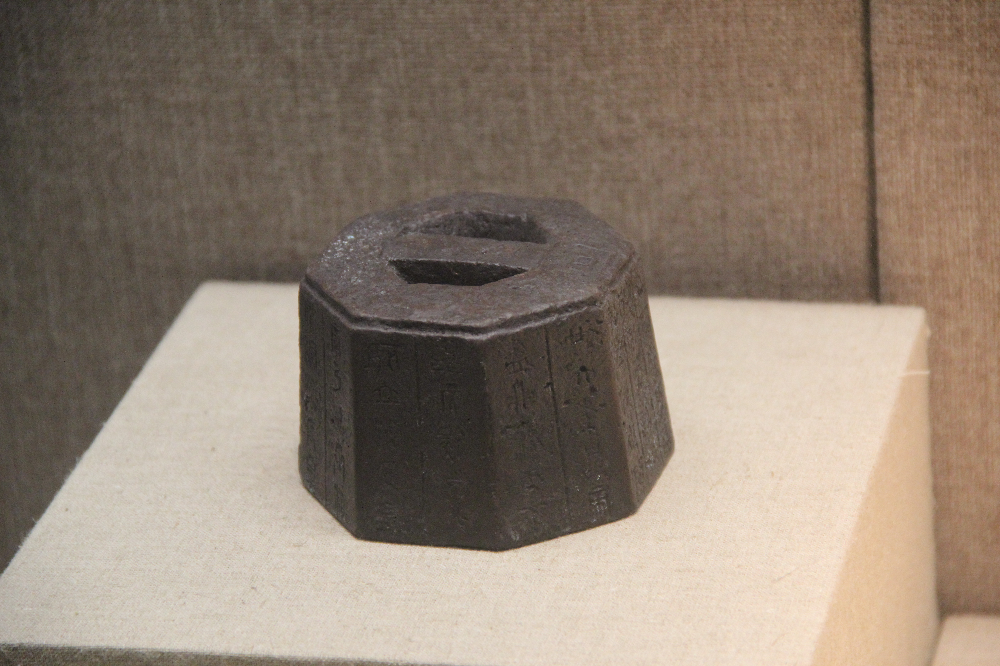{width="720px" loading="lazy"}

> **图 1-1｜让不同地方的人，用同一个重量标准**
>
   这是一件秦朝的铜权，也就是用来比较重量的标准砝码。器身上的铭文，把统一度量衡的要求留在了工具上。

但统一一次，不等于永远不变。单位仍会随着朝代、制度和实际需要发生变化。历史学家今天还要仔细判断一个时代的尺、斗、斤究竟对应多少现代单位。人们逐渐意识到：要让测量跨越时间和地域，就必须规定标准，还得留下能让后来人复核的标准器。

## 第二章　地球有多大

在古希腊，学者们开始追问一个更大的问题：如果大地不是平面，它是什么形状？

亚里士多德（Aristotle，公元前384—322）曾以月食为论据。月亮被地球的影子遮住时，那道影子的边缘总是弯曲的；若遮挡物是球体，无论它朝向何处，投下的影子都会保持圆弧。亚里士多德还注意到，向南或向北旅行时，夜空中可见星体的高度会改变。两个观察从不同方向指向同一个答案：我们脚下的大地更像一个球面，而不是一张无限延伸的平板。

约一个世纪之后，埃拉托色尼（Eratosthenes，约公元前276—194）把这个球面变成了一个可以计算的对象。他出生于北非的昔兰尼，曾在雅典学习，后来担任亚历山大图书馆馆长，而亚历山大图书馆被认为是古典世界最伟大的图书馆，在毁于一场火后，人类失去了希腊罗马时代的无数史料与学术作品。他是数学家、天文学家、地理学家，也是那个时代的知识组织者。图书馆收藏各地的书卷，而埃拉托色尼试图让这些零散知识彼此照亮。

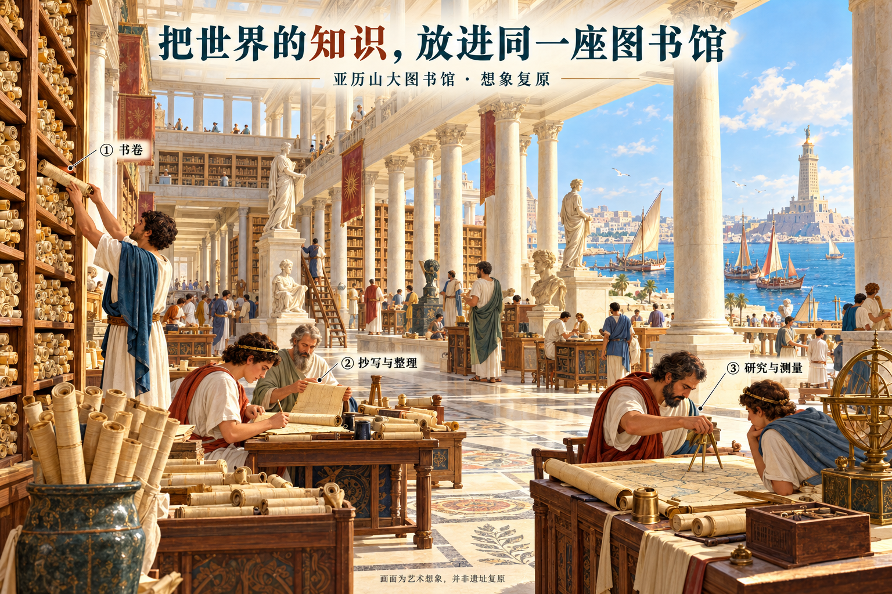{loading="lazy"}

> **图 2-1｜古代学者的“知识汇合处”**
>
> **顺着编号看：** ① 架子上存的是卷起来的书卷；② 抄写、整理让知识能够保存和传递；③ 学者把地理记录、天文观察和数学方法放在一起研究。

关于地球大小的故事，常从一口井开始。传说在夏至正午，埃及南方的锡埃内（今阿斯旺附近）阳光能够照到井底，直立物几乎没有影子；同一时刻，在北方的亚历山大，一根竖直的木杆却投下了影子。

若太阳离地球极远，那么照到两座城市的阳光可以近似看作平行线。锡埃内的阳光几乎垂直地面，亚历山大的阳光却斜了一点。木杆和影子构成一个直角三角形，测出影长与杆高的比例，就能估计阳光偏离竖直方向的角度：若杆高为 $h$、影长为 $x$，那么 $\tan\alpha=x/h$。在这个基础上，后世通常把亚历山大的太阳偏角记作约 $7.2^\circ$。

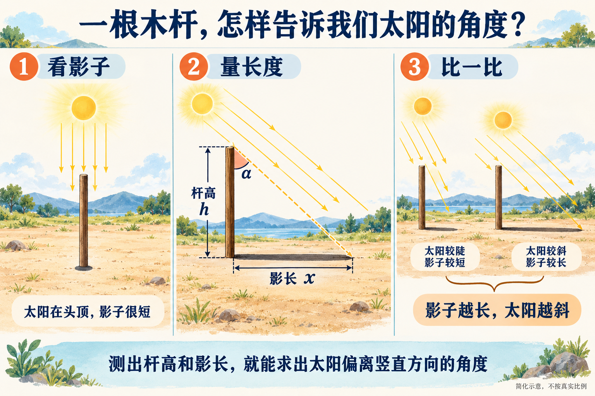{loading="lazy"}

> **图 2-2｜把太阳的位置，变成一个小三角形**
>
> **① 看影子：** 太阳越接近头顶，竖直木杆的影子通常越短。
>
> **② 量长度：** 量出杆高和地上的影长，木杆、影子、阳光就围出一个直角三角形。
>
> **③ 读角度：** 图中的 α 在木杆顶部，夹在竖直方向与阳光之间。它表示太阳偏离头顶多少度。杆高相同时，影子越长，这个角通常越大。

把地球剖开，想象成一个圆。为了做这项简化计算，我们把亚历山大和锡埃内看作大致位于同一条经线上；两地间的地表距离，是圆周上的一小段弧，各自指向地心的半径则夹出了一个角。由于太阳光线近似平行、木杆与当地半径同向，亚历山大的阳光偏角，近似等于这两条半径之间的角度。这是平行线截线产生相等内错角的几何关系。

现在只需做一个除法：

$$
360^\circ \div 7.2^\circ = 50
$$

这说明两地之间的弧，大约是整圈的五十分之一。若两地距离约为5,000 stadia（斯塔迪亚，一种古代长度单位），那么整颗地球的周长就是：

$$
5{,}000 \times 50 = 250{,}000\text{ stadia}
$$

他先测出一小段弧，再借助几何比例把它放大五十倍。这样的计算是极其伟大的：人不必绕地球走上一圈，便可能从一段路、一根木杆和太阳留下的影子，推知整个星球的尺度。

当然，故事中的数字带着历史的雾气。两地距离如何测得，斯塔迪亚究竟对应多长，古代记载中的结果是250,000还是252,000 stadia，学者们的观点并非完全一致；锡埃内与亚历山大也没有精确位于同一条经线上。因此我们不把这项古代估算换算成一个看似精确、实则依赖假设的公里数。

埃拉托色尼工作的重要性，不在于他精准测量出了地球的周长，而在于一种新方法已经出现：观测可以变成角度，角度可以和距离组成比例，比例又可以让人推知看不见的整体。

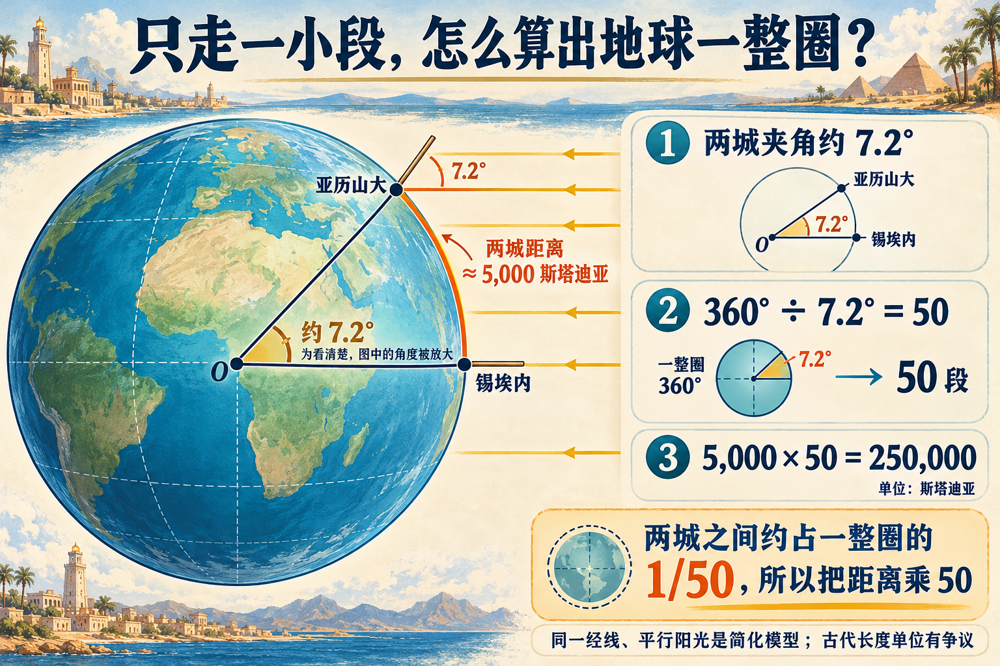{loading="lazy"}

> **图 2-3｜把一个小角度放大成整颗地球**
>
> **① 左边找两座城：** 每根杆都沿着当地的“竖直方向”，也就是朝地心的半径方向；金色阳光彼此平行。因此，亚历山大测到的太阳偏角，与两座城在地心夹出的角近似相等。
>
> **② 右边做除法：** 整圈 360° 除以约 7.2°，得到 50。两座城之间这一段路，约占整圈的五十分之一。
>
> **③ 再做乘法：** 把两城距离约 5,000 斯塔迪亚乘以 50，得到约 250,000 斯塔迪亚。
>
> 为了辨认木杆、半径和角度，城市间隔与角度都被放大了；这张图不是两座城的真实比例位置图。

到了公元二世纪，生活在亚历山大的托勒密（Claudius Ptolemy，约100—170）在《地理学指南》中系统整理经纬度坐标和地图投影方法，为数千个地点编列坐标。他不是从零创造地理知识，而是汇集、批评并组织前人的成果。托勒密采用的地球大小和地点资料并不总是准确，但他留下的坐标框架影响了后世许多地图绘制者。

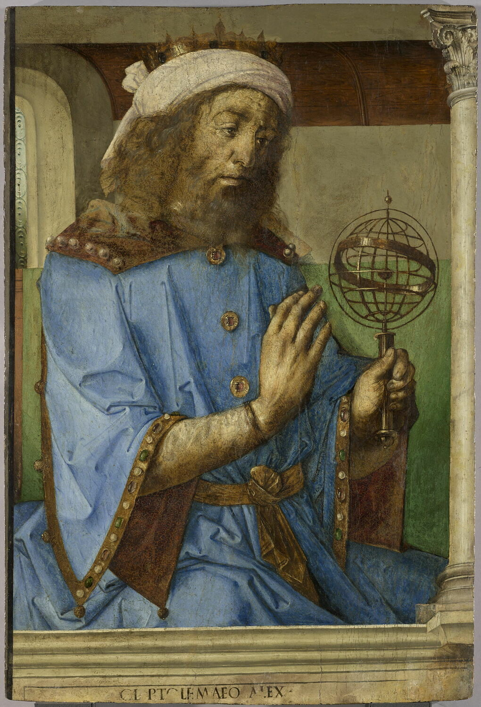{width="380px" loading="lazy"}

> **图 2-4｜把地点的名字排进坐标表的人**
>
> **看人物手中的模型：** 它呼应了后世人对托勒密这位天文学家、地理学家的认识。
>
> 这幅画约绘于 1476 年，距离托勒密生活的时代已过去一千多年

差不多在几个世纪后，中国西晋的裴秀（224—271）总结出“制图六体”，讨论比例、方位、距离，以及怎样处理地形起伏和道路曲折。他绘制的地图已经失传，但后世记载显示，中国地图学家也在思考同一类难题：如何把真实的大地，可靠地缩小到纸上。裴秀的网格比例法与托勒密的经纬系统不是同一套坐标，却都让地图向可计算的方向迈进。

{loading="lazy"}

> **图 2-5｜把每一块大地，搬进对应的小格**
>
> **① 先在大地上定格子：** 看村庄、河流和桥各落在哪一格。
>
> **② 再缩到纸上：** 地上一格代表 1 千米，纸上就把这一格画成 1 厘米。
>
> **③ 最后连成地图：** 地点的相对位置保留下来，距离也按同一比例缩小。

一个圆周给出了新的测量尺度，也给地图带来了新的问题：地球是弯的，纸却是平的。我们要怎样把球面上的位置，画在一张纸上？

## 第三章　怎么把地球“拍扁”

1492年前后，德国制图家和航海家马丁·贝海姆（Martin Behaim）主持制作了今天仍保存下来的最古老地球仪之一，名为“地球苹果”（Erdapfel）。它诞生的年份格外耐人寻味：同一年，哥伦布的船队横渡大西洋；而贝海姆的地球仪上还没有美洲。

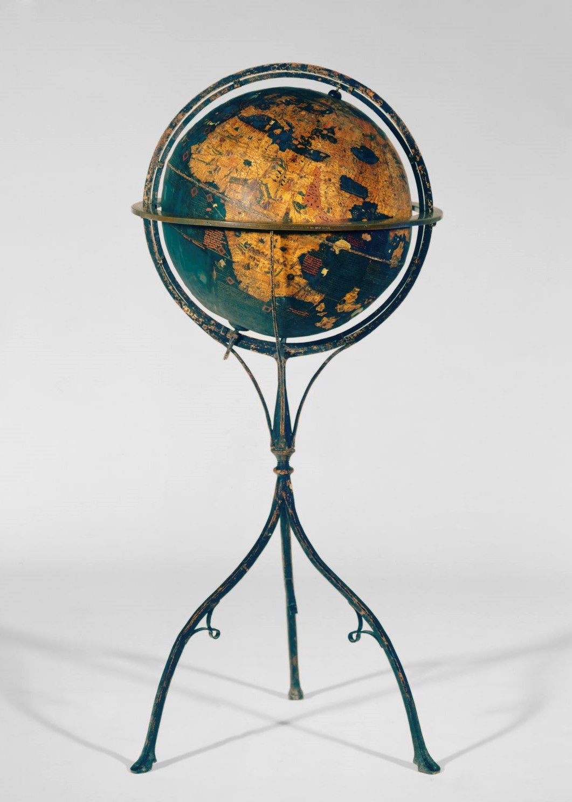{width="440px" loading="lazy"}

> **图 3-1｜1492 年的“地球苹果”**
>
> **先看球面，再看支架：** 地名和海岸被画在球面上，支架让人可以转动、观察这个世界模型。
>
> 这件地球仪上没有美洲，保留的是制作时欧洲制图者掌握的地理知识。看古地图时，可以把“画出来的部分”和“仍然缺少的部分”一起当作历史线索。

这个球体记录的不是“我们今天知道的世界”，而是那个时代欧洲人已经获得、仍然缺失或想象出来的地理知识。地球仪不只展示大陆和海洋，也是一份历史档案：它告诉我们，制作者能看见什么、相信什么，又希望驶向何方。

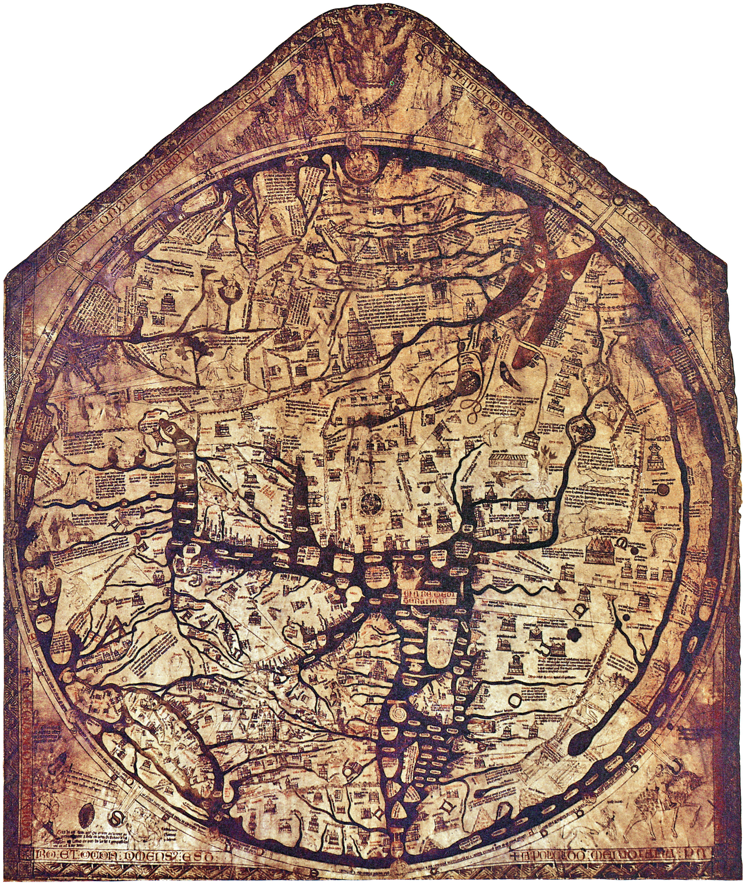{width="720px" loading="lazy"}

> **图 3-2｜中世纪的一种世界图景**
>
> 这幅地图把东方放在上方，与今天常见的“北朝上”不同。可以看见中央的耶路撒冷，以及地图中穿插的人物、故事和奇异生物。
>
> 它既表现地理，也安排信仰、历史和故事。它展示了中世纪欧洲的一种制图传统，不能直接当作今天等比例的航海地图来量路程。

{loading="lazy"}

> **图 3-3｜远航把新的海岸带回图上**
>
> **从海岸线开始看：** 找一找非洲的轮廓、通往印度的海路，以及左侧新出现的美洲沿岸信息。横跨海面的线网，为航海方位提供参考。
>
> **与上一幅图比较：** 这幅 1502 年的地图汇集了远航带来的新记录。海岸的形状、港口的位置与航行方向变得格外重要。比较两幅图，可以看见地图的用途和资料怎样改变它的面貌。

球面模型忠实保留地球的形状，却不方便携带，也不适合在甲板上摊开来规划航程。地图制作者于是遇上一个无法同时满足的要求：把弯曲表面摊平时，不可能同时保留所有距离、角度和面积。每一种地图投影，都必须选择牺牲什么。

### 经纬度：把地球表面写成坐标

经纬度把地球表面的位置写成两个角。纬度从赤道向北或向南量，范围从0°到90°；经度沿赤道方向计算，表示某地相对于约定零度经线向东或向西偏了多少角度。把相同纬度的点连起来，得到纬线；把南北两极相连并经过同一经度的点连起来，得到经线。两条线的交点，便给出一个地点的坐标。

这套网格不是由一位制图师在某一天突然发明的。古希腊天文学家喜帕恰斯等人已用经纬网组织地点和天文位置；二世纪的托勒密在《地理学指南》中汇集、整理数千处地点的经纬度，并讨论地图投影，使坐标框架成为可供后人继承的地理方法。经纬度把球面上的位置变成数字，也让不同地图可以在同一套角度语言中比较。经线起点并非天然存在，零度经线后来仍须由各国协商约定。

十六世纪，佛兰德制图家杰拉杜斯·墨卡托（Gerardus Mercator，1512—1594）创造了后来以他命名的投影方法，并在1569年的世界地图中使用。它的优点是让恒定罗盘方向的航线在地图上成为直线，这对当时的远洋航行十分实用。但它会显著放大高纬度地区：格陵兰在地图上看起来几乎和非洲一样大，实际面积却远小于非洲。

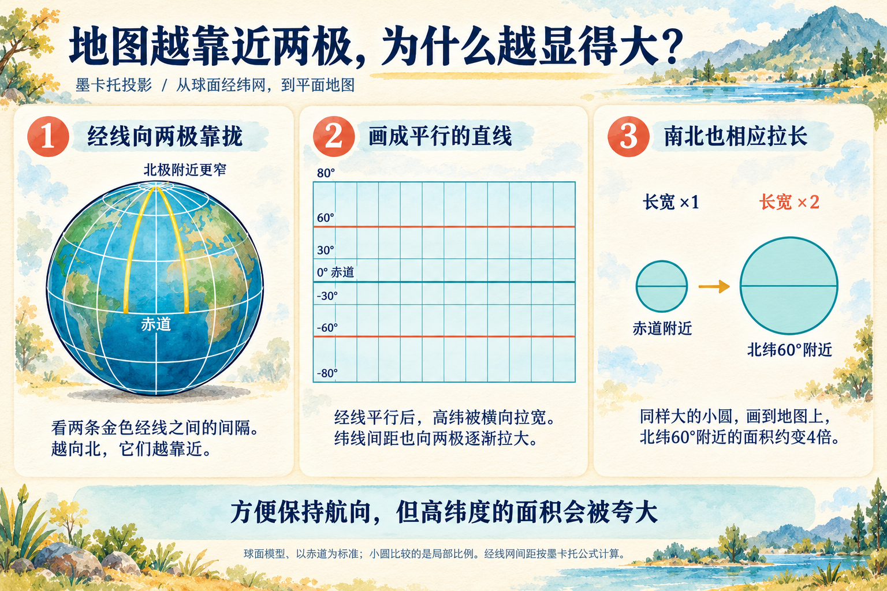{loading="lazy"}

> **图 3-4｜为了方便辨方向，地图怎样拉伸地球**
>
> **① 看球面：** 经线向两极靠拢。
>
> **② 看平面：** 墨卡托图把经线画成平行的竖直线，原本收拢的地方就被横向拉宽。
>
> **③ 再看南北：** 为了在很小的范围内保住角度，南北方向也要相应拉长，所以高纬度的纬线间隔更大。
>
> **放大多少？** 在球面模型、以赤道为基准时，北纬 60° 附近很小的图形，长和宽都约放大 2 倍，面积便约放大 4 倍。这里比较的是局部比例；并不是说所有高纬度地区都恰好放大 4 倍。

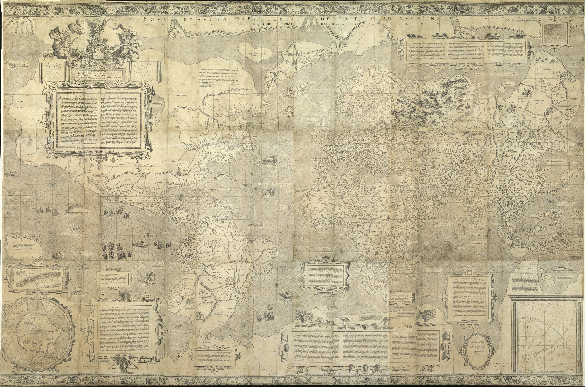{loading="lazy"}

> **图 3-5｜把原理放回真正的历史地图**
>
> **照着上一张原理图找：** 观察横向的纬线与竖直的经线，再比较赤道附近和高纬度的网格。越靠近两极，南北方向的纬线间隔越明显地拉开。
>
> **这给水手什么帮助？** 保持同一罗盘方向的航线，可以在这种地图上画成直线。它方便规划航向，但量面积、比较国家大小时，需要记住高纬度被放大的代价。

这种放大不是制图师画错了，而是几何转译的代价。墨卡托投影要在局部保持角度，就必须随着纬度增加而拉伸东西方向的地图距离。它的球面公式是：

$$
x=R\lambda,\qquad
y=R\ln\tan\left(\frac{\pi}{4}+\frac{\varphi}{2}\right)
$$

这里的 $\lambda$ 是经度，$\varphi$ 是纬度，都用弧度表示；$R$ 是球半径。经度直接决定横坐标，而纵坐标则通过一个对数函数随纬度增加。当纬度 $\varphi$ 趋近北极的 $90^\circ$ 时，$y$ 趋向无穷大。于是极点根本无法画在一张有限大小的墨卡托地图上；越往北，地图上的面积被拉得越夸张。或许你还看不懂上述的复杂公式，但是你只需要知道，墨卡托投影制作的地图会导致越靠近极点的地方，在地图上显示的越大

为什么航海者仍愿意使用它？因为恒定航向的航线（恒向线）在墨卡托地图上是一条直线。水手可以沿着一个罗盘方向前进。当然，这条直线通常不是两点之间最短的球面路径；更短的“大圆航线”在地图上往往是一条弯线。墨卡托地图擅长帮助人保持方向，却不是地球本身的样子。

地球仪与平面地图像是两种不同的诚实：前者承认球面，却不便携带；后者方便传播，却把选择与变形留在纸上。读地图时，不仅要看它画出了什么，也要问它为了铺平地球，拉伸了哪里、压缩了哪里。

## 第四章　钟摆、六分仪与经度竞赛

终于，航海时代的水手知道了地球的样子，但仍然有一个问题需要解决：我们的船究竟在哪里呢？人们可以借助太阳和北极星估计南北位置，也就是纬度；但向东或向西走了多远，也就是经度，长期是更难的问题。要理解其中的原理，先看地球的自转：在把一天近似为平均太阳日的模型中，24小时对应地球一周360度，于是：

$$
360^\circ\div24\text{小时}=15^\circ/\text{小时}
$$

地球每转过15度，就相当于一个小时。若船上保留着出发港的时间，而水手又能测出船所在位置的地方太阳时，那么两地时间差便能换算成经度差。假如当地时间相差2小时：

$$
2\text{小时}\times15^\circ/\text{小时}=30^\circ
$$

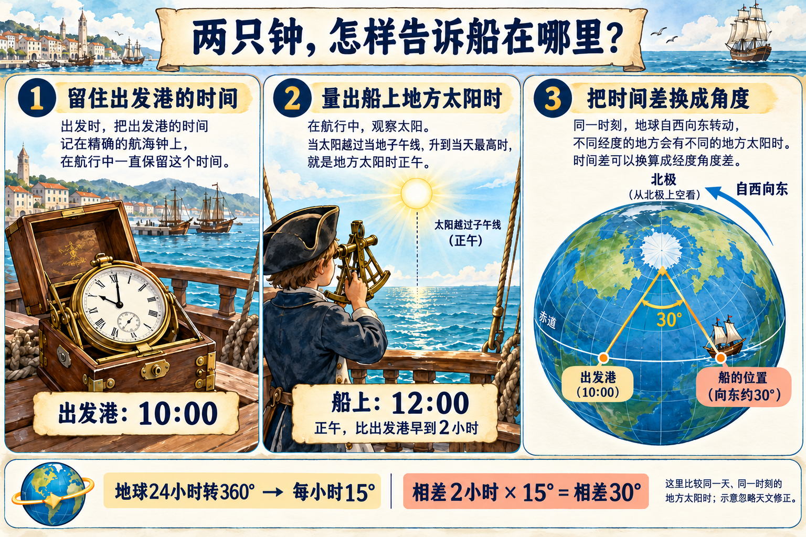{loading="lazy"}

> **图 4-1｜把两个地方的时间差，换成东西距离**
>
> **两只钟要在同一时刻比较：** 船上观测得到当地正午 12:00，航海钟保存的出发港时间却是 10:00。船所在的地方，比出发港先迎来正午，所以在东方。
>
> **一步计算：** 地球约 24 小时转一周 360°，每小时就是 15°。相差 2 小时，便对应约 30° 的经度差。图中的时间用来说明地方太阳时关系，实际航海还要做天文修正。

先到正午的地方在东方，因为地球自西向东自转。原理很简单，真正困难的地方却在如何获得精准的时间：海上摇晃、温度变化、盐雾侵蚀，都会让那个时代的落后钟表走快或走慢。

伟大的物理学家伽利略·伽利雷（很奇怪的名字）（Galileo Galilei，1564—1642）首先研究摆的运动，看到了摆动中蕴含着稳定的节奏。直到荷兰科学家克里斯蒂安·惠更斯（Christiaan Huygens，1629—1695）把摆钟发展成实用计时器，并用数学研究摆的周期。对长度为 $L$、当地重力加速度为 $g$ （这是一个你可能还不认识的常量，你只需要知道这个量几乎在世界各地都相等，只是随着纬度变化有一定差异）的单摆，在摆幅较小时，完整摆动一周的周期近似为：

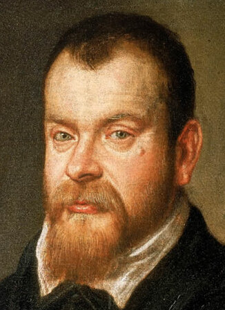{width="330px" loading="lazy"}

> **图 4-2｜伽利略先从摆动里发现可研究的节奏**
>
> 伽利略研究摆的运动，关心一次摆动要用多久、哪些条件会影响它。留意后面的钟摆图：只有把“一次”说清楚，时间才能被可靠地比较。

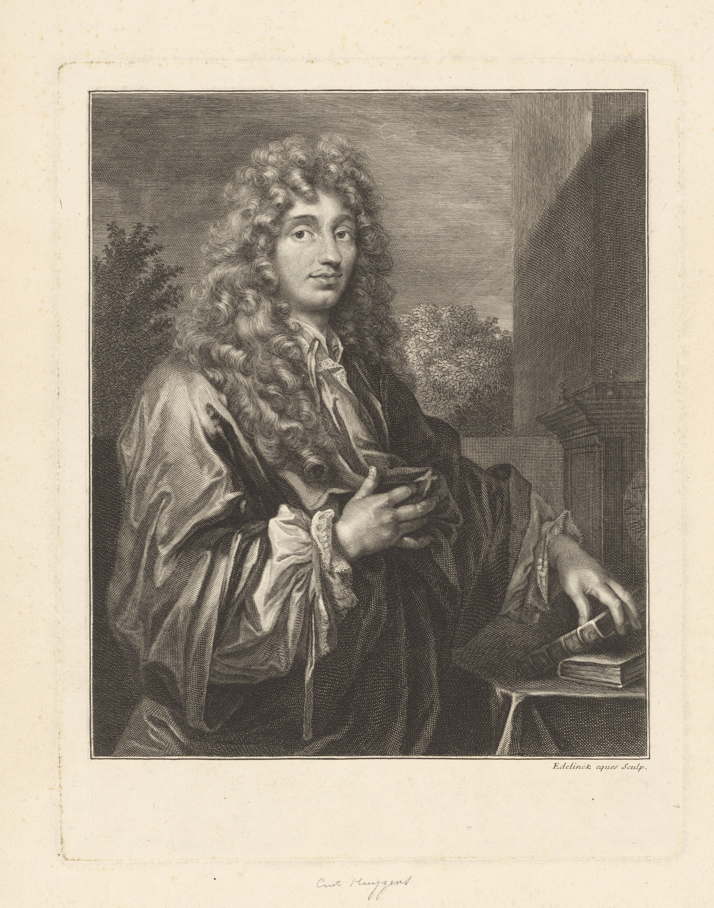{width="420px" loading="lazy"}

> **图 4-3｜让规律变成能工作的钟表**
>
> **从问题走向工具：** 惠更斯把摆用于实用钟表，又用数学研究摆的周期。钟表的任务，是让一个尽量稳定的过程重复发生，再把重复次数记下来。

$$
T=2\pi\sqrt{\frac{L}{g}}
$$

这个公式说：摆长越长，摆动越慢；重力越强，摆动越快。摆锤的质量不出现在公式里，所以在理想模型中，换一个更重的摆锤不会改变周期。它也给我们带来一个颇有趣的问题：为什么地表的重力加速度 $g$，用米和秒表示时，数值竟然这么接近 $\pi^2$？

这其实不是一个完全的巧合。我们把单摆公式倒过来，看看一个“秒摆”需要多长。所谓秒摆，是完整摆一周约用2秒，也就是来回一次各约1秒。令 $T=2\text{ s}$：

$$
2=2\pi\sqrt{\frac{L}{g}}
$$

两边先除以2，再平方，得到：

$$
1=\pi\sqrt{\frac{L}{g}}
$$

再平方一次并整理：

$$
1=\frac{\pi^2L}{g}
\qquad\Longrightarrow\qquad
L=\frac{g}{\pi^2}
$$

如果我们采用标准重力加速度 $g=9.80665\text{ m/s}^2$，可得：

$$
L\approx\frac{9.80665}{9.86960}\text{ m}\approx0.9936\text{ m}
$$

一秒摆半次的摆，大约需要一米长。反过来说，若我们把摆长取作1米，代回周期公式：

$$
T=2\pi\sqrt{\frac{1\text{ m}}{9.80665\text{ m/s}^2}}
\approx2.006\text{ s}
$$

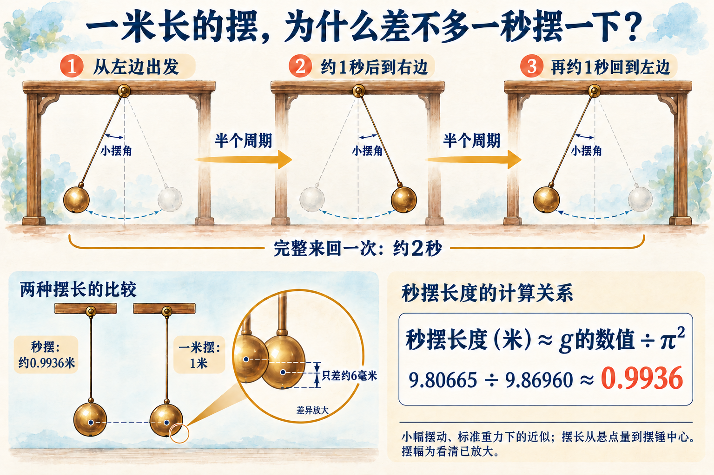{loading="lazy"}

> **图 4-4｜“摆一下”和“一个周期”，不是同一回事**
>
> **沿上方三个画面读：** 从左边出发，约 1 秒到右边；再约 1 秒回到左边。这整个来回，约用 2 秒，才叫一个周期。为了看清过程，画面把摆动幅度放大了。
>
> **再看下面的长度：** 摆长从悬点量到摆锤中心。在标准重力与小幅摆动的近似下，秒摆长约 0.9936 米，与 1 米只差约 6 毫米。把秒摆公式整理，就能看见 π² 为什么会出现在这里。数字接近并不表示米曾按秒摆正式定义。

它的一半约为1.003秒，正好接近“一秒一拍”。所以，$g$ 的数值接近 $\pi^2$，是因为以米和秒计量时，一米长的摆恰好接近秒摆，周期公式里又自然带有 $2\pi$。那为什么一米的长度会接近秒摆的摆长呢？这并不是因为米最初按秒摆定义。十八世纪确实有人提议用特定纬度的秒摆长度作为长度标准，但法国最终选择了子午线方案。于是，一米与秒摆长度只差约千分之六，是两个独立标准意外接近，并非后来更换米的定义造成的误差。

艾萨克·牛顿（Isaac Newton，1643—1727）在十七世纪后期根据地球自转和引力理论推断：旋转的地球会在赤道略微鼓起、两极稍稍扁平。

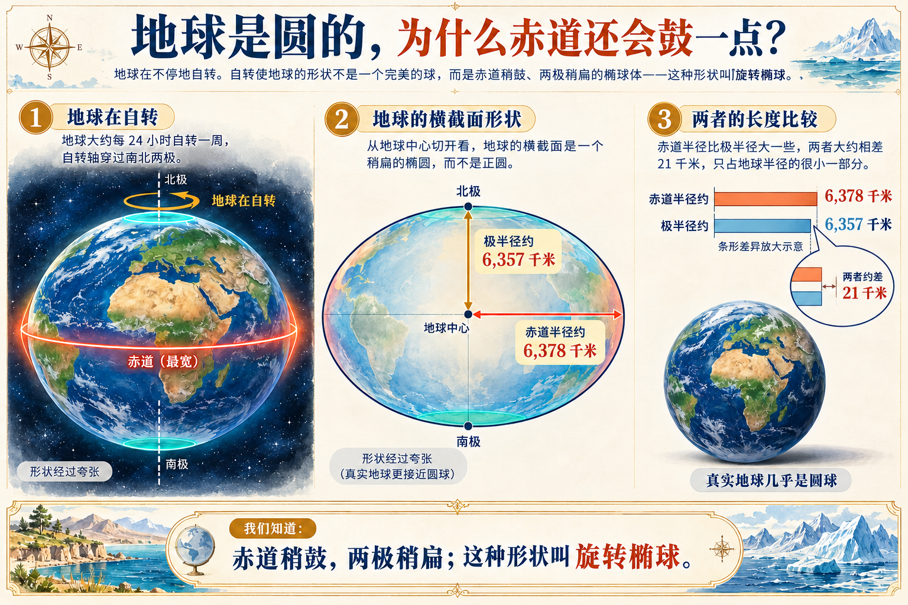{loading="lazy"}

> **图 4-5｜地球有多扁？比图上看起来轻微得多**
>
> **先看中间的两根箭头：** 从地心到赤道的距离，约为 6,378 千米；从地心到极点，约为 6,357 千米。两者只差约 21 千米。
>
>  如果严格按真实比例画，普通大小的插图很难看出差别，所以图中的扁率和比较条差异都被放大。右下方接近圆球的地球，更接近我们日常所见的真实外形。

进入十八世纪，远洋贸易和海军航行让经度问题变得更加紧迫。英国议会在1714年设立经度奖金，鼓励人们寻找可靠的海上经度测定方法。约翰·哈德利（John Hadley，1682—1744）与美国的托马斯·戈弗雷（Thomas Godfrey，1704—1749）约在1730年前后分别发展出反射象限仪，也叫八分仪。仪器通过镜片叠合两个方向的影像，让航海者在晃动中量取太阳或星体的高度。两次反射使镜面转过的角度加倍地反映在观测方向上，因此八分仪较短的弧形刻度也能量出更大的天体夹角。后来出现的六分仪可测更大的角度，成为海上测角的重要工具。它能帮助测天体高度、估计纬度，也能支持月距法测经度；但它本身并不是一只钟。

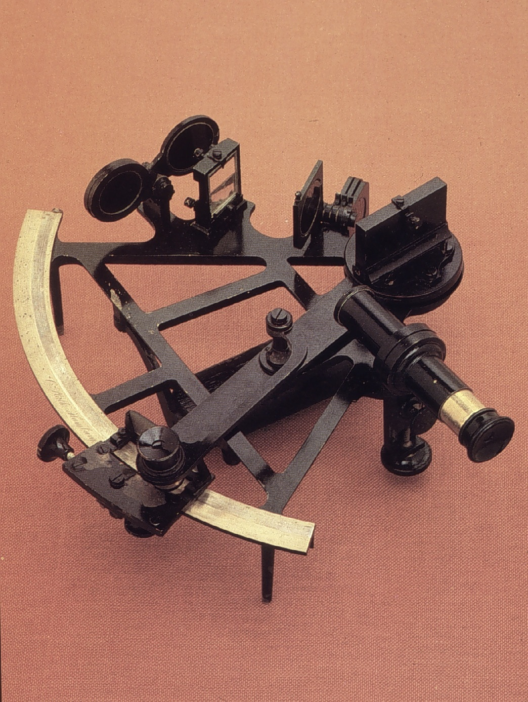{width="520px" loading="lazy"}

> **图 4-6｜水手手里的测角工具**
>
> **看三个部位：** 弧形刻度像一段扇形边缘；可转动的指示臂带着镜子；望远镜让观测者比较远处的两条方向。这件仪器测量夹角，角度本身并不是经度答案。
>
> **与下一幅图连着看：** 水手把太阳的反射影像与海平线放进同一个视野，调到相接，再读取角度。这里采用 NOAA 收藏的普拉特六分仪历史照片。

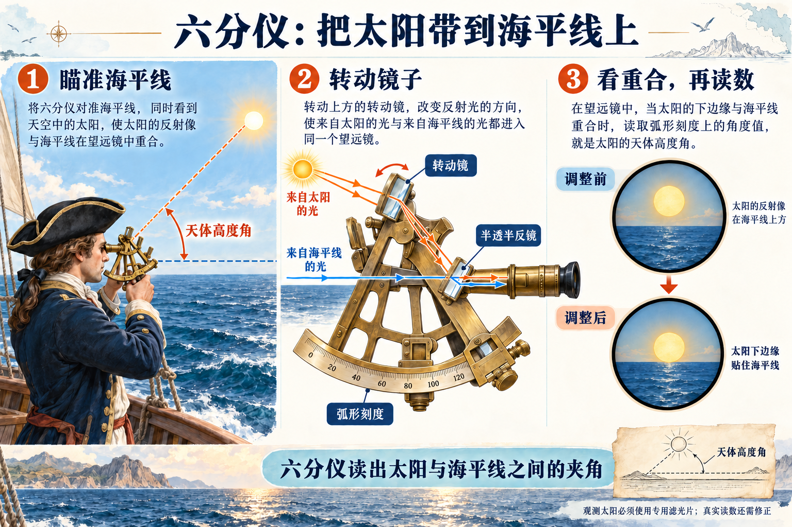{loading="lazy"}

> **图 4-7｜把两条方向，放进同一个小窗口**
>
> **① 对准海平线：** 让望远镜能看见海面与天空的分界。
>
> **② 转动镜子：** 太阳光经过两次反射进入同一个视野，海平线的光则沿另一条路进入。
>
> **③ 看相接：** 转动指示臂，直到太阳影像的下边缘刚好贴住海平线，再读弧形刻度。
>
> **为什么用两面镜子？** 双反射让镜面之间的转角，以两倍的角度反映在两条观测方向上；刻度已经把这一关系计入。实际测量还要修正仪器误差、眼睛高度和大气折射等影响。观测太阳必须使用适当的专用滤光片。

同一世纪里，牛顿的预测也接受了检验。法国科学院组织测量队分别前往秘鲁和北欧拉普兰，比较不同纬度的一度子午线长度。实地测量支持了他的判断：地球是一个两极稍扁、赤道略鼓的旋转椭球。牛顿的理论与测量队的远征，说明科学判断需要两条腿：一条从数学和物理原理出发，另一条走到大地上用仪器测量。

另一条路线，是造一只不依赖摆锤、可以在船上保存出发港时间的钟。英国木匠兼钟表匠约翰·哈里森（John Harrison，1693—1776）为此耗费数十年。

1714年英国议会通过《经度法案》，设立经度委员会，并为能在远洋上可靠测定经度的人提供最高两万英镑的奖金。哈里森是林肯郡出身的木匠和自学成才的钟表匠；他先后制造H1、H2和H3，不断试着让钟表抵抗船只颠簸、温度变化与润滑条件改变。1736年，H1随船赴里斯本试航，返航时帮助船长辨认海岸位置，哈里森由此得到委员会关注。

他后来把希望转向H4：一只外形像大怀表、内部却为海上计时重新设计的精密计时器。1761年H4随船前往牙买加，返航后显示的经度误差远小于法案要求，表现出足以改变航海进程的精度；1764年的第二次试航也取得优异结果。但委员会没有立刻按最高奖金结案，而要求更多测试、交出设计细节，并经历了冗长的审查与争论。哈里森与天文学家内维尔·马斯基林等人所代表的月距法路线，也在奖金制度与科学权威之间竞争。国会后来分阶段给予哈里森补偿，直到1773年，在乔治三世支持下，他才获得额外款项。

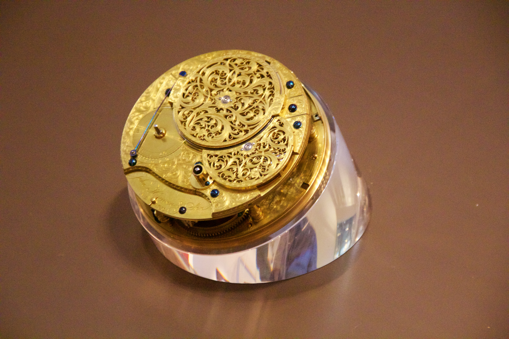{loading="lazy"}

> **图 4-8｜海上的困难，藏在一只钟的内部**
>
> **先看密集的机械结构：** 这张照片展示 H4 的机芯，不是普通钟面的装饰。齿轮、调速机构和各个零件必须共同工作，才可能在温度变化、船体运动时尽量保存稳定的节奏。
>
> **它与经度有什么关系？** 水手需要的，是一份可靠的“出发港时间”。钟走错了，换算出的经度也会错；在这个模型里，时间错 4 分钟，就会带来约 1° 的经度误差。

哈里森并没有独自解决整道经度难题。天文学家改进星表和月距法，仪器制作者提高角度测量精度，皇家天文台和海军机构把观测与标准时间连接起来。科学史不是一位英雄独自走向终点，而是许多伟大而坚韧的思维在不断的较量。

## 第五章　法国大革命与一个世界通用的米

十八世纪末，法国人决心重新安排衡量世界的方法。大革命推翻旧制度，各地混乱不一的长度、容量和重量单位，成为商业、税收和行政上的实际阻碍。于是，一次和“秦始皇统一度量衡”颇有异曲同工意味的度量衡革命在法国科学院开始了。

法国科学院的目标不仅是换一把新尺，而是创造一套“对所有人都适用”的标准。若单位来自国王的身体，它属于一位统治者；若单位来自巴黎的某条街，它属于一个地方。科学家们希望找到自然界中不由任何国家独占、能够被重新测量的基准，并让单位之间采用十进制关系，使换算不再困在十二、十六、二十等不同进位里。

那么，为什么偏偏是一米？为什么又要把地球的子午线四分之一除以一千万？

法国科学院在1791年选择地球子午线作为基础：以通过巴黎的子午线为参照，从赤道到北极沿经线走过的四分之一圆弧，取其一千万分之一作为米。子午线属于整颗地球，不属于某个王朝或城市，理论上可由不同国家重新测量；而巴黎子午线则是法国当时能够组织测量、并与国家地图工程衔接的具体参照。那么，“一千万”有什么道理？地球四分之一子午线约为一千万米：若取其一百万分之一，单位会接近十米；若取其一亿分之一，则只有约十厘米。除以一千万，得到的单位约一米，适合人手拿来量桌子、房间和道路；再配上十进制，较大的距离和较小的分数也能用整齐的十倍关系换算。它既试图具备全球性，又落在日常可用的尺度上。“一千万”是科学家为通用性、十进制和人类尺度作出的设计选择。

为了测出这个基准，天文学家让-巴蒂斯特·德朗布尔（Jean-Baptiste Delambre，1749—1822）与皮埃尔·梅尚（Pierre Méchain，1744—1804）在1792年至1798年间测量敦刻尔克到巴塞罗那之间的子午线弧段。他们在山顶、城塔和教堂间建立三角网：先精确测一段地面基线，再从相邻地点观测角度，利用三角形的关系推算更长的距离。每一段都把已知变成未知，又把刚求出的未知变成下一段的已知。

负责推动计量改革的让-夏尔·德·博尔达（Jean-Charles de Borda，1733—1799）也为这项工程设计精密测角仪器。他们不是把一把尺一路从法国北端拉到西班牙，而是用角度和几何，把一段段地表连接成一张巨大的测量网。

这是一场科学远征，也是一场与时代的拉锯。革命、战争、边境猜疑和漫长计算都横亘在测量者面前。子午线弧长并不能直接拿尺从地面量完；测量者必须观察星体、测角、建立三角网，再依据地球并非完美球体这一事实，从弧段推算整个子午线。1799年，新的米制标准以铂制标准器的形式固定下来，地球的弧长被压缩成一根可以放进档案馆的尺。

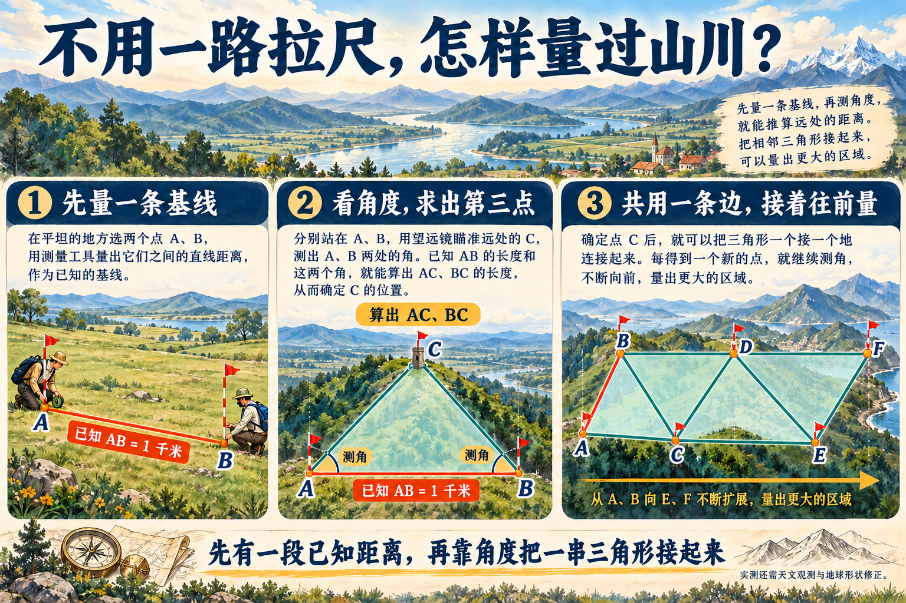{loading="lazy"}

> **图 5-1｜用一串三角形，把远处连接过来**
>
> **① 量基线：** 先精确知道 AB 有多长。
>
> **② 测角度：** 从 A、B 两处看向远处的 C，量出两个角，就能确定这个三角形的形状和大小，求出 AC、BC。
>
> **③ 接下去：** 把刚求出的边当作下一座三角形的已知边，一站一站向前推算。
>
> **注意看右边：** 相邻三角形共用一条边，因此前一站的计算能接到后一站。真正测子午线时，还要结合天文观测、地形与地球形状修正，不能简单把图上的折线长度相加。

不过，“用地球定义”并不意味着科学家们真的先精确知道了地球四分之一子午线的长度。1791年他们选定的是原则和比例；德朗布尔与梅尚随后才用实地测量确定数值。法国科学院也讨论过另一种候选方案：用特定纬度处“一秒摆”的长度定义米。它看上去与一米极接近，也方便复现；但摆的周期取决于当地重力，而重力会随纬度和地点改变。秒摆的长度因此不是全地球同一个值。更重要的是，当时的秒是把平均太阳日分成86,400份得到的；如果米由秒摆定义，长度单位也会依赖地球自转所给出的时间单位。选择子午线作为依据，是为了让长度不依赖某个地方的重力，也不依赖一件钟表。

这也让我们看见一个鲜为人知的历史交叉：后来的一米虽不是按秒摆定义的，却与秒摆长度意外地接近。我们刚才算出的秒摆长约0.9936米，与一米只差约6毫米。两者都落在人类日常使用的尺度，也都与地球的大小和运动有关；但一个以子午线为基础，一个由秒和当地重力共同决定，来路并不相同。

理想定义与实测标准之间并非没有误差。地球不是完美球体，测量也不可能没有偏差；后来人们发现，档案米与按照原始子午线定义应有的长度有细小差异。历史并未因此丢弃米制：人们保留这根已经用于贸易、工程和科学的标准器，随后再用更稳定、可复现的方法重新定义米。

这根铂制标准器把革命时期的理想带进了十九世纪。此后，计量学家还会继续追问：怎样让米不依赖一件放在档案馆里的物体？

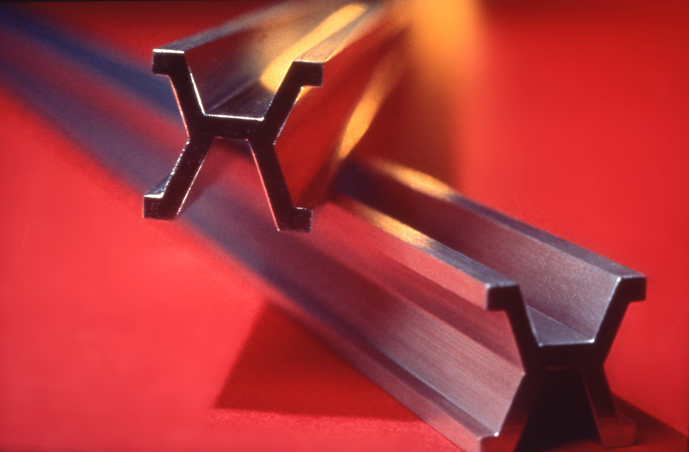{loading="lazy"}

> **图 5-2｜一米怎样被保存在金属上**
>
> **先看 X 形截面：** 这种截面帮助细长的金属杆保持刚性、不容易弯曲。真正保存“一米”的，是杆上两条很细的刻线之间的距离；刻线在这幅图里并不容易看清。比较长度还要遵守规定的温度条件。
>
> 图中是后来 1889 年铂铱国际米原器的计算机示意图，不是 1799 年铂制档案米的实拍。它帮助我们理解“用一件实物保存长度”的方法；实物会受温度、损伤和长期稳定性影响，人们才继续寻找更可复现的定义。

## 第六章　经度如何成为共同时间

经纬网已经给世界铺好了地址，但还有一个问题没有回答：所有人从哪一条经线开始计算经度？各地原先依照日晷和太阳位置生活，读的是当地的视太阳时；后来，钟表和天文学家发展出平均太阳时，让一天被均分成稳定的24小时。随着铁路、贸易和通信跨越城市，各地钟表若各自停留在地方时，列车时刻表和远距离联络就会陷入混乱。

1875年，17个国家签署《米制公约》，建立国际度量衡合作机制。米制从法国的改革计划，逐渐成为需要多国共同维护的标准。

与以赤道为0度的纬线不同，地球上没有一条天然的“零度经线”。零度在哪里，必须由人们约定。1884年，国际子午线会议选定经过英国格林尼治皇家天文台的子午线作为国际零度经线，并推动各地协调经度和标准时间。

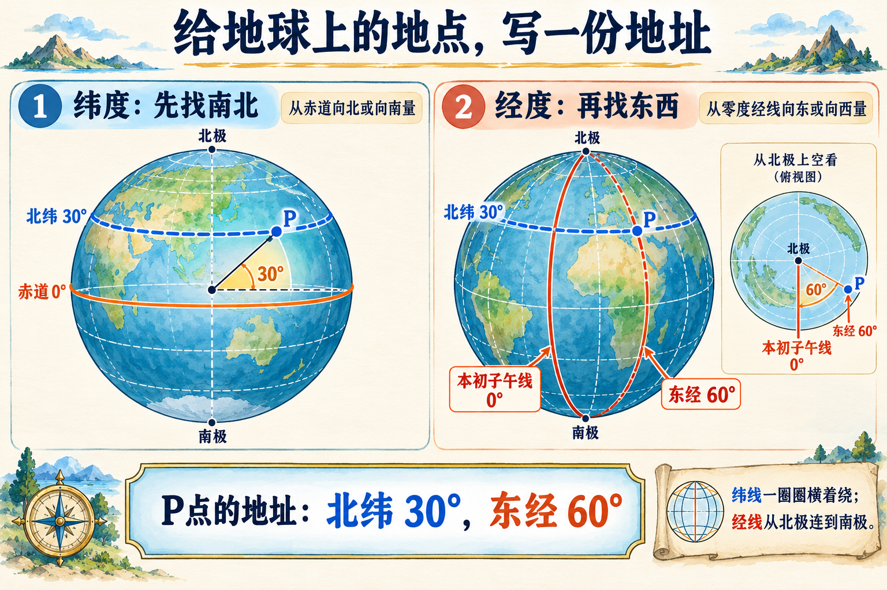{loading="lazy"}

> **图 6-1｜两组角度，合成一个地球地址**
>
> **① 蓝色找南北：** 从赤道往北量到 30°，得到“北纬 30°”。
>
> **② 红色找东西：** 从约定的零度经线向东转过 60°，得到“东经 60°”。右上角的小图从北极上空看，专门展示这个东西方向的转角。
>
> **③ 找交点：** 蓝色纬线与红色经线相交，就是示例点 P 的位置。P 是教学用的假想点，不是在标注某座城市。纬度的起点是赤道；经度的零点需要人们共同约定。

长度单位也走过相似的国际化道路。1889年，国际米制会议以铂铱合金制成的国际米原器作为标准；1960年，米改以氪-86原子发出的特定波长定义。1967年，国际单位制把秒定义为铯-133原子某种跃迁对应的9,192,631,770个振荡周期，让“秒”不再依赖地球自转的细微变化。1983年，米也与真空中的光速相连：光在真空中于 $1/299\,792\,458$ 秒内走过的距离，就是一米。长度和时间从此在计量定义中扣在一起。

GPS把这段历史带上了地球轨道。卫星携带原子钟，把时间信号发送到地面；接收器比较不同卫星信号抵达的时间差，换算自己到各颗卫星的距离，再由多个距离的交会确定位置。

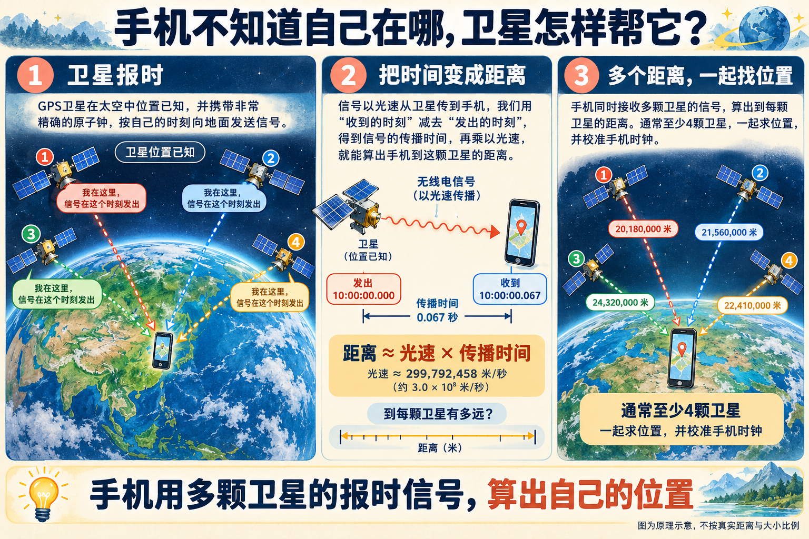{loading="lazy"}

> **图 6-2｜把卫星的报时，变成手机的位置**
>
> **① 收到报时：** 卫星告诉手机自己在哪里、信号何时发出。
>
> **② 算传播时间：** 手机比较发出与收到信号的时间，用传播时长乘以光速，估计到卫星的距离。
>
> **③ 一起求解：** 把多颗卫星给出的距离约束放在一起，通常至少需要 4 颗卫星，同时求出位置并处理手机时钟的误差。

这套系统甚至必须把爱因斯坦的相对论写进钟表的校准里。卫星运动较快，狭义相对论效应让它的钟每天慢约7微秒；卫星所在的引力场比地面弱，广义相对论效应又让钟每天快约45微秒。两者相抵后，卫星钟仍比地面钟每天快约38微秒。光可以在38微秒内走过约11公里。若系统不修正这个偏差，位置计算很快就会失准。

当你看见手机地图上的定位点，它背后并不是一颗卫星直接“看见”了你，而是原子跃迁、电磁波、轨道、几何和相对论共同完成了一场计时。三角定位，就是之前法国人测量子午线的方法，仍然在每一次使用手机定位时发挥作用。

## 结语　当远方有了坐标

最初，一根影子落在地上。它告诉人们太阳在天空的位置，也让人们第一次把角度、距离和地球的曲面放进同一道计算里。

后来，一把尺连接不同的人；一个球体让人看见地球的整体；一张地图连接不同的城市；一只钟连接不同的经度；一颗卫星把时间信号送过海洋、山脉和夜空。人类没有把地球变小，却学会了用共同的单位和坐标描述它。

世界不是在一夜之间被画出来的。几千年的历程中，世界的尺度在测量中一点点显现：先有手掌与脚步，继而有刻度、三角形和地球仪；先有太阳和星辰的升落，继而有精密钟表、原子跃迁和卫星定位。每一次测量都不是故事的终点，而是下一次发问的起点。

于是，人类用数学与时间，跨越数千年织成了一张描绘远方的坐标网。

## 参考资料

### 史实与科学资料（由AI收集来源）

- [NASA：古希腊人对地球形状和周长的认识](https://www.nasa.gov/history/90-years-of-our-changing-views-of-earth/)
- [University of Florida：埃拉托色尼测量地球周长的教学资料](https://web.mae.ufl.edu/uhk/ERATOSTHENES-CIRCUMFERENCE.pdf)
- [美国国会图书馆：托勒密《地理学》与经纬坐标](https://www.loc.gov/exhibits/vatican/math.html)
- [中国国家博物馆：秦始皇统一度量衡诏铜权](https://www2.chnmuseum.cn/collections_577/collection_highlights_608/artifacts_handed___down_from_ancient_times_612/202008/t20200827_247511.html)
- [《Isis》：裴秀制图六体与中国古代网格制图](https://www.journals.uchicago.edu/doi/full/10.1086/722360)
- [德国国家博物馆：贝海姆地球仪](https://www.gnm.de/your-museum-in-nuremberg/collections/behaim-globe)
- [美国国会图书馆：墨卡托投影](https://www.loc.gov/item/prn-09-146/understanding-the-mercator-projection/2009-07-24/)
- [牛津大学科学史博物馆：八分仪](https://www.hsm.ox.ac.uk/octant)
- [Royal Museums Greenwich：哈里森与经度问题](https://www.rmg.co.uk/stories/time/harrisons-clocks-longitude-problem)
- [Royal Museums Greenwich：格林尼治子午仪与国际零度经线](https://www.rmg.co.uk/royal-observatory/attractions/airy-transit-circle-telescope)
- [NIST：GPS卫星钟与相对论修正](https://www.nist.gov/atomic-clocks/a-powerful-tool-for-science/putting-einstein-test)
- [BIPM：米的历史](https://www.bipm.org/en/history-si/metre)
- [NIST：国际单位制的定义与米制历史](https://www.nist.gov/nist-museum/defining-international-system-units-si)
- [BIPM：国际单位制定义常数](https://www.bipm.org/en/measurement-units/si-defining-constants)
- [Springer：米的定义与秒摆方案的历史研究](https://doi.org/10.1007/s13137-023-00218-9)
- [NIST CODATA：标准重力加速度](https://physics.nist.gov/cgi-bin/cuu/Value?gn%7Csearch_for=acceleration+of+gravity)

### 插图来源与阅读说明

- **教学插图：**图 2-1、2-2、2-3、2-5、3-4、4-1、4-4、4-5、4-7、5-1、6-1、6-2，使用Codex内置 imagegen 重新绘制，并逐张核对文字、方向、周期和几何关系。墨卡托经纬网先按公式计算参照图，再据此绘制。图 2-1 是历史场景的艺术想象；其余为原理示意。图中为看清过程而放大的角度、摆幅、地球扁率，以及没有按真实比例绘制的物体，均在图内或图注说明。
- **图 1-1，秦代铜权：**Gary Lee Todd 摄影，[Wikimedia Commons 原始文件](https://commons.wikimedia.org/wiki/File:Qin_Bronze_Weight_with_Inscription_(10185772904).jpg)，CC0。
- **图 2-4，托勒密后世画像：**Joos van Ghent / Pedro Berruguete，约 1476 年，卢浮宫藏，[Wikimedia Commons](https://commons.wikimedia.org/wiki/File:Ptolemy_1476_with_armillary_sphere_model.jpg)，公版作品。
- **图 3-1，贝海姆地球仪：**Germanisches Nationalmuseum / Juergen Musolf 摄影，[Wikimedia Commons](https://commons.wikimedia.org/wiki/File:Erdglobus,_sogenannter_Behaim-Globus.jpg)，[CC BY-SA 4.0](https://creativecommons.org/licenses/by-sa/4.0/)，原图未作内容修改。
- **图 3-2，赫里福德世界地图：**约 1300 年，[Wikimedia Commons](https://commons.wikimedia.org/wiki/File:Hereford_Mappa_Mundi.jpg)，公版作品。
- **图 3-3，坎蒂诺世界地图：**1502 年，意大利摩德纳埃斯滕西图书馆藏，[Wikimedia Commons](https://commons.wikimedia.org/wiki/File:Cantino_planisphere_(1502).jpg)，公版作品。
- **图 3-5，墨卡托世界地图：**Gerardus Mercator，1569 年，法国国家图书馆藏本的合成图，[Wikimedia Commons](https://commons.wikimedia.org/wiki/File:Mercator_1569_composite.jpg)，公版作品。
- **图 4-2，伽利略画像：**Domenico Tintoretto，[Wikimedia Commons](https://commons.wikimedia.org/wiki/File:Portrait_of_Galileo_Galilei.jpg)，公版作品。
- **图 4-3，惠更斯画像：**Rijksmuseum 藏，[Wikimedia Commons](https://commons.wikimedia.org/wiki/File:Portret_van_Christiaan_Huygens,_RP-P-BI-7524.jpg)，CC0。
- **图 4-6，普拉特六分仪：**NOAA 历史图像收藏，[Wikimedia Commons](https://commons.wikimedia.org/wiki/File:Sextant.jpg)，美国联邦政府公版图像。原图未作内容修改。
- **图 4-8，H4 机芯：**Mike Peel 摄影，[Wikimedia Commons](https://commons.wikimedia.org/wiki/File:Harrison_H4_clockwork_1.jpg)，[CC BY-SA 4.0](https://creativecommons.org/licenses/by-sa/4.0/)，原图未作内容修改。
- **图 5-2，国际米原器：**NIST 计算机示意图，[Wikimedia Commons](https://commons.wikimedia.org/wiki/File:Platinum-Iridium_meter_bar.jpg)，美国联邦政府公版图像。