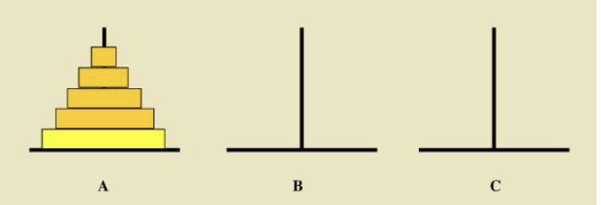

## 理论课内容


课程材料：26FIP6 递归.pdf

### 递归

#### 汉诺塔问题

> 印度传说大梵天创世时制作了三根金刚石柱。在一根柱子上从下往上按照大小顺序摞着64片黄金圆盘。大梵天命令婆罗门把圆盘从下面按照大小顺序重新摆放在另一根柱子上。规定：在小圆盘上不能放大圆盘，在三根柱子之间一次只能移动一个圆盘。



如果使用普通的循环问题考虑，想要描述64片圆盘从A柱子移到C柱子，会陷入几乎无穷无尽的条件判断。这个问题是难以通过普通的枚举解决的。

但是我们可以换一种思维方式：
**假设我们已经知道了如何把63片圆盘从一根柱子移动到另外一根柱子**。那么整个问题就可以化归为：先把63片移动到B柱子，再把最大的圆盘移动到C柱子，再用同样的方法把63片圆盘移动到C柱子。

这种思维就是**递归**。

> **递归四原则**（Mark Allen Weiss, 《数据结构与算法分析》）
> 
> 1. **基准情形**(Base Cases)：必须总有某些基准情形，无须递归就能直接求解，作为递归的出口。
> 2. **不断推进**(Making Progress)：对于需要递归求解的情形，每一次递归调用都必须使状况朝向基准情形推进。
> 3. **设计法则**(Design Rule——You Gotta Believe!)：假设所有的递归调用都能正常运行，专注于用递归假设来构建当前步骤，而无需追踪每一层调用的细节。
> 4. **合成效益法则**(Compound Interest Rule)：在求解同一问题的同一实例时，切勿在不同的递归调用中做重复性的工作。

#### 递归求解汉诺塔问题

用算法的语言描述，上述问题和方法可以描述为：
问题：把$n$个圆盘从source柱移到target柱，aux柱可以作为辅助
- **Progress**（把$n$个盘从source柱移动到target柱的方法是）：

	- 把上面的$n-1$个盘从source移到aux（**假设我们可以解决这个子问题**）

	- 把第$n$个盘从source移动到target

	- 把$n-1$个盘从aux移动到target（**假设我们可以解决这个子问题**）
	
- **Base Case**：没有盘（$n=0$），直接结束。

```python
def hanoi(n, source, target, aux):
	if n == 0:
		return
	hanoi(n - 1, source, aux, target)
	print(f"Move disk {n} from {source} to {target}")
	hanoi(n - 1, aux, target, source)
```


当$n=3$时，调用树如下：

```text
hanoi(3, A, C, B) 
├── hanoi(2, A, B, C) 
│   ├── hanoi(1, A, C, B) 
│   │    ├── hanoi(0, A, B, C) → 返回 
│   │    ├── move 1 from A to C 
│   │    └── hanoi(0, B, A, C) → 返回 
│   ├── move 2 from A to B 
│   └── hanoi(1, C, B, A) ... 
├── move 3 from A to C 
└── hanoi(2, B, C, A) ... 
```

#### Always Believe

就个人体会而言，**递归**对于初学者来说是比较反直觉的，但是可以这样思考：我们在写的只不过是对子问题的整合，而不是真正在“解决”这个问题，我们只需要相信子问题是对的，整合这些子问题的解法，就足够了。

#### 递进与回归

- 递归的执行可以拆分为“递进”和“回归”两个阶段
- 递归总是从要解决的问题的最大状态开始
- 在递进阶段，问题不断被分解、缩小，直到遇到base case；有些计算也会在调用前完成
- 在回归阶段，从已知结果的base case出发，按照递进的反方向逐层返回；阶乘中的乘法就在此时完成

> **递归的底层实现**
> 如果你熟悉数据结构，会发现递归的实现方法和 **“栈”** 是强相关的。递归在“递进”阶段事实上是在一个栈中不断加入新的调用层，最大规模问题的调用层在栈底，base case的调用层被加到栈顶后，我们触发“回归”例程，按照**后进先出(LIFO)原则**，从base case出发，向下触发越来越大规模问题的子调用例程，完成一层调用后就让这个调用层出栈。直到栈空（所有调用层都被调用完成），就得到原始问题的答案。
> 这个对原理的讨论也让我们更加清楚，为什么**Base Case**是极其重要的：如果没有出口，或者参数始终无法到达出口，Python最终会抛出`RecursionError`。

### 阶乘：线性递归

$$
n!=\begin{cases}
1, & n=0\\
n\times(n-1)!, & n>0
\end{cases}
$$

```python
def factorial(n):
	if n == 0:
		return 1
	return n * factorial(n - 1)
```

`factorial(4)`先逐层调用到`factorial(0)`，再依次算出`1!`、`2!`、`3!`、`4!`。每层只产生一个子调用：时间$O(n)$，调用栈$O(n)$。汉诺塔则每层产生两次规模为$n-1$的调用，移动次数满足$T(n)=2T(n-1)+1=2^n-1$，调用栈深度为$O(n)$。

### 斐波那契数列问题：合成效益法则的重要性

考虑最经典的斐波那契数列问题

#### 递归定义斐波那契数列

$$
f(n)=\begin{cases}
n, & n=0\text{ 或 }1\\
f(n-1)+f(n-2), & n>1
\end{cases}
$$

#### 代码实现

```python
def fib(n):
	if n == 0 or n == 1:
		return n
	return fib(n -1) + fib(n - 2)
```

#### 调用树

```text
fib(5)
├── fib(4) 
│   ├── fib(3) 
│   │   ├── fib(2) 
│   │   │   ├── fib(1) 
│   │   │   └── fib(0)
│   │   └── fib(1)
│   └── fib(2)
│       ├── fib(1)
│       └── fib(0)
└── fib(3)
    ├── fib(2) 
    │   ├── fib(1)
    │   └── fib(0) 
    └── fib(1)
```

这是一个树状递归，算法的效率事实上**远低于**一般的迭代算法。**为什么？** 因为这个算法违反了之前所说的**合成效益法则**：`fib(2)`被计算了**3次**，`fib(1)`被计算了**5次**，也就是说我们**重复计算了多次同一个子问题** ，这样会导致算法的效率极其低下。

#### 复杂度分析

- 每次调用产生2个子调用，递归树深度为$n$
- 时间复杂度为$O(2^n)$
- 调用栈深度为$O(n)$

### 斐波那契数列的记忆化优化递归算法

既然重复计算会导致算法效率极大下降，那我们不妨**记录已经算出过的调用值**，因为我们几乎肯定在数据规模增大时，前面算出的数值一定会被后续调用层调用，减少重复计算的收益远高于储存计算结果的开销。

```python
def fib_memo(n, memo=None):
	if memo is None:
		memo = {}
	if n in memo:
		return memo[n]
	if n == 0 or n == 1:
		result = n
	else:
		result = fib_memo(n - 1, memo) + fib_memo(n - 2, memo)
	memo[n] = result
	return result
```

通过记忆化，每个不同的$n$只计算一次，时间和缓存空间都是$O(n)$；递归调用栈仍是$O(n)$。默认参数写成`None`，避免多次调用共用同一个可变字典。

### `@lru_cache`：函数进、函数出

手写的`memo`可以换成库：

```python
from functools import lru_cache

@lru_cache(maxsize=None)
def fib(n):
	if n == 0 or n == 1:
		return n
	return fib(n - 1) + fib(n - 2)
```

> `@`是装饰器：输入一个函数，返回一个**增强后的函数**（带有cache）。内部是函数进、函数出，也即**高阶函数**。缓存的键来自函数参数，参数必须可哈希；`maxsize=None`表示不限制缓存条目数。`fib.cache_info()`可查看命中情况，需要重新统计或清空缓存时调用`fib.cache_clear()`

### Euclid算法

辗转相除法也可以写成递归函数的形式，这里直接给出代码形式：

```python
def gcd(x, y):
	if y == 0:
		return x
	return gcd(y, x % y)
```

### 尾递归(tail recursion)

- 当递进结束时，不对递进调用返回的值再做任何计算就直接返回的是尾递归：
	- `return gcd(y, x % y)`
- 尾调用返回后没有待完成的计算，但在Python中它仍然会占用调用栈；Python不会自动把它优化成循环

#### 尾递归和循环的转化

```python
def gcd(x, y):
	while y != 0:
		x, y = y, x % y
	return x
```

#### 一般递归与循环的转化（递归变迭代）

```python
# 引入结果变量p，改造为尾递归
def f(n, p=1):
	if n == 0 or n == 1:
		return p
	else:
		return f(n - 1, p * n)

# 把尾递归改写为循环	
def f(n, p=1):
	while n != 0 and n != 1:
		n, p = n - 1, n * p
	return p
```

把（线性）递归往往可以改写为循环，而这往往可以提高程序运行的性能。换言之，递归可以作为算法思考的方法，具体的实现方法可以通过改写为循环实现。

### Quick Check 3

已知`first(xs)`返回第一个元素，`butfirst(xs)`返回去掉首元素后的剩余列表，`isempty(xs)`判断列表是否为空。不使用循环，实现`count`、`reverse`、`find`、`iterate`和讲义中的`accumarate`（累计）。以下默认`xs`支持构造空列表、单元素列表以及列表拼接。

```python
def count(xs):
	if isempty(xs):
		return 0
	return 1 + count(butfirst(xs))

def reverse(xs):
	if isempty(xs):
		return []
	return reverse(butfirst(xs)) + [first(xs)]

def find(xs, element):
	if isempty(xs):
		return False
	return first(xs) == element or find(butfirst(xs), element)

def iterate(xs, f):
	if isempty(xs):
		return
	f(first(xs))
	iterate(butfirst(xs), f)

def accumarate(xs, f, value):
	if isempty(xs):
		return value
	return accumarate(butfirst(xs), f, f(first(xs), value))
```


五题的**Base Case**都是空列表：数量为`0`、逆序为空列表、查找为`False`、遍历直接结束、累计则返回当前`value`；**Progress**都是递归处理`butfirst(xs)`。`reverse`必须把当前首元素放在剩余列表逆序结果的末尾；`find`借助`or`短路，找到后不再继续查；`iterate`先调用`f`再递归，保持原有顺序；`accumarate`先算`f(first(xs), value)`，再把新值交给下一层，所以`f`的两个参数顺序不能颠倒。

## 阅读材料补充


课程材料：6 递归阅读材料.pdf

### 递归四基础


| 基础 | 含义 | 缺了会怎样 |
|---|---|---|
| Base Case | 最小规模直接返回，不再递归 | 无限递归，最终`RecursionError` |
| Make Progress | 每次调用都向Base Case靠近 | 规模不变或变大，同样无法结束 |
| Always Believe | 相信子调用能正确解决更小的问题，只考虑当前层如何组合 | 总想展开完整调用树，难以写清递推关系 |
| Compound Interest | 同一子问题不要反复计算 | 树状递归可能出现指数级重复计算 |

思考时通常**先想Progress，再找Base Case**。例如汉诺塔先假设会移动上面`n-1`个盘，于是当前层只需“移走上层 → 移最大盘 → 移回上层”；顺着规模不断缩小，才得到`n=0`时什么也不做。阶乘则是先相信`factorial(n-1)`已算好，再乘`n`。

| 常见问题 | 应如何检查 |
|---|---|
| 忘记Base Case | 手推`n=0`或`n=1`，确认直接返回 |
| 有出口却到不了 | 看每次参数是否严格缩小；`n<0`时一直做`n-1`就到不了`0` |
| 汉诺塔柱子传错 | 每次递归重新辨认`source`、`target`、`aux`的角色 |
| 试图手推所有步骤 | 只手推小规模，写代码时相信子问题的返回结果 |

### 线性递归与尾递归


每层只调用一次自身的是**线性递归**；阶乘和欧几里得算法都是例子。`factorial(5)`在递进时依次走向`5 → 4 → 3 → 2 → 1`，回归时结果依次为`1 → 2 → 6 → 24 → 120`。阶乘的乘法要等子调用返回后才能完成。

| 判断点 | 尾递归 | 非尾递归 |
|---|---|---|
| 返回形式 | `return gcd(y, x % y)` | `return n * factorial(n-1)` |
| 子调用返回后 | 直接返回，没有额外计算 | 还要乘、加或合并 |
| 例子 | GCD | 阶乘、朴素斐波那契 |

“写在最后一行”不足以判断尾递归；关键是**回归阶段还要不要计算**。将尾递归改为循环时，用`while`保留重复过程，把Base Case改成退出条件，并按原Progress同时更新循环变量。GCD中要一起更新`x, y = y, x % y`，不能先改`x`再用新`x`计算余数。Python不会自动消除尾递归，深层调用仍可能抛出`RecursionError`；可以改写为循环。

| 改写时的错误 | 修正 |
|---|---|
| 把函数末尾的递归调用都当作尾递归 | 看子调用返回后是否还有运算 |
| 循环版漏更新某个变量 | 逐一对照递归调用中的下一轮参数 |
| 认为尾递归不会占用栈 | Python中深层尾递归仍有调用栈 |

### 树状递归、记忆化与默认参数


`fib(n)`每次需要`fib(n-1)`和`fib(n-2)`，因而形成树状调用；`fib(5)`中`fib(2)`会计算3次，`fib(1)`会计算5次。朴素版时间约`O(2^n)`。把结果存入字典后，每个不同的`n`只计算一次，时间变为`O(n)`。

| 项目 | 线性递归 | 无记忆化的树状递归 |
|---|---|---|
| 每层子调用 | 一次 | 两次或更多 |
| 调用形状 | 一条链 | 一棵树 |
| 重复计算 | 通常没有 | 常见 |
| 典型处理 | 可考虑改循环 | 记忆化或自底向上递推 |

手写`fib_memo(n, memo=None)`时，第一次调用若`memo is None`才创建空字典；后续递归调用都传入**同一个字典**。`memo={}`不能直接写成默认值，因为默认值只在定义函数时求值一次，多次外层调用会共用字典。有默认值的形参也须放在无默认值形参后面。

| 陷阱 | 原因与处理 |
|---|---|
| `memo={}`作为默认参数 | 字典跨调用共享；用`None`作哨兵，在函数内新建 |
| 子调用漏传`memo` | 每层重新建字典，无法共享结果；递归时继续传`memo` |
| 多组测试要独立统计 | 每组新建字典，或清空装饰器缓存 |
| 以为记忆化消除递归深度 | 它消除重复计算，调用栈仍可能达到`O(n)` |

### 多维状态与缓存键


缓存键必须包含**全部决定答案的状态**。格子版杨辉三角`pascal(n, k)`由行`n`、列`k`共同决定，仅以`n`为键会把同一行的不同格子混在一起。

```python
def pascal_cell(n, k, memo=None):
	if memo is None:
		memo = {}
	if k == 0 or k == n:
		return 1
	key = (n, k)
	if key not in memo:
		memo[key] = (pascal_cell(n - 1, k - 1, memo)
		             + pascal_cell(n - 1, k, memo))
	return memo[key]
```


| 键的写法 | 结果 |
|---|---|
| `n` | 漏掉`k`，不同格子可能共用错误答案 |
| `[n, k]` | 列表不可哈希，不能作字典键 |
| `(n, k)` | 元组可哈希，能完整表示状态 |

这里的格子版只用于理解缓存键；研讨课实现的是返回**整行**的`pascal(n)`。

### `functools.lru_cache`


`@lru_cache`把缓存放进装饰器，适合“相同参数总得到相同结果”的计算函数。本周会使用、能认出`@`即可，不要求手写装饰器。

| 项目 | 用法 |
|---|---|
| `@lru_cache(maxsize=None)` | 缓存条目数不设上限 |
| `@lru_cache(maxsize=128)` | 最多保留128项，按最近使用情况淘汰旧项 |
| `typed=False` | 默认值，不保证区分不同参数类型 |
| `typed=True` | 按参数类型区分缓存键 |
| `cache_info()` | 返回`hits`、`misses`、`maxsize`、`currsize` |
| `cache_clear()` | 清空缓存，返回`None` |

```python
from functools import lru_cache

@lru_cache(maxsize=None)
def fib_cached(n):
	if n <= 1:
		return n
	return fib_cached(n - 1) + fib_cached(n - 2)

fib_cached(10)
print(fib_cached.cache_info())
fib_cached.cache_clear()
```


多参数函数会自动把参数组成缓存键，不必自己写`(n, k)`；但**参数须可哈希**，列表、字典、集合不能直接作参数。返回列表可以，不过不应改动已缓存的返回值。带输入输出、副作用或依赖可变外部状态的函数不适合缓存，因为命中缓存时不会执行函数体。

| 对比 | 手写字典`memo` | `@lru_cache` |
|---|---|---|
| 缓存键 | 自行设计 | 自动根据参数生成 |
| 容量 | 自己管理 | `maxsize`控制 |
| 统计 | 需自己实现 | `cache_info()` |
| 适用 | 需要自定义状态或缓存行为 | 参数可哈希的纯计算函数 |

### 类型注解与递归审查


| 写法 | 读法 |
|---|---|
| `list[int]` | 元素预期为`int`的列表 |
| `int \| None` | 值可能是整数，也可能是`None` |

类型注解是给读代码的人和静态工具看的，Python运行时不会自动据此检查实参类型。

| 检查项 | 具体看什么 |
|---|---|
| Base Case | 小规模输入能否直接返回；非法输入是否会无限递归 |
| Progress | 参数是否严格向出口靠近 |
| 合并结果 | 阶乘是否乘回`n`；杨辉三角是否正确拼接 |
| 记忆化键 | 是否包含所有维度；键能否哈希 |
| 缓存使用 | 参数是否可哈希，函数是否有副作用，是否需要清空缓存 |
| 类型注解 | 是否把标注误当作运行时检查 |

要求生成递归代码时，要先写清输入输出、Base Case、Progress和返回值的组合方式；得到代码后仍用小规模轨迹逐项核对。

## 研讨课内容


课程材料：6 递归-研讨课.pdf

### 任务一：先读`fib(4)`调用树


不运行代码，先画出完整调用树：

```text
fib(4)
├── fib(3)
│   ├── fib(2)
│   │   ├── fib(1)
│   │   └── fib(0)
│   └── fib(1)
└── fib(2)
    ├── fib(1)
    └── fib(0)
```


| 问题 | 结果 |
|---|---|
| 包含`fib(4)`自身，共调用几次？ | 9次 |
| `fib(2)`调用几次？ | 2次 |
| 重复从哪里来？ | 两条分支都重新计算同一个`fib(2)` |

这正是后面杨辉三角“上一行不要算两遍”的引子。

### 任务二：整行杨辉三角的递推关系


本节的`pascal(n)`返回**第`n`行整个列表**，从第0行计数；返回单个格子的`pascal(n, k)`留到后续课程。

| 行号 | 返回值 |
|---|---|
| 0 | `[1]` |
| 1 | `[1, 1]` |
| 2 | `[1, 2, 1]` |
| 3 | `[1, 3, 3, 1]` |
| 4 | `[1, 4, 6, 4, 1]` |

| 部分 | 规则 |
|---|---|
| Base Case | `pascal(0)`返回`[1]` |
| Progress | 先得到上一整行`prev = pascal(n-1)` |
| 当前行两端 | 都是`1` |
| 当前行中间 | `prev[i] + prev[i+1]` |
| 结果长度 | 第`n`行有`n+1`个元素 |

上一行长度为`n`，有`n-1`对相邻元素。想清楚函数返回的是“整行”，才不会把整行问题写成逐个格子重复求值。

### 坏写法：上一行在循环中反复计算


```python
def pascal_bad(n):
	if n == 0:
		return [1]
	row = [1]
	for i in range(n - 1):
		row.append(pascal_bad(n - 1)[i] + pascal_bad(n - 1)[i + 1])
	row.append(1)
	return row
```


`pascal_bad(3)`有两个中间元素，每个元素两次调用`pascal_bad(2)`，因此仅顶层就调用上一行**4次**；这些调用又会继续重复计算更小的行。结果虽对，计算却会迅速膨胀。

| 现象 | 原因 |
|---|---|
| `pascal_bad(16)`可能明显变慢 | 同一上一行在循环内反复递归生成 |
| `pascal_bad(1)`没有中间元素 | 仍须在末尾补`1`，结果才是`[1, 1]` |
| 加了记忆化后可能变快 | 重复调用命中缓存，但没有解决写法上不必要的重复请求 |

### 好写法：上一行只求一次


```python
def pascal(n):
	if n == 0:
		return [1]
	prev = pascal(n - 1)
	row = [1]
	for i in range(len(prev) - 1):
		row.append(prev[i] + prev[i + 1])
	row.append(1)
	return row
```


| `pascal(3)`的阶段 | 结果 |
|---|---|
| 递进 | `3 → 2 → 1 → 0` |
| Base Case | `pascal(0) → [1]` |
| 回归一层 | `pascal(1) → [1, 1]` |
| 再回归 | `pascal(2) → [1, 2, 1]` |
| 最后回归 | `pascal(3) → [1, 3, 3, 1]` |

每层只调用一次上一行，调用关系是一条链。第`k`行拼接花`O(k)`，从第0行到第`n`行总时间为`O(n^2)`；调用栈深`O(n)`，各层保留的行可能使峰值空间达到`O(n^2)`。

也可以用列表推导式拼当前行，但**上一行仍须先存进变量**：

```python
def pascal(n):
	if n == 0:
		return [1]
	prev = pascal(n - 1)
	return [1] + [prev[i] + prev[i + 1]
	              for i in range(len(prev) - 1)] + [1]
```


若加`@lru_cache`，键`n`是可哈希的整数；返回列表本身不妨碍缓存，但不要修改缓存返回的列表。

### 任务三：迭代实现


递归版是从第`n`行问到第0行，再逐层回归；迭代版从第0行出发，一行一行生成到第`n`行。

```python
def pascal_iter(n):
	row = [1]
	for _ in range(n):
		new_row = [1]
		for i in range(len(row) - 1):
			new_row.append(row[i] + row[i + 1])
		new_row.append(1)
		row = new_row
	return row
```


`pascal_iter(4)`返回`[1, 4, 6, 4, 1]`。它与好写法都构造前面各行，时间同为`O(n^2)`；迭代版只保留当前行和新行，额外空间`O(n)`，且没有递归调用栈。

| 实现 | 上一行的处理 | 时间 | 空间 | 使用时的判断 |
|---|---|---|---|---|
| 坏写法 | 每拼一个中间项就重新递归 | 重复计算严重 | 调用数膨胀 | 避免 |
| 好写法 | 递归一次，存入`prev` | `O(n^2)` | 最坏`O(n^2)` | 便于理解递推 |
| 迭代 | 从第0行逐行更新`row` | `O(n^2)` | `O(n)` | 大规模时更稳妥 |

### 易错点与代码审查


| 错误 | 现象 | 修正 |
|---|---|---|
| `pascal(0)`返回`[]`或`1` | 类型或长度不对 | 返回列表`[1]` |
| 忘记行末`append(1)` | 每行少一个`1` | 中间元素拼完后补末尾 |
| 循环到`len(prev)`仍取`prev[i+1]` | `IndexError` | 使用`range(len(prev)-1)` |
| 在循环中调用`pascal(n-1)` | 同一行反复计算 | 先保存`prev` |
| 缓存键用列表 | `TypeError` | 整行版以整数`n`作键 |

对照代码时，先手推`pascal(0)`到`pascal(3)`，再检查Base Case、`n-1`是否真正缩小问题、上一行是否只算一次、行末是否补`1`。汉诺塔可用`n=3`的移动序列核对柱子顺序。若把文件引用给工具审查，仍应明确写出这些检查条件；文件引用只提供上下文，不会代替规格。
