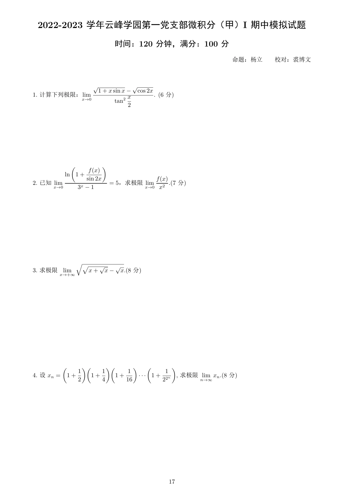
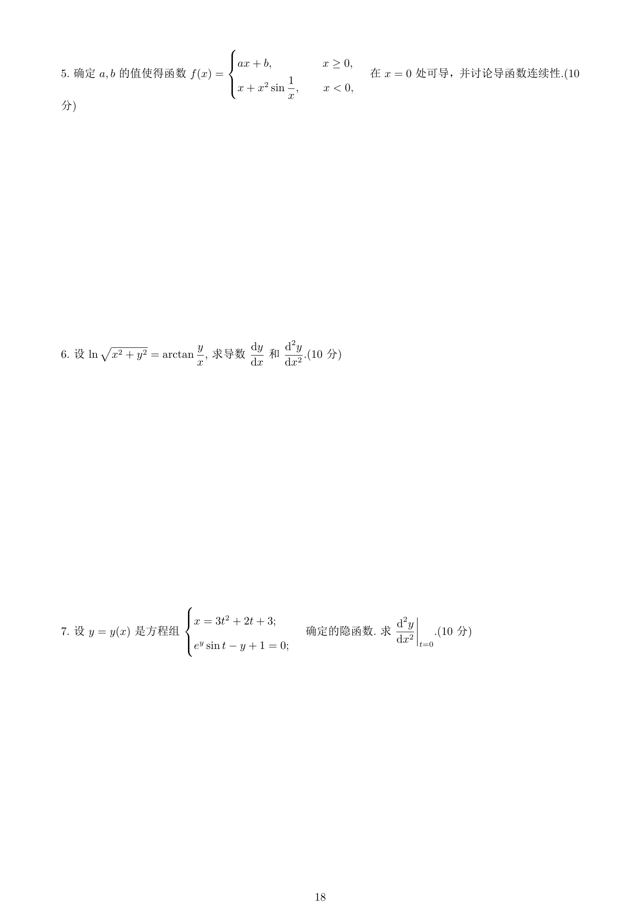
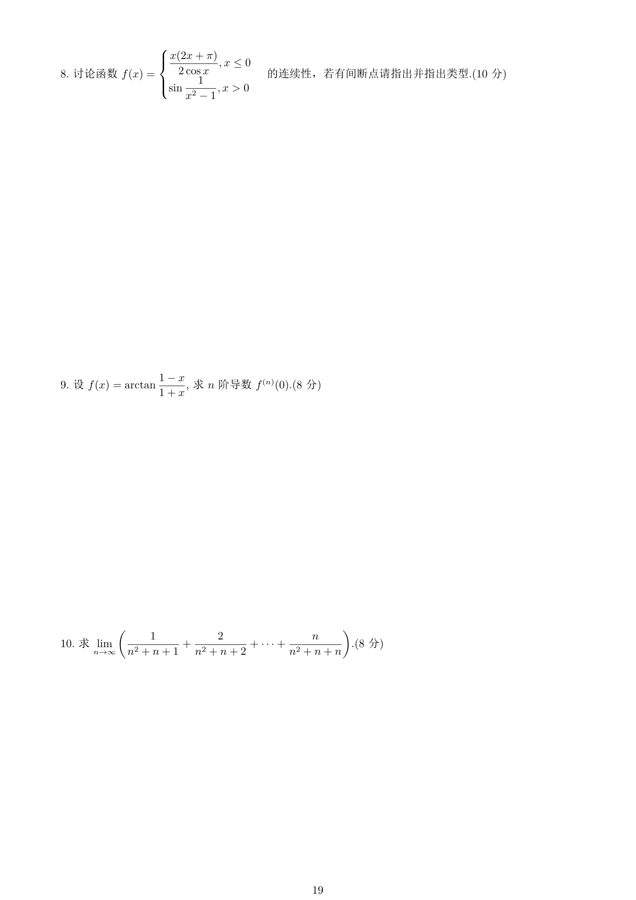
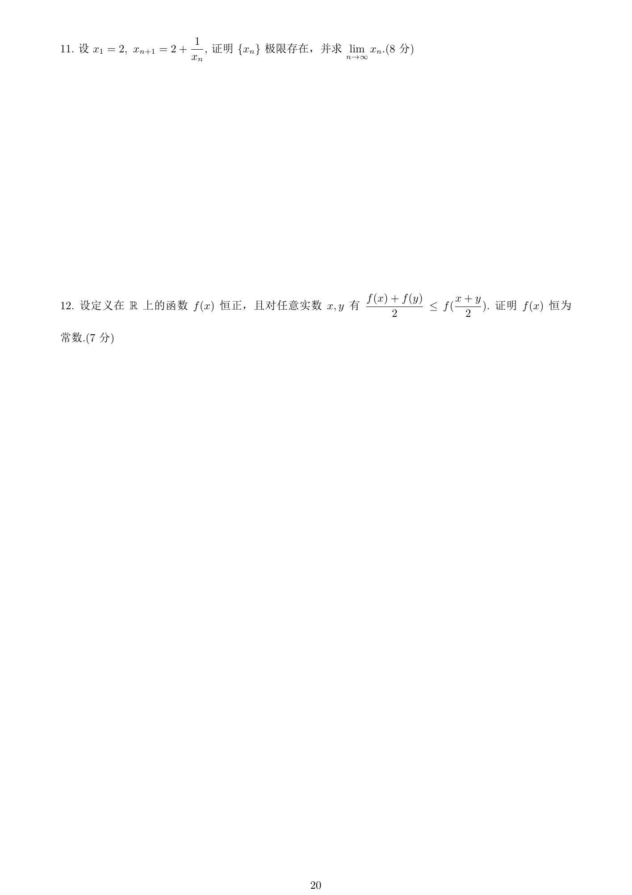
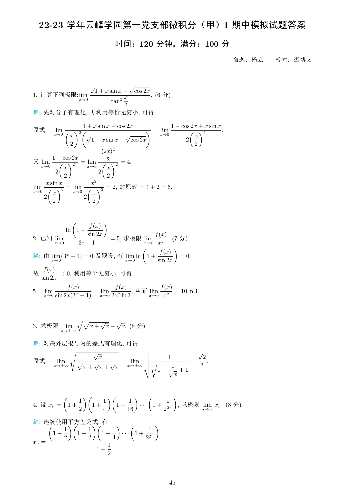
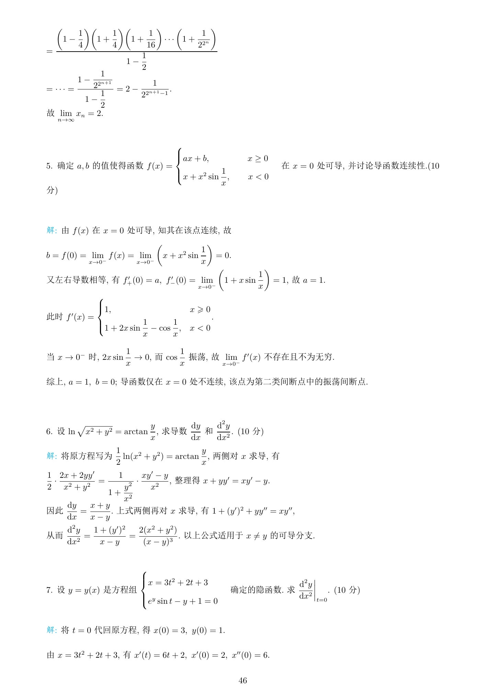
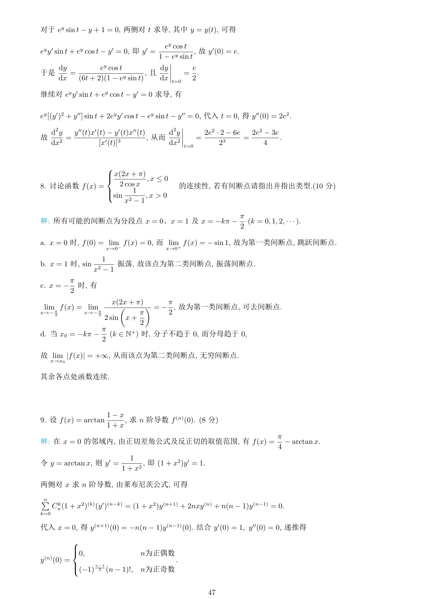
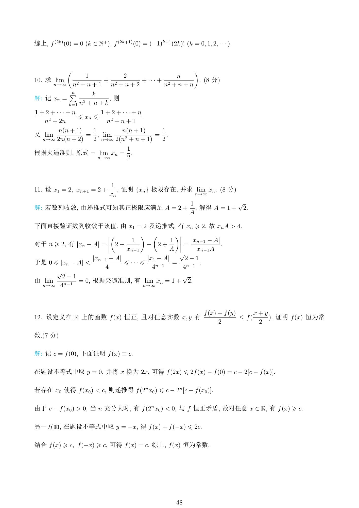

来源：云峰学园第一党支部微积分（甲）Ⅰ期中模拟试卷及答案汇编，杨立命题。考试时间 120 分钟，满分 100 分。本卷共 12 道正题。

::: {.download-box}
[下载原始试卷 PDF ↓](/assets/pdf/exams/original/calculus-midterm-mock-2022-2023-original.pdf){download="calculus-midterm-mock-2022-2023-original.pdf"}
:::

## 第一部分：题目 {#questions}

### 题目 · 第 1 页

{fig-alt="2022-2023 微积分期中模拟卷题目第 1 页" width="100%" loading="lazy"}

### 题目 · 第 2 页

{fig-alt="2022-2023 微积分期中模拟卷题目第 2 页" width="100%" loading="lazy"}

### 题目 · 第 3 页

{fig-alt="2022-2023 微积分期中模拟卷题目第 3 页" width="100%" loading="lazy"}

### 题目 · 第 4 页

{fig-alt="2022-2023 微积分期中模拟卷题目第 4 页" width="100%" loading="lazy"}

## 第二部分：详细解析 {#solutions}

### 解析 · 第 1 页

{fig-alt="2022-2023 微积分期中模拟卷详细解析第 1 页" width="100%" loading="lazy"}

### 解析 · 第 2 页

{fig-alt="2022-2023 微积分期中模拟卷详细解析第 2 页" width="100%" loading="lazy"}

### 解析 · 第 3 页

{fig-alt="2022-2023 微积分期中模拟卷详细解析第 3 页" width="100%" loading="lazy"}

### 解析 · 第 4 页

{fig-alt="2022-2023 微积分期中模拟卷详细解析第 4 页" width="100%" loading="lazy"}

## 第三部分：知识点总结 {#summary}

### 考点梳理

- 根式极限。

- 复合对数极限。

- 数列乘积与裂项。

- 分段函数的可导性及导函数连续性。

- 隐函数二阶导数。

- 参数求导。

- 间断点分类。

- 反三角函数高阶导数。

- 变项求和。

- 单调递推。

- 函数方程。

### 解题检查

- 极限计算先确认定义域、趋近方向与所需展开阶数。
- 分段函数先检查连续性，再比较左右导数。
- 参数二阶导数注意求导对象，并保留分母非零条件。
- 数列先证明收敛，再对递推关系取极限。
- 使用介值定理和中值定理前，核对区间及连续、可导条件。
