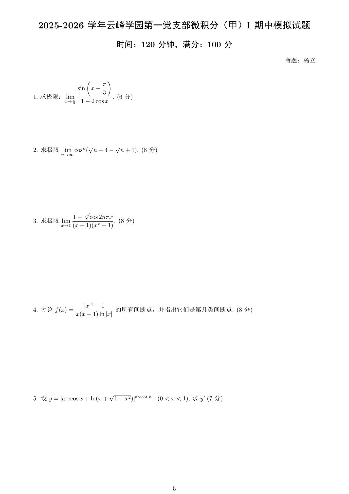
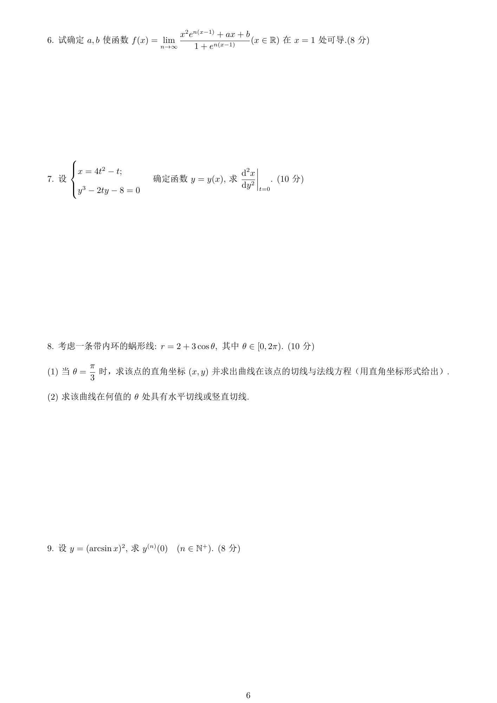
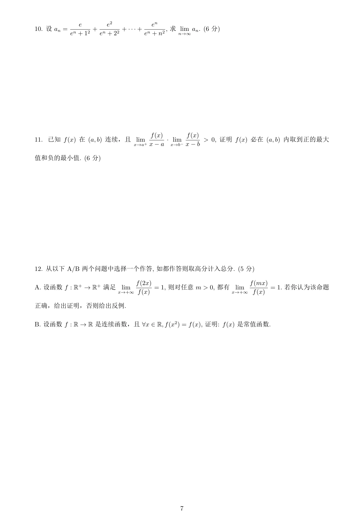
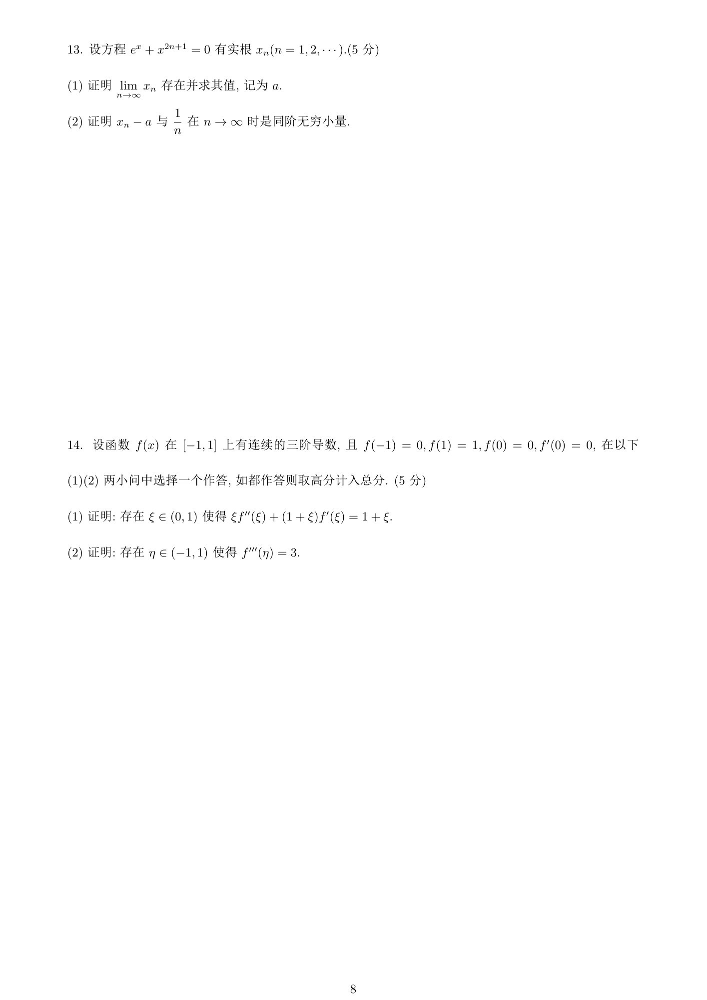
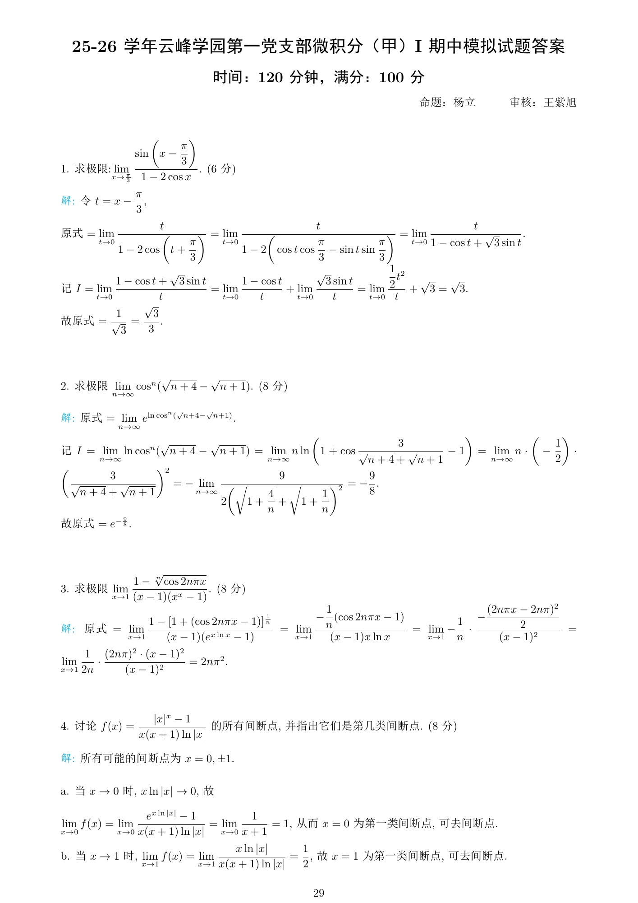
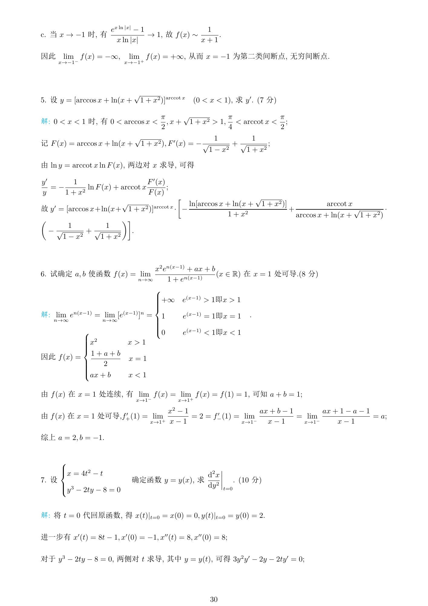
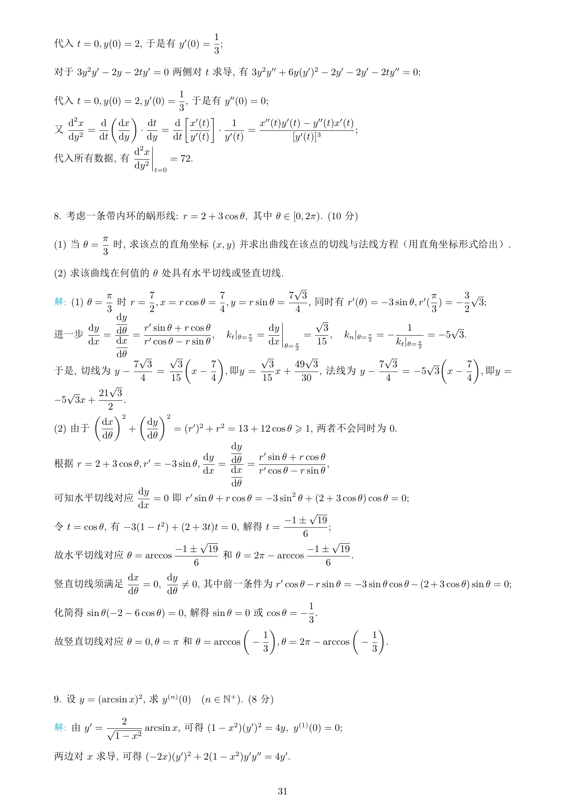
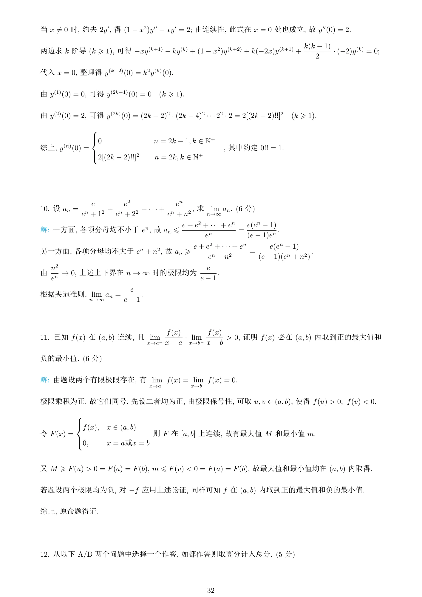
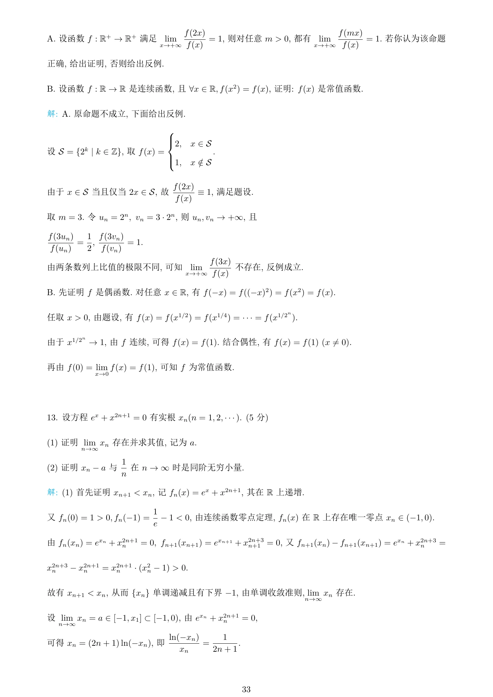
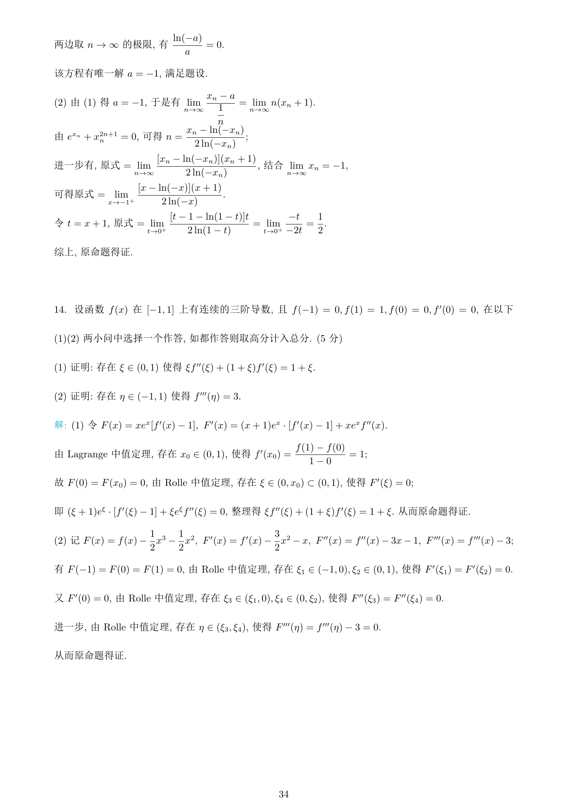

来源：云峰学园第一党支部微积分（甲）Ⅰ期中模拟试卷及答案汇编，杨立命题。考试时间 120 分钟，满分 100 分。本卷共 14 道正题。

::: {.download-box}
[下载原始试卷 PDF ↓](/assets/pdf/exams/original/calculus-midterm-mock-2025-2026-original.pdf){download="calculus-midterm-mock-2025-2026-original.pdf"}
:::

## 第一部分：题目 {#questions}

### 题目 · 第 1 页

{fig-alt="2025-2026 微积分期中模拟卷题目第 1 页" width="100%" loading="lazy"}

### 题目 · 第 2 页

{fig-alt="2025-2026 微积分期中模拟卷题目第 2 页" width="100%" loading="lazy"}

### 题目 · 第 3 页

{fig-alt="2025-2026 微积分期中模拟卷题目第 3 页" width="100%" loading="lazy"}

### 题目 · 第 4 页

{fig-alt="2025-2026 微积分期中模拟卷题目第 4 页" width="100%" loading="lazy"}

## 第二部分：详细解析 {#solutions}

### 解析 · 第 1 页

{fig-alt="2025-2026 微积分期中模拟卷详细解析第 1 页" width="100%" loading="lazy"}

### 解析 · 第 2 页

{fig-alt="2025-2026 微积分期中模拟卷详细解析第 2 页" width="100%" loading="lazy"}

### 解析 · 第 3 页

{fig-alt="2025-2026 微积分期中模拟卷详细解析第 3 页" width="100%" loading="lazy"}

### 解析 · 第 4 页

{fig-alt="2025-2026 微积分期中模拟卷详细解析第 4 页" width="100%" loading="lazy"}

### 解析 · 第 5 页

{fig-alt="2025-2026 微积分期中模拟卷详细解析第 5 页" width="100%" loading="lazy"}

### 解析 · 第 6 页

{fig-alt="2025-2026 微积分期中模拟卷详细解析第 6 页" width="100%" loading="lazy"}

## 第三部分：知识点总结 {#summary}

### 考点梳理

- 周期性与等价无穷小。

- 极限定义函数的可导条件。

- 参数二阶导数。

- 蜗形线切线。

- 高阶导数递推。

- 反例构造。

- 隐式数列的收敛与同阶无穷小。

- 三阶导数的存在性证明。

### 解题检查

- 极限计算先确认定义域、趋近方向与所需展开阶数。
- 分段函数先检查连续性，再比较左右导数。
- 参数二阶导数注意求导对象，并保留分母非零条件。
- 数列先证明收敛，再对递推关系取极限。
- 使用介值定理和中值定理前，核对区间及连续、可导条件。
