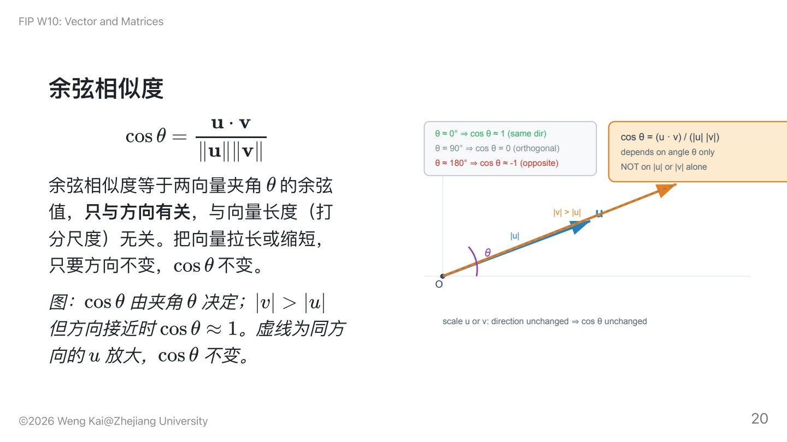
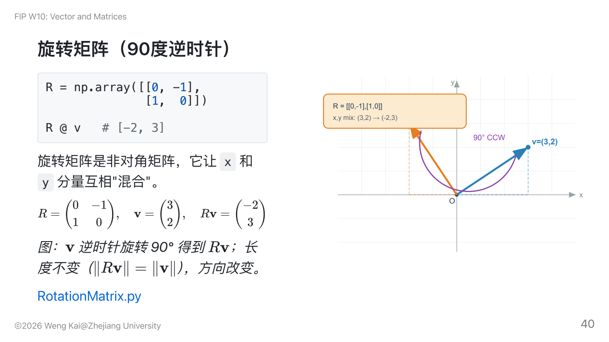
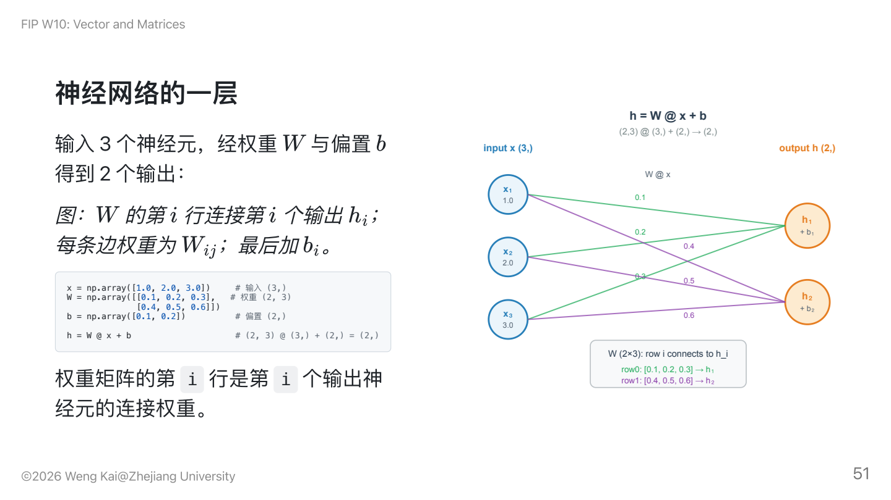

## 理论课内容

### Quick Recap

前两周使用了两套术语体系，分别对应数据结构和Python实现。

| Data Structure    | Python        |
| ----------------- | ------------- |
| array             | list/tuple    |
| linked list       | class define  |
| circular queue    | list simulate |
| queue/deque/stack | deque         |
| priority queue    | heapq         |

本周的“向量与矩阵”主题是传统数据结构和程序设计课程中不包含的，本周课程与线性代数课程高度相关，某种意义下本周的课程学习的核心对象是`NumPy`。

### NumPy

#### Python列表的局限

Python列表无法做矩阵运算，且遍历访问速度很慢。

#### NumPy Array

可以使用`np.array()`创建`NumPy`数组，这里的数组基本就是数据结构意义上的严格数组，满足：

 - 大小固定
 - 类型相同
 - 连续存储

```python
import numpy as np

scores = np.array([
	[85, 90, 78],
	[92, 88, 84],
	[78, 85, 90]
])
```

`numpy array`具有一些属性：
- `shape`：数组的形状，以元组形式呈现（单个元素时逗号不可省略）
- `dtype`：元素的数据类型
- `ndim`：数组的轴数
- `size`：数组中的元素个数
- `itemsize`：每个元素占用的字节数；数值数组的数据大小为 `size * itemsize`

##### 区分维度和`ndim`

数学上的维度和`NumPy ndim`是不同的概念

| 数学                  | NumPy: `ndim`     |
| ------------------- | ----------------- |
| 向量有几个分量             | 数组有**几条轴**（嵌套了几层） |
| `[5, 1, 2, 4]`是4维向量 | `ndim == 1`是一维数组  |

`(4,)` 是一维数组，`(1,4)` 是二维行数组，`(4,1)` 是二维列数组。三者都有4个元素。一维数组 `.T` 转置不改变形状。

#### 列表与数组的运算区别


| 操作   | Python `list` | NumPy `ndarray`          |
| ---- | ------------- | ------------------------ |
| `+`  | 拼接            | 逐元素相加                    |
| `*`  | 重复            | 逐元素相乘                    |
| 矩阵乘法 | 需另行实现         | `@` 或 `np.matmul`        |
| 元素类型 | 可混合           | 同一 `dtype`，混合输入可能转换类型或报错 |

数组的形状通常固定，改变元素个数往往需要重新分配。新建数值数组通常连续存储，但切片、转置得到的视图不一定连续。

### 向量：用一组数表示对象


用户偏好、文档词频、图像像素（3个RGB通道）等都可以表示为向量。需要注意的是各分量的含义和顺序必须一致才能比较，否则没有实际意义。

```python
# 这里数据预保存为浮点数，后续可以原地归一化，否则会因为数据类型由整型变为浮点型报错
alice = np.array([5., 1., 2., 4.])
bob = np.array([4., 2., 1., 5.])
```


| 运算    | 数学含义                                     | NumPy                       |
| ----- | ---------------------------------------- | --------------------------- |
| L2范数  | $\|v\|_2=\sqrt{\sum_i v_i^2}$，向量长度       | `np.linalg.norm(v)`         |
| 内积    | $u\cdot v=\sum_i u_iv_i$                 | `np.dot(u, v)` 或一维的 `u @ v` |
| 余弦相似度 | $\cos\theta=\frac{u\cdot v}{\|u\|\|v\|}$ | 内积除以两范数之积                   |
| 欧氏距离  | $d(u,v)=\|u-v\|_2$                       | `np.linalg.norm(u - v)`     |

> 除了L2范数（欧几里得距离）之外，还有L1范数（曼哈顿距离）等比较常用的范数。

内积也满足 $u\cdot v=\|u\|\|v\|\cos\theta$。



余弦相似度取值为 $[-1,1]$：`1` 同向，`0` 正交，`-1` 反向。非零向量整体乘正数不改变余弦；欧氏距离则保留绝对差距。比较偏好方向常用余弦，比较同尺度下的远近常用欧氏距离。

`cosine_similarity` 和 `euclidean_distance` 是下面自行定义的函数，不是 NumPy 内置函数。NumPy 提供 `np.dot` 和 `np.linalg.norm`，我们用它们实现相似度与距离计算。

```python
def cosine_similarity(u, v):
    denominator = np.linalg.norm(u) * np.linalg.norm(v)
    if denominator == 0:
        raise ValueError("零向量的余弦相似度无定义")
    return np.dot(u, v) / denominator

def euclidean_distance(u, v):
    return np.linalg.norm(u - v)
```


Alice与Bob：内积为 `44`，两者范数均为 $\sqrt{46}$，余弦为 $44/46\approx0.957$，欧氏距离为 `2`。注意 `np.abs(u-v).sum()` 是L1距离，不是欧氏距离。

#### 线性相关


两个非零向量线性相关，等价于一个是另一个的数倍，也等价于 $|\cos\theta|=1$。正倍数同向，负倍数反向；余弦为1不代表向量相等。若包含零向量，向量组仍线性相关，但不能使用余弦相似度判断。

### 矩阵：数据表与线性变换


$m\times n$ 矩阵有 $m$ 行、$n$ 列，既可看成 $m$ 个行向量，也可看成 $n$ 个列向量。矩阵可以保存表格数据，也可以作为线性变换**算子**。

#### 矩阵乘法


| 运算 | 形状规则 | 结果 |
|---|---|---|
| 矩阵乘向量 | `(m,n) @ (n,)` | `(m,)` |
| 矩阵乘矩阵 | `(m,n) @ (n,p)` | `(m,p)` |
| 逐元素乘法 | `A * B` | 按广播规则决定 |

矩阵乘法的内侧维数必须相等。结果中的每个元素是左矩阵一行与右矩阵一列的内积：$C_{ij}=\sum_k A_{ik}B_{kj}$。

矩阵乘向量有两种理解：按行看，结果每个分量是该行与向量的内积；按列看，结果是矩阵各列以向量分量为系数的线性组合。

```python
A = np.array([[1, 2], [3, 4]])
B = np.array([[5, 6], [7, 8]])
A * B   # [[5, 12], [21, 32]]
A @ B   # [[19, 22], [43, 50]]
```


#### 单位、缩放与旋转


```python
v = np.array([3, 2])
I = np.eye(2) # 单位矩阵，只需要提供一阶数参数
S = np.array([
	[2, 0],
	[0, 3]
])
R = np.array([
	[0, -1],
	[1, 0]
])
I @ v   # [3, 2]
S @ v   # [6, 6]
R @ v   # [-2, 3]
```


单位矩阵不改变向量；对角矩阵分别缩放各轴；这里的 `R` 绕原点逆时针旋转90°，保持长度不变。



**连续变换从右向左作用**：`S @ R @ v` 先旋转再缩放，得到 `[-4,9]`；`R @ S @ v` 先缩放再旋转，得到 `[-6,6]`。矩阵乘法一般不满足交换律，但等比例缩放等特殊情况可以交换。

### 成绩分析：索引与聚合


```python
scores[0, 1]       # 第0行、第1列：90
scores[0]         # 第0行，shape (3,)
scores[:, 1]      # 第1列，shape (3,)
scores[0:2, :]    # 前两行，shape (2,3)
scores[scores[:, 1] > 90]       # 第1列（第二列）超过90分的学生
scores[(scores >= 60).all(axis=1)]  # 每科都及格的学生
```


切片仍左闭右开；逗号分隔不同轴。`scores[:, 1]` 取一列但结果是一维的 `(3,)`；若要保留二维列形状，用 `scores[:, 1:2]`，结果为 `(3,1)`。

#### 布尔索引：先判断，再筛选


数组与数字比较，会逐元素生成 `dtype=bool` 的数组，称为布尔掩码（mask）。用掩码作下标，只保留 `True` 对应的数据，不改变原顺序。

```python
a = np.array([55, 80, 92, 60])
mask = a >= 60          # [False, True, True, True]
a[mask]                # [80, 92, 60]
# 等价于 a[a >= 60]
```


二维数组中，要区分 **筛选整行** 和 **筛选单个元素**：

```python
grades = np.array([[85, 95, 58],
                   [92, 88, 84],
                   [50, 91, 90]])

mask = grades[:, 1] > 90    # [True, False, True]，shape (3,)
grades[mask]               # [[85,95,58], [50,91,90]]，shape (2,3)
grades[mask, 0]            # [85,50]，选中学生的第0科成绩

mask2 = grades >= 90       # shape (3,3)，每个成绩分别判断
grades[mask2]             # [95,92,91,90]，shape (4,)
```


| 掩码位置与形状 | 筛选对象 | 结果 |
|---|---|---|
| `A[row_mask]`，掩码长度等于行数 | 整行 | 保留二维，行数为 `True` 的个数 |
| `A[:, col_mask]`，掩码长度等于列数 | 整列 | 保留二维，列数为 `True` 的个数 |
| `A[element_mask]`，掩码与 `A` 同形 | 单个元素 | 按行顺序取出，成为一维数组 |

#### 多条件筛选与赋值


| 运算符 | 含义 | 示例 |
|---|---|---|
| `&` | 对应位置都为真 | `(a >= 60) & (a < 90)` |
| `\|` | 对应位置至少一个为真 | `(a < 60) \| (a >= 90)` |
| `~` | 每个布尔值取反 | `~(a >= 60)` |

组合数组条件时用 `&`、`|`，不用 Python 的 `and`、`or`；每个比较条件分别加括号，避免运算优先级改变含义。

```python
grades[(grades[:, 0] >= 60) & (grades[:, 1] > 90)]
# [[85,95,58]]，同时满足两个条件的整行

grades[grades < 60] = 60   # 原地把所有不及格成绩改成60
```


`selected = grades[mask]` 通常得到副本，修改 `selected` 不影响原数组；`grades[mask] = value` 则直接修改原数组。要修改原数组，应直接写索引赋值，避免 `grades[mask][0] = ...` 这种链式写法。

#### 聚合与 `axis`：沿指定轴合成结果


聚合把多个元素汇总成和、均值、最值等。二维数组的 `axis=0` 是行轴、`axis=1` 是列轴；指定哪条轴，就沿那条轴计算并消去它。

```python
A = np.array([[1, 2, 3],
              [4, 5, 6]])       # shape (2,3)
A.sum()                        # 21，全部元素求和
A.sum(axis=0)                  # [5,7,9]，上下相加，每列一个和
A.sum(axis=1)                  # [6,15]，左右相加，每行一个和
A.mean(axis=0)                 # [2.5,3.5,4.5]
A.max(axis=1)                  # [3,6]
```


 `axis=0` 表示沿第0条轴汇总所有行，按轴0压缩。

| 写法 | 含义 | 对 `(m,n)` 的结果形状 |
|---|---|---|
| `scores.mean(axis=0)` | 消去行轴，每科均分 | `(n,)` |
| `scores.sum(axis=1)` | 消去列轴，每人总分 | `(m,)` |
| `scores.argmax(axis=1)` | 每人最高分科目的下标 | `(m,)` |
| `scores.mean()` | 全部元素的均值 | 标量 |
| `(scores >= 60).all(axis=1)` | 每人是否全部及格 | `(m,)`，布尔数组 |

`axis=k` 表示沿第 $k$ 条轴归约；`argmax` 返回下标，`max` 返回最大值，最大值重复时 `argmax` 返回第一个位置。

| 方法 | 作用 | 注意 |
|---|---|---|
| `sum` / `mean` | 和 / 算术平均值 | 未指定 `axis` 时汇总全部元素 |
| `std` | 标准差 | 默认除以元素数，即 `ddof=0` |
| `max` / `min` | 最大值 / 最小值 | 返回数值 |
| `argmax` / `argmin` | 最大值 / 最小值的位置 | 指定轴时返回该轴内的位置 |
| `all` / `any` | 全部为真 / 至少一个为真 | 数值中0为假，非0为真 |

```python
B = np.array([[8, 2, 8], [1, 9, 3]])
B.max(axis=1)       # [8,9]
B.argmax(axis=1)    # [0,1]，每行最大值的列下标
B.argmax(axis=0)    # [0,1,0]，每列最大值的行下标
B.argmax()          # 4，不指定轴时返回按行展平后的位置
```


#### `all`、`any`：从成绩判断学生


```python
grades = np.array([[85, 95, 58],
                   [92, 88, 84],
                   [50, 91, 90]])
passed = grades >= 60
# [[True, True, False],
#  [True, True, True],
#  [False, True, True]]

passed.all(axis=1)       # [False,True,False]，每人是否科科及格
passed.any(axis=1)       # [True,True,True]，每人是否至少一科及格
(grades < 60).any(axis=1)  # [True,False,True]，每人是否有不及格
grades[passed.all(axis=1)] # [[92,88,84]]，取出全部及格的学生
passed.all(axis=0)       # [False,True,False]，每科是否所有人及格
```


`passed.all()` 是对整张表判断，只有每个成绩都及格才为真。空数组上 `all()` 为真、`any()` 为假。

#### `keepdims=True`：保留轴，便于广播


默认聚合会消去所选轴；`keepdims=True` 则保留这条轴，但长度变为1。

| 对 `A.shape == (2,3)` | 默认结果形状 | 加 `keepdims=True` |
|---|---|---|
| `A.sum(axis=0)` | `(3,)` | `(1,3)` |
| `A.sum(axis=1)` | `(2,)` | `(2,1)` |

```python
row_mean = A.mean(axis=1, keepdims=True)  # [[2.],[5.]]，shape (2,1)
A - row_mean                            # 每行减自己的均值
# [[-1.,0.,1.], [-1.,0.,1.]]
```


若不保留轴，行均值为 `(2,)`，不能直接与 `(2,3)` 广播；列均值为 `(3,)`，则可以直接从每行减去。

#### 排名：下标与成绩行分开


```python
totals = grades.sum(axis=1)       # [238,264,231]
order = np.argsort(totals)       # [2,0,1]，总分从低到高的学生下标
top3 = order[::-1][:3]           # [1,0,2]，从高到低取前三
grades[top3]                    # 按排名取出成绩行
```


`np.sort(totals)` 返回排序后的分数，`np.argsort(totals)` 返回对应下标。`argmax` 只找第一名，`argsort` 可生成完整排名；上面的写法未额外规定同分时的次序。

### 神经网络：批量矩阵运算


单样本一层的计算为 $h=Wx+b$。`W` 的每一行对应一个输出神经元，每一列对应一个输入分量。



```python
x = np.array([1., 2., 3.])
W = np.array([[0.1, 0.2, 0.3], [0.4, 0.5, 0.6]])
b = np.array([0.1, 0.2])
h = W @ x + b    # [1.5, 3.4]，shape (2,)
```


| 对象 | 形状 | 含义 |
|---|---|---|
| `X` | `(batch,in)` | 每行一个样本 |
| `W` | `(out,in)` | 每行一组输出权重 |
| `W.T` | `(in,out)` | 与批量输入右乘 |
| `b` | `(out,)` | 广播到每个样本 |
| `X @ W.T + b` | `(batch,out)` | 批量输出 |

矩阵乘法把所有输入按权重求和，逐元素乘法不能完成这一汇总。向量化仍需计算各个乘积与和，只是由底层优化实现，不能理解成时间复杂度变成 $O(1)$。各输出元素可独立计算，适合并行。


### 广播与数据标准化


广播从末尾维度向前对齐：每一对维度必须相等，或其中一个为1；缺失的前导维度按1处理。广播是逻辑扩展，不必真的复制成相同大小。

| 形状              | 能否广播 | 结果形状    |     |
| --------------- | ---- | ------- | --- |
| `(3,4) + (4,)`  | 能    | `(3,4)` |     |
| `(3,4) + (3,)`  | 不能   | —       |     |
| `(3,4) + (1,4)` | 能    | `(3,4)` |     |
| `(5,3) - (5,)`  | 不能   | —       |     |
| `(5,3) - (5,1)` | 能    | `(5,3)` |     |

#### Z-score与Min-Max


不同特征单位和尺度不同，会影响距离等计算。对每列分别标准化：$z=(x-\mu)/\sigma$。

```python
mean = data.mean(axis=0)
std = data.std(axis=0)
safe_std = np.where(std == 0, 1, std)
normalized = (data - mean) / safe_std
```


非常数列标准化后均值约0、标准差约1；常数列减均值后为0，不能直接除以0。`std()` 默认 `ddof=0`。

Min-Max使用 $(x-x_{min})/(x_{max}-x_{min})$，把非恒定数据映射到 `[0,1]`；Z-score以均值和标准差为基准，不限制范围。两者都需处理分母为0。

## 阅读材料补充


课程材料：10 向量与矩阵阅读材料.pdf

### 创建与形状操作速查


| 写法 | 功能 / 注意 |
|---|---|
| `np.array(seq, dtype=float)` | 创建浮点数组 |
| `np.asarray(a)` | 转为数组；类型等条件允许时复用原数据 |
| `np.zeros((2,3))` | 2行3列全0，默认浮点 |
| `np.ones((2,3))` | 全1 |
| `np.full((2,3), 7)` | 全部填7 |
| `np.eye(3)` | 3阶单位矩阵 |
| `np.arange(0,10,2)` | `[0,2,4,6,8]`，不含终点 |
| `np.linspace(0,1,5)` | `[0,0.25,0.5,0.75,1]`，默认含两端 |
| `a.reshape(2,3)` | 改为2行3列，总元素数不变 |
| `a.reshape(-1,1)` | 自动推断行数，变成单列 |
| `A.T` / `A.transpose()` | 二维时交换行列 |
| `a.copy()` | 独立复制数值数据 |

NumPy基本切片通常是 **视图**，修改可能影响原数组，与列表切片不同。`reshape` 可能返回视图，也可能复制；需要独立数据时明确 `.copy()`。布尔索引通常返回副本。

```python
a = np.array([1, 2, 3])
b = a[:2]
b[0] = 9       # a 也变为 [9,2,3]
c = a[:2].copy()
c[0] = 0       # 不影响 a
```


### `keepdims` 与按行归一化


```python
norms = np.linalg.norm(ratings, axis=1, keepdims=True)
# ratings (n,d) → norms (n,1)
normalized = ratings / np.where(norms == 0, 1, norms)
```


`keepdims=True` 保留被归约的轴，长度设为1，便于广播。这里每行除以自己的范数。零行保留为零只是计算约定，它与其他向量的数学余弦仍无定义。

### 环境与绘图


```bash
python -c "import sys; print(sys.executable)"
python -m pip -V
python -m venv .venv
```


| 系统 | 激活虚拟环境 |
|---|---|
| PowerShell | `.venv\Scripts\Activate.ps1` |
| Windows cmd | `.venv\Scripts\activate.bat` |
| macOS / Linux | `source .venv/bin/activate` |

```bash
python -m pip install numpy matplotlib
python -c "import numpy as np; print(np.__version__)"
```


`python -m pip` 使用当前解释器安装包；IDE也要选择同一解释器。退出用 `deactivate`，再次使用时重新激活即可，`.venv/` 加入 `.gitignore`。

| 报错 | 排查 |
|---|---|
| `ModuleNotFoundError` | 当前解释器未安装包，或装到了另一套Python |
| `Permission denied` | 使用项目虚拟环境，避免向系统目录安装 |
| `ImportError` 涉及DLL或 `numpy._core` | 检查环境和二进制兼容性，必要时在当前环境重装 |

先读traceback最后一行的异常类型，再回看出错位置，不要用 `except: pass` 吞掉导入错误。

```python
import matplotlib.pyplot as plt

plt.plot([5, 1, 2, 4], marker="o")
plt.plot([4, 2, 1, 5], marker="o")
plt.show()
```


只传一组数据时，横坐标默认从0开始；`plt.plot(x,y)` 可指定横纵坐标。无图形界面时用 `plt.savefig("plot.png")` 保存，保存通常放在 `show()` 前。

## 研讨课内容


课程材料：10 向量与矩阵研讨课课件.pdf

### 用户相似度与最近邻推荐


| 用户 | 评分向量 | 与Alice的余弦 | 欧氏距离 |
|---|---|---|---|
| Alice | `[5,1,2,4]` | 1 | 0 |
| Bob | `[4,2,1,5]` | 0.957 | 2.000 |
| Carol | `[1,5,5,1]` | 0.491 | 7.071 |
| Dave | `[5,1,2,4]` | 1.000 | 0.000 |
| Eve | `[3,3,3,3]` | 0.885 | 3.162 |

两种度量均判断Dave最接近Alice。Carol与其他用户比较时，Eve的余弦最高，约0.832。

```python
def nearest_user(users, target):
    candidates = (name for name in users if name != target)
    return max(candidates,
               key=lambda name: cosine_similarity(users[target], users[name]))
```


找到最近邻后，`np.argmax(users[best_name])` 返回其最高分类型的下标。Eve各类评分相同，因此返回第一个下标0；实际推荐还要排除目标用户已观看的内容。

#### 文档词袋


固定词表 `["Python","AI","数据","编程","算法"]`，每个分量记录词频：

```python
doc1 = np.array([3, 2, 1, 2, 1])
doc2 = np.array([2, 3, 2, 1, 2])
doc3 = np.array([0, 0, 0, 5, 0])
```


`doc1` 与 `doc2` 的余弦为 $18/\sqrt{418}\approx0.880$；与 `doc3` 为 $2/\sqrt{19}\approx0.459$，因此更接近 `doc2`。只有“Python”重复100次的文档，向量为 `[100,0,0,0,0]`，与 `doc1` 的余弦为 $3/\sqrt{19}\approx0.688$；重复次数不会使方向自动接近 `doc1`。

### 项目A：批量几何变换


每行一个点时，`points` 为 `(N,2)`；左乘变换矩阵前先转成 `(2,N)`，最后再转回。

```python
points = np.array([[0, 0], [2, 0], [2, 1], [0, 1]])
S = np.array([[2, 0], [0, 3]])
R = np.array([[0, -1], [1, 0]])
transformed = ((S @ R) @ points.T).T
# [[0,0], [0,6], [-2,6], [-2,0]]
```


形状依次为 `(2,2) @ (2,4) → (2,4) → (4,2)`。先缩放再旋转改成 `((R @ S) @ points.T).T`。绕非原点旋转需先减去旋转中心、旋转后再加回；平移不属于原二维空间中的线性变换。

### 项目B：批量相似度矩阵


```python
np.random.seed(42)
ratings = np.random.randint(1, 6, size=(10, 5))
norms = np.linalg.norm(ratings, axis=1, keepdims=True)
normalized = ratings / norms
sim_matrix = normalized @ normalized.T

sim_0 = sim_matrix[0].copy()
sim_0[0] = -np.inf
best = np.argmax(sim_0)
```


本例评分为1到5，不存在零行。`normalized` 为 `(10,5)`，相似度矩阵为 `(10,10)`；第 `(i,j)` 项是两用户的余弦。矩阵对称，对角线约为1；寻找其他用户时排除自身，复制后修改可避免改变原相似度矩阵。

未归一化的 `ratings @ ratings.T` 是内积矩阵。若有 $n$ 个用户、每人 $d$ 个特征，普通批量计算与双重循环计算的运算量均为 $O(n^2d)$，但矩阵运算可利用底层优化和并行。

### 形状阅读与检查


| 表达式 | 结果 |
|---|---|
| `X(2,3) @ W(4,3).T + b(4,)` | `(2,4)` |
| `(3,4) + (4,)` | 可广播 |
| `(3,4) + (3,)` | 不可广播 |
| `(5,3) - (5,)` | 不可广播 |
| 输入100、隐层256、输出10 | 权重 `(256,100)`、`(10,256)` |

检查计算时先写 `shape`，再区分 `@` 与 `*`、确认 `axis` 和广播方向，最后核对范数、标准差是否为0，并手算一组结果。
