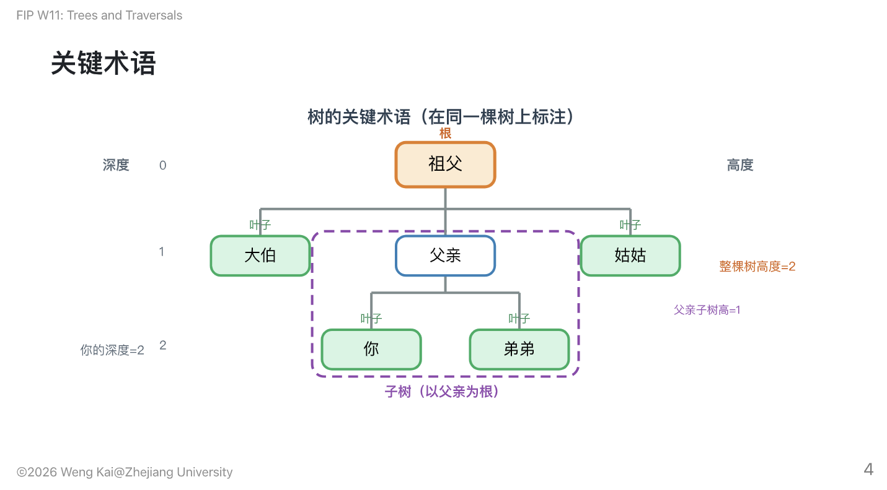

## 理论课内容


课程材料：26FIP11 树及其遍历.pdf

### Recap

容器(Container)和数据结构(Data Structure)：描述的东西差不多，只是从不同的维度出发。
当前我们学过的数据结构：

| DS          | array                   | linked list             | hash     |
| ----------- | ----------------------- | ----------------------- | -------- |
| Python type | list(tuple)             | deque                   | set/dict |
| 拓展实现        | stack/queue/deque/cq/pq | stack/queue/deque/cq/pq | /        |

### 树

#### 树的概念

描述层次关系的数据结构。树中有一些关键的术语：

- 根：最顶端结点，无父结点
- 叶子：没有后代的结点
- 深度：某个结点到根的距离
- 高度：某结点到其最远叶子的路径边数；整棵树的高度是根结点的高度
- 子结点：直接下层
- 父结点：直接上层
- 子树：以某个结点为根的整颗树


深度和高度都按 **边数** 计算：根的深度为0，叶子的高度为0；只有根的树高度为0。同一父结点的子结点称为兄弟。非空树有 $n$ 个结点时，有 $n-1$ 条边。

#### Python中树的表示

```python
class TreeNode:
	def __init__(self, val):
		self.val = val
		self.children = []
	def height(self):
		if not self.children:
			return 0
		return 1 + max(child.height() for child in self.children)
```

> 数据结构的实现是基于它要实现什么功能而设计的，对于树，我们可以让结点记录父结点，也可以不需要，取决于用途。

一般树的叶子仍是一个结点，只是 `children == []`，因此高度函数判断 `not self.children`；`None` 表示没有结点，是另一种情况。遍历一般树时依次递归 `children` 中的每个孩子。


#### 二叉树(Binary Tree)

二叉树每个结点最多有两个子结点，称为左子结点和右子结点。

```python
class TreeNode:
	def __init__(self, val):
		self.val = val
		self.left = None
		self.right = None
```

`left`和`right`是对子结点的引用，在没有对应子结点的时候值为`None`。

### 树的遍历

#### 前序遍历（根->左->右）

```python
def preorder(node):
	if not node: return
	print(node.val, end=' ')
	preorder(node.left)
	preorder(node.right)
```

前序遍历的例子可以考虑复制文件夹的过程，在备份文件夹的时候我们总是先创建父结点，再在其中复制入子结点。这就要求先创建根。

#### 中序遍历（左->根->右）

```python
def inorder(node): 
	if not node: return 
	inorder(node.left)
	print(node.val, end=' ') 
	inorder(node.right) 
```

中序遍历可以用于**BST(二叉搜索树)**，定义左子树值<根<右子树值，在从小到大遍历所有值的时候就需要使用中序遍历。

#### 后序遍历（左->右->根）

```python
def postorder(node): 
	if not node: return 
	postorder(node.left) 
	postorder(node.right) 
	print(node.val, end=' ')
```

后序遍历可以实现汇总与拆除。在右键文件夹看总大小的时候，需要遍历完所有子结点才可以返回总的文件夹大小。删除文件夹也是同理，使用后序遍历清空完所有子文件夹后才能删除根文件夹。

### 树递归的调用栈

树状递归不能简单地改造为循环，我们要考虑递归调用栈的本质。三种DFS遍历的递归，本质上都是在使用**栈**，只是Python自动维护了**调用栈**：

- 进入`preorder(left)`->压栈
- 函数返回->弹栈
把**隐式调用栈**改为**显式调用栈**就可以写出非递归的循环版本，可以避免遍历深度很大的树时导致递归栈溢出。

#### 前序·显式栈

```python
def preorder_stack(root):
	if not root:
		return
	stack = [root]
	while stack:
		node = stack.pop()
		print(node.val, end=' ')
		if node.right: stack.append(node.right)
		if node.left: stack.append(node.left)
```

先压右子树，再压左子树，**LIFO**保证出栈顺序根左右。

#### 中序·显式栈

```python
def inorder_stack(root):
	stack, node = [], root
	while stack or node:
		while node:# 走到最左端叶子结点，同时把路过的根节点入栈
			stack.append(node)
			node = node.left
		node = stack.pop()
		print(node.val, end=' ')
		node = node.right
		
```


#### 后序·显式栈

后序要求左右子树都访问完，最后才访问根。**双栈法** 先生成“根→右→左”的顺序，再整体反转，得到“左→右→根”。

| 阶段 | 操作 | 顺序 |
|---|---|---|
| 栈1压入孩子 | 先压左，再压右 | 右孩子在栈顶，先弹出 |
| 栈1弹出，暂存到栈2 | 根先暂存，再处理右子树、左子树 | 根→右→左 |
| 栈2弹出并打印 | 把暂存顺序反转 | 左→右→根 |

这里的“左、右”指整棵子树。`s2.append(node)` 只是暂存，并没有访问输出；最后的 `print` 才是访问结点。

```python
def postorder_stack(root):
	if not root:
		return
	s1, s2 = [root], []
	while s1:
		node = s1.pop()
		s2.append(node)
		if node.left: s1.append(node.left)
		if node.right: s1.append(node.right)
	while s2:
		print(s2.pop().val, end=' ')
	
```


##### 逐句理解第一轮循环


```python
while s1:                       # 还有待处理结点
    node = s1.pop()              # 从栈1取一个结点
    s2.append(node)              # 暂存到栈2，暂不打印
    if node.left:
        s1.append(node.left)    # 先放左孩子
    if node.right:
        s1.append(node.right)   # 后放右孩子，下一轮先取右
```


`append` 放到列表末尾，`pop()` 从末尾取出，因此栈顶写在最右边。以这棵树为例：

```text
    A
   / \
  B   C
```


| 每轮结束 | `s1`（底→顶） | `s2`（底→顶） |
|---|---|---|
| 初始 | `[A]` | `[]` |
| 弹出A，暂存A，先压B再压C | `[B,C]` | `[A]` |
| 弹出C，暂存C；C无孩子 | `[B]` | `[A,C]` |
| 弹出B，暂存B；B无孩子 | `[]` | `[A,C,B]` |

栈1为空后，第二个 `while` 从栈2依次弹出 `B、C、A`，才真正打印后序结果。

再看课件的5结点树：`1` 的左右孩子为 `2、3`，`2` 的左右孩子为 `4、5`。放入栈2的顺序是 `1,3,2,5,4`，反向弹出为 `4,5,2,3,1`。第二个栈反转的是 **整个序列**，子树内部顺序也随之反转。

#### 层序遍历：按层BFS

除了上述的遍历方法，还有按照层从左到右的访问方法，即层序遍历：

```python
from collections import deque

def level_order(root):
    if not root:
        return
    q = deque([root])
    while q:
        node = q.popleft()
        print(node.val, end=' ')
        if node.left:
            q.append(node.left)
        if node.right:
            q.append(node.right)
```


先到的结点先展开，孩子排在队尾，因此同层结点从左到右访问。用 `pop()` 会变成栈；`list.pop(0)` 每次需移动后续元素，不适合实现高效队列。

#### 四种遍历对照


```text
    1
   / \
  2   3
 / \
4   5
```


| 遍历 | 顺序 | 本例输出 | 工具 |
|---|---|---|---|
| 前序 | 根→左→右 | `1 2 4 5 3` | 调用栈 / 显式栈 |
| 中序 | 左→根→右 | `4 2 5 1 3` | 调用栈 / 显式栈 |
| 后序 | 左→右→根 | `4 5 2 3 1` | 调用栈 / 双栈 |
| 层序 | 按层从左到右 | `1 2 3 4 5` | 队列 |

所有遍历都访问每个结点一次，时间为 $O(n)$。递归DFS和中序显式栈辅助空间为 $O(h+1)$；前序显式栈最坏也可达 $O(h+1)$。后序双栈保存全部结点，空间为 $O(n)$；层序队列空间为 $O(w)$，其中 $w$ 是最大层宽。

中序显式栈中，`while stack or node` 表示“还有未回访的祖先，或还有子树待走”；内层循环沿左链压栈，弹出后访问当前结点，再转向其右子树，并非只寻找整棵树最左侧的叶子。

#### 表达式树


运算符作内部结点，操作数作叶子。例如 `(3+4)*2` 的根为 `*`，左子树为 `+`（孩子3、4），右孩子为2。

| 遍历 | 表达式形式 | 结果 |
|---|---|---|
| 前序 | 前缀 | `* + 3 4 2` |
| 中序 | 中缀 | 需恢复括号：`((3+4)*2)` |
| 后序 | 后缀 | `3 4 + 2 *` |

只打印中序的符号会得到 `3+4*2`，改变原式含义，因此表达式树的中序需要适当加括号。后序可先计算左右子表达式，再在根执行运算。


### 二叉搜索树（BST）


对 **每个结点**，左子树所有值小于根，右子树所有值大于根；约束不限于直接孩子。因此中序遍历得到升序序列。以下实现约定不存重复值。

#### 查找与插入


```python
def search(root, val):
    if not root:
        return False
    if val == root.val:
        return True
    if val < root.val:
        return search(root.left, val)
    return search(root.right, val)

def insert(root, val):
    if not root:
        return TreeNode(val)
    if val < root.val:
        root.left = insert(root.left, val)
    elif val > root.val:
        root.right = insert(root.right, val)
    return root
```


插入是沿查找路径找到空位置，再挂上新结点。函数返回更新后的子树根，因此既要 `return root`，调用时也要接回引用：

```python
root = None
for val in [50, 30, 70, 20, 40, 60, 80]:
    root = insert(root, val)
```


```text
      50
     /  \
   30    70
  / \   / \
20  40 60  80
```


查找60：`50→70→60`；查找40：`50→30→40`；查找65：`50→70→60→None`，未找到。

#### 删除：返回新的子树根


| 情况 | 处理 |
|---|---|
| 叶子 | 返回 `None`，父结点断开引用 |
| 只有一个孩子 | 返回这个孩子，让它接替原位置 |
| 两个孩子 | 用右子树最小值替换当前值，再从右子树删除该值 |

```python
def delete(root, val):
    if not root:
        return None
    if val < root.val:
        root.left = delete(root.left, val)
    elif val > root.val:
        root.right = delete(root.right, val)
    else:
        if not root.left:
            return root.right
        if not root.right:
            return root.left
        succ = root.right
        while succ.left:
            succ = succ.left
        root.val = succ.val
        root.right = delete(root.right, succ.val)
    return root
```


两个孩子时，中序后继是 **右子树最左侧结点**。它大于左子树全部值，小于右子树其他值，用它替换后仍保持BST性质；还必须删除原来的后继，避免重复。也可对称使用左子树最大值，即中序前驱。

后继没有左孩子，但可能有右孩子；递归删除时由“单孩子”情况接回。直接 `return root.left` 会丢掉整棵右子树，即使剩余部分仍满足大小关系，也不是正确删除。

调用写 `root = delete(root, val)`，因为删除根后，整棵树的根可能改变。

#### 退化与复杂度


BST每次排除一侧子树，**不保证排除一半结点**。查找、插入、删除都沿树高进行，时间为 $O(h+1)$。在随机插入等常见平均模型下为 $O(\log n)$，退化时为 $O(n)$。

依次插入 `1,2,3,4,5`，形成右链，高度4，查找5需检查5个结点。中序遍历只改变访问顺序，不能把链恢复平衡；平衡BST通过结构调整控制高度。

| 场景          | 结构选择    | 原因                   |
| ----------- | ------- | -------------------- |
| 数据少变，主要查找   | 排序数组+二分 | 查找 $O(\log n)$，结构简单  |
| 经常有序插删、范围查询 | 平衡BST   | 查找、插删可保证 $O(\log n)$ |
| 普通BST有序输入   | 警惕退化    | 最坏三种操作均为 $O(n)$      |

排序数组插入、删除通常需移动元素，为 $O(n)$；BST优势是动态维护有序关系。若只需按键判断存在、不需顺序，也可考虑哈希结构。

## 阅读材料补充


课程材料：11 树及其遍历.pdf

### 一般树与二叉树


| 项目 | 一般树 | 二叉树 |
|---|---|---|
| 字段 | `children` 列表 | `left`、`right` |
| 孩子数量 | 任意 | 最多两个，左右有区别 |
| 空树 | 根引用为 `None` | 根引用为 `None` |
| 叶子 | `not node.children` | 左右均为 `None` |
| 递归 | 循环处理每个孩子 | 分别递归左右子树 |

两种结点定义是不同造型，不要在一般树代码里使用 `.left`，也不要在二叉树代码里判断 `.children`。

### 结点数、叶子数与高度


```python
def count_nodes(node):
    if not node:
        return 0
    return 1 + count_nodes(node.left) + count_nodes(node.right)

def count_leaves(node):
    if not node:
        return 0
    if node.left is None and node.right is None:
        return 1
    return count_leaves(node.left) + count_leaves(node.right)

def binary_height(node):
    if not node:
        return -1
    return 1 + max(binary_height(node.left), binary_height(node.right))
```


空树高度在这里约定为 $-1$，使叶子高度为0；其他材料可能按结点数定义高度，必须先确认约定。空树结点数和叶子数均为0，单结点树两者均为1。三个函数时间均为 $O(n)$，递归辅助空间为 $O(h+1)$。

## 研讨课内容


课程材料：11 树及其遍历-研讨课.pdf

### 组织架构建模


CEO下设CTO、CFO；CTO下设前端组、后端组、AI组；前端组下设页面1组、页面2组；后端组下设API组、数据库组；CFO下设会计组、审计组。

采用一般树的 `children` 表示，因为CTO有三个直接孩子。根为CEO，叶子是页面1组、页面2组、API组、数据库组、AI组、会计组、审计组，共7个；总结点12个，树高3。

### 遍历手推


```text
       10
      /  \
     5    15
    / \   / \
   3   7 12 20
```


| 遍历 | 输出 |
|---|---|
| 前序 | `10 5 3 7 15 12 20` |
| 中序 | `3 5 7 10 12 15 20` |
| 后序 | `3 7 5 12 20 15 10` |
| 层序 | `10 5 15 3 7 12 20` |

审查遍历先看空结点判断，再看 `print` 的位置。漏判空的 `count_leaves` 在单结点树上可能返回1，但对空树或只有一个孩子的结点会访问 `None.left`。

### BST项目：构建、查找与删除


插入 `[50,30,70,20,40,60,80]`，前3步依次是根50、左挂30、右挂70，最终结构见理论课。中序结果为 `20 30 40 50 60 70 80`。

在同一棵树上依次删除：

| 删除 | 类型与变化 | 删除后的中序 |
|---|---|---|
| 20 | 叶子，30的左引用置空 | `30 40 50 60 70 80` |
| 30 | 此时只有右孩子40，由40接替 | `40 50 60 70 80` |
| 50 | 两个孩子，用后继60替换，再删原60 | `40 60 70 80` |

后继查找只需从右孩子开始不断向左，前提是当前结点确有右子树。注意这里依次删除，删除30时的结构已经不同于最初。

### 查找策略与检查


十万单词、五年更新一次，倾向排序数组加二分；每周新增用户或实时插入股票数据，若需动态有序查询，倾向平衡BST。最终仍取决于查询种类和更新频率，不能只看数据量。

提交前核对：空树与单结点、左右子树是否都访问、插删是否接回新根、双孩子删除是否保留两侧数据、普通BST是否可能因输入有序而退化。用小树手推遍历和查找路径，再运行对照。
